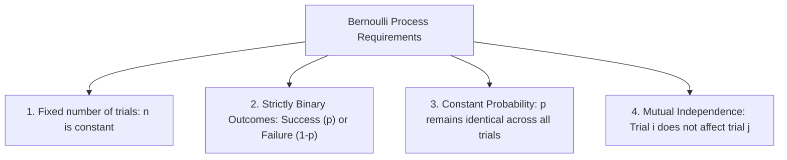

# Lecture 20.18: Binomial Distribution

## 📌 Topic Overview
In this lecture, Shraddha ma'am details the **Binomial Distribution**, establishing the 4 strict Bernoulli criteria, deriving the combination formula on the blackboard, and solving the classic 5-coin toss problem ($P(\text{3 Heads in 5 tosses}) = \frac{5}{16} = 0.3125$) using both manual mathematics and `scipy.stats.binom`.

---

## 🏛️ The 4 Bernoulli Trial Conditions



---

## 📐 Mathematical Formulation

Let random variable $X \sim \text{Binomial}(n, p)$ count the number of successes:

$$
P(X = k) = \binom{n}{k} p^k (1 - p)^{n - k} = \frac{n!}{k!(n - k)!} p^k (1 - p)^{n - k}
$$

### Parameters:
- **Mean (Expected Value):** $\mu = n \cdot p$
- **Variance:** $\sigma^2 = n \cdot p \cdot (1 - p)$
- **Standard Deviation:** $\sigma = \sqrt{n \cdot p \cdot (1 - p)}$

### Blackboard Example: 5 Coin Tosses, Exactly 3 Heads
- $n = 5$, $k = 3$, $p = 0.5$, $1 - p = 0.5$

$$
P(X = 3) = \binom{5}{3} (0.5)^3 (0.5)^2 = \frac{5!}{3! 2!} \left(\frac{1}{8}\right)\left(\frac{1}{4}\right) = 10 \times \frac{1}{32} = \frac{5}{16} = 0.3125 \quad (31.25\%)
$$

---

## 💻 Python Implementation

```python
from scipy.stats import binom

def compute_binomial_probability(n=5, k=3, p=0.5):
    """
    Computes exact Binomial probability P(X = k) for k successes in n Bernoulli trials.
    Demonstrates analytical combination formula and scipy.stats.binom verification.
    
    Parameters:
        n (int): Number of independent trials.
        k (int): Number of successful outcomes.
        p (float): Success probability on a single trial.
        
    Returns:
        dict: Mean, Variance, analytical and scipy PMF probabilities.
    """
    # Mean and Variance formulas: mu = n*p, var = n*p*(1-p)
    mean_val = n * p
    variance_val = n * p * (1 - p)
    
    # Scipy implementation
    prob_k = float(binom.pmf(k, n, p))
    
    return {
        "n_trials": n,
        "k_successes": k,
        "p_single": p,
        "mean_np": mean_val,
        "variance_npq": variance_val,
        "P(X=k)": prob_k,
        "fraction_str": "10 * (1/32) = 5/16 = 0.3125"
    }

# --- Execution & Verification ---
# Shraddha ma'am's coin problem: Toss 5 times, find probability of exactly 3 heads
res = compute_binomial_probability(n=5, k=3, p=0.5)
print(f"Trials n = {res['n_trials']}, Heads k = {res['k_successes']}, p = {res['p_single']}")
print(f"Theoretical Probability: {res['fraction_str']}")
print(f"Scipy binom.pmf result : {res['P(X=k)']:.4f}")
print(f"Mean np = {res['mean_np']}, Variance np(1-p) = {res['variance_npq']:.2f}")

```

---

## 🔑 Key Takeaways
1. A Binomial distribution is simply the sum of $n$ independent Bernoulli trials.
2. $\binom{n}{k}$ accounts for all the different ordering permutations in which $k$ successes can occur among $n$ trials.
3. In deep learning and NLP, A/B testing conversion rates and click-through rates are modeled using Binomial distributions.
