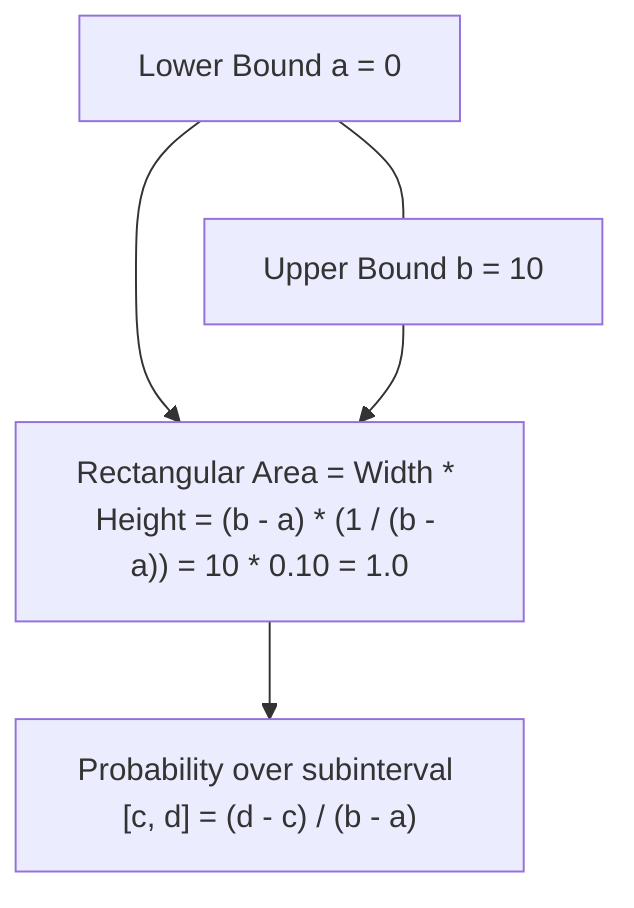

# Lecture 20.19: Uniform Distribution

## 📌 Topic Overview
In this lecture, Shraddha ma'am covers the **Continuous Uniform Distribution** ($U(a, b)$), explaining how every interval of equal length has identical probability, deriving the flat constant probability density function $f(x) = \frac{1}{b - a}$, and simulating it with 1,000,000 samples in NumPy.

---

## 🏛️ Rectangular Probability Density Geometry



---

## 📐 Mathematical Formulation

A continuous random variable $X \sim U(a, b)$ has constant probability density over $[a, b]$:

$$
f(x) = \begin{cases} \frac{1}{b - a} & \text{if } a \le x \le b \\ 0 & \text{otherwise} \end{cases}
$$

### Normalization Axiom Check:
The total area under the density curve must equal 1:

$$
\int_a^b f(x) \, dx = \int_a^b \frac{1}{b - a} \, dx = \frac{1}{b - a} [b - a] = 1.00
$$

### Moments:
- **Mean (Expected Value):**

$$
\mu = \frac{a + b}{2}
$$

- **Variance:**

$$
\sigma^2 = \frac{(b - a)^2}{12}
$$

---

## 💻 Python Implementation

```python
import numpy as np
import matplotlib.pyplot as plt

def simulate_continuous_uniform_distribution(low=0.0, high=10.0, n_samples=1_000_000, show_plot=True):
    """
    Simulates a Continuous Uniform Distribution U(a, b).
    Generates 1,000,000 random variables using np.random.uniform
    and plots a normalized probability density histogram showing constant height 1/(b-a).
    
    Parameters:
        low (float): Lower bound a.
        high (float): Upper bound b.
        n_samples (int): Sample draw count.
        show_plot (bool): Display control.
        
    Returns:
        dict: Theoretical vs empirical mean, variance, and theoretical density height.
    """
    # 1. Theoretical properties
    theo_mean = (low + high) / 2.0
    theo_var = ((high - low) ** 2) / 12.0
    theo_height = 1.0 / (high - low)
    
    # 2. Empirical simulation
    np.random.seed(42)
    values = np.random.uniform(low, high, n_samples)
    emp_mean = float(np.mean(values))
    emp_var = float(np.var(values))
    
    plt.figure(figsize=(8, 5))
    # density=True ensures total area under histogram equals 1.0
    plt.hist(values, bins=100, density=True, color="skyblue", edgecolor="steelblue", alpha=0.6)
    plt.axhline(y=theo_height, color="red", linestyle="--", linewidth=2.0, label=f"Theoretical PDF: f(x) = {theo_height:.2f}")
    
    plt.title(f"Continuous Uniform Distribution U({low}, {high}) - Area = 1.0", fontweight="bold")
    plt.xlabel("x")
    plt.ylabel("Probability Density")
    plt.legend(loc="upper right")
    plt.grid(True, linestyle=":", alpha=0.5)
    
    plt.tight_layout()
    if show_plot:
        plt.show()
        
    return {
        "theoretical_height_1/(b-a)": theo_height,
        "theoretical_mean": theo_mean,
        "empirical_mean": emp_mean,
        "theoretical_variance": theo_var,
        "empirical_variance": emp_var
    }

# --- Execution & Verification ---
res = simulate_continuous_uniform_distribution(low=0.0, high=10.0, n_samples=100000, show_plot=False)
print(f"Theoretical PDF Height f(x): {res['theoretical_height_1/(b-a)']:.2f} (Rectangle height)")
print(f"Theoretical Mean: {res['theoretical_mean']:.2f} | Empirical Mean: {res['empirical_mean']:.4f}")
print(f"Theoretical Var : {res['theoretical_variance']:.2f} | Empirical Var : {res['empirical_variance']:.4f}")

```

---

## 🔑 Key Takeaways
1. The Uniform distribution represents total uncertainty / maximum ignorance within a bounded interval $[a, b]$.
2. The height of the PDF is $1/(b-a)$, ensuring that the rectangular area under the curve equals 1.0.
3. In deep learning, neural network weights are frequently initialized using Uniform distributions (e.g. Xavier/Glorot uniform initialization).
