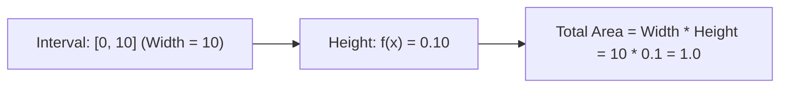

# Notes_20.19: Uniform Distribution [Hinglish]

## 📌 Topic Overview
Is lecture mein Shraddha ma'am ne **Continuous Uniform Distribution ($U(a, b)$)** ka concept samjhaya hai: kaise 0 se 10 ke beech har number ke aane ke barabar chances hote hain, flat horizontal curve $f(x) = \frac{1}{b - a}$ kaise banta hai, aur 10 lakh samples lekar NumPy mein iska simulation kiya hai.

---

### 📋 Is Topic Mein Hum Kya Seekhenge?
- Uniform Distribution kya hota hai ("Har outcome ko barabar chance").
- PDF formula: $f(x) = \frac{1}{b - a}$ flat line kyu hoti hai?
- Total area under the rectangle $1.0$ kyu hota hai ($10 \times 0.1 = 1.0$).
- NumPy mein `np.random.uniform(0, 10, 10_00_000)` se simulation karna.

---

### 🔍 Har Ek Point Ka Simple & Detailed Explanation

#### 1. Concept:
Agar hum 0 se 10 ke beech koi bhi random number chunein, aur kisi bhi number ke sath koi bhedbhav na ho (sabke aane ke equal chances hon), toh use **Continuous Uniform Distribution** kehte hain.

#### 2. Rectangle Ka Area:
Kyunki total probability hamesha $1.0$ honi chahiye:
Rectangle ka base $= b - a = 10 - 0 = 10$.
Toh rectangle ki height aisi honi chahiye ki $\text{Base} \times \text{Height} = 1$:

$$
\text{Height } f(x) = \frac{1}{b - a} = \frac{1}{10} = 0.10
$$

#### 3. Moments:
- **Mean:** Bilkul beech ka center point: $\mu = \frac{0 + 10}{2} = 5.0$.
- **Variance:** $\sigma^2 = \frac{(b - a)^2}{12} = \frac{100}{12} \approx 8.33$.

---

### 📊 Blackboard Diagram: 0 Se 10 Ka Rectangular Area



---

### 💻 Python Code Implementation

```python
import numpy as np
import matplotlib.pyplot as plt

def simulate_continuous_uniform_distribution(low=0.0, high=10.0, n_samples=1_000_000, show_plot=True):
    """
    Simulates a Continuous Uniform Distribution U(a, b).
    Generates 1,000,000 random variables using np.random.uniform
    and plots a normalized probability density histogram showing constant height 1/(b-a).
    
    Parameters:
        low (float): Lower bound a.
        high (float): Upper bound b.
        n_samples (int): Sample draw count.
        show_plot (bool): Display control.
        
    Returns:
        dict: Theoretical vs empirical mean, variance, and theoretical density height.
    """
    # 1. Theoretical properties
    theo_mean = (low + high) / 2.0
    theo_var = ((high - low) ** 2) / 12.0
    theo_height = 1.0 / (high - low)
    
    # 2. Empirical simulation
    np.random.seed(42)
    values = np.random.uniform(low, high, n_samples)
    emp_mean = float(np.mean(values))
    emp_var = float(np.var(values))
    
    plt.figure(figsize=(8, 5))
    # density=True ensures total area under histogram equals 1.0
    plt.hist(values, bins=100, density=True, color="skyblue", edgecolor="steelblue", alpha=0.6)
    plt.axhline(y=theo_height, color="red", linestyle="--", linewidth=2.0, label=f"Theoretical PDF: f(x) = {theo_height:.2f}")
    
    plt.title(f"Continuous Uniform Distribution U({low}, {high}) - Area = 1.0", fontweight="bold")
    plt.xlabel("x")
    plt.ylabel("Probability Density")
    plt.legend(loc="upper right")
    plt.grid(True, linestyle=":", alpha=0.5)
    
    plt.tight_layout()
    if show_plot:
        plt.show()
        
    return {
        "theoretical_height_1/(b-a)": theo_height,
        "theoretical_mean": theo_mean,
        "empirical_mean": emp_mean,
        "theoretical_variance": theo_var,
        "empirical_variance": emp_var
    }

# --- Execution & Verification ---
res = simulate_continuous_uniform_distribution(low=0.0, high=10.0, n_samples=100000, show_plot=False)
print(f"Theoretical PDF Height f(x): {res['theoretical_height_1/(b-a)']:.2f} (Rectangle height)")
print(f"Theoretical Mean: {res['theoretical_mean']:.2f} | Empirical Mean: {res['empirical_mean']:.4f}")
print(f"Theoretical Var : {res['theoretical_variance']:.2f} | Empirical Var : {res['empirical_variance']:.4f}")

```

---

### 🎯 Key Takeaways:
1. `plt.hist(..., density=True)` pass karne par y-axis frequency ke bajaye probability density show karta hai.
2. Machine learning mein weights ko initialize karte waqt Uniform distribution bohot widely use hota hai.
