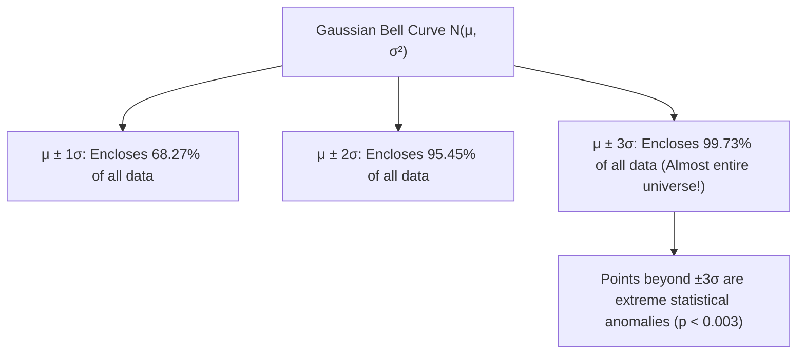

# Lecture 20.20: Normal Distribution & The Empirical Rule

## 📌 Topic Overview
In this lecture, Shraddha ma'am covers the **Normal (Gaussian) Distribution** $\mathcal{N}(\mu, \sigma^2)$, the single most critical probability distribution in Machine Learning. She details the bell-shaped probability density function, the Central Limit Theorem intuition, and the **68-95-99.7 Empirical Rule**.

---

## 🏛️ The Empirical 68-95-99.7% Confidence Architecture



---

## 📐 Mathematical Formulation: The Gaussian PDF

A continuous random variable $X \sim \mathcal{N}(\mu, \sigma^2)$ is governed by:

$$
f(x) = \frac{1}{\sigma \sqrt{2\pi}} \exp\left( -\frac{(x - \mu)^2}{2\sigma^2} \right)
$$

### Parameters:
- $\mu$: The distribution mean, median, and mode (location of the peak).
- $\sigma$: Standard deviation controlling the width / dispersion of the bell curve.
- Inflection points occur exactly at $x = \mu \pm \sigma$.

### Standard Normal Distribution ($Z$):
Standardizing any Gaussian variable via the Z-score transformation:

$$
Z = \frac{X - \mu}{\sigma} \sim \mathcal{N}(0, 1)
$$

---

## 💻 Python Implementation

```python
import numpy as np
import matplotlib.pyplot as plt
from scipy.stats import norm

def plot_normal_distribution_empirical_rule(mean=0.0, std=1.0, show_plot=True):
    """
    Plots the Gaussian Normal Distribution curve and visualizes the
    Empirical Rule (68-95-99.7% rule) within 1, 2, and 3 standard deviations.
    
    Parameters:
        mean (float): Distribution mean mu.
        std (float): Distribution standard deviation sigma.
        show_plot (bool): Display control.
        
    Returns:
        dict: Empirical rule coverage percentages.
    """
    x = np.linspace(mean - 4 * std, mean + 4 * std, 1000)
    pdf = norm.pdf(x, loc=mean, scale=std)
    
    plt.figure(figsize=(10, 5))
    plt.plot(x, pdf, "b-", linewidth=2.5, label=f"N({mean}, {std}²)")
    
    # 68% band (mu ± 1 sigma)
    x1 = np.linspace(mean - std, mean + std, 300)
    plt.fill_between(x1, norm.pdf(x1, mean, std), color="blue", alpha=0.3, label="68.27% (μ ± 1σ)")
    
    # 95% band (mu ± 2 sigma)
    x2_left = np.linspace(mean - 2 * std, mean - std, 150)
    x2_right = np.linspace(mean + std, mean + 2 * std, 150)
    plt.fill_between(x2_left, norm.pdf(x2_left, mean, std), color="orange", alpha=0.25)
    plt.fill_between(x2_right, norm.pdf(x2_right, mean, std), color="orange", alpha=0.25, label="95.45% (μ ± 2σ)")
    
    plt.axvline(x=mean, color="black", linestyle="--", linewidth=1.5, label=f"Mean μ = {mean}")
    plt.title("Normal (Gaussian) Distribution & The Empirical 68-95-99.7 Rule", fontweight="bold")
    plt.xlabel("Z-Score / Values")
    plt.ylabel("Probability Density")
    plt.legend(loc="upper right")
    plt.grid(True, linestyle=":", alpha=0.5)
    
    plt.tight_layout()
    if show_plot:
        plt.show()
        
    # Exact CDF coverage calculations
    cov_1sigma = norm.cdf(mean + std, mean, std) - norm.cdf(mean - std, mean, std)
    cov_2sigma = norm.cdf(mean + 2 * std, mean, std) - norm.cdf(mean - 2 * std, mean, std)
    cov_3sigma = norm.cdf(mean + 3 * std, mean, std) - norm.cdf(mean - 3 * std, mean, std)
    
    return {
        "coverage_1_sigma": float(cov_1sigma),
        "coverage_2_sigma": float(cov_2sigma),
        "coverage_3_sigma": float(cov_3sigma)
    }

# --- Execution & Verification ---
cov = plot_normal_distribution_empirical_rule(mean=0.0, std=1.0, show_plot=False)
print(f"Coverage within ±1σ: {cov['coverage_1_sigma'] * 100:.2f}% (≈ 68%)")
print(f"Coverage within ±2σ: {cov['coverage_2_sigma'] * 100:.2f}% (≈ 95%)")
print(f"Coverage within ±3σ: {cov['coverage_3_sigma'] * 100:.2f}% (≈ 99.7%)")

```

---

## 🔑 Key Takeaways
1. The Normal distribution is symmetric around the mean: $\text{Mean} = \text{Median} = \text{Mode} = \mu$.
2. The Empirical Rule states that 68% of data falls within $\pm 1\sigma$, 95% within $\pm 2\sigma$, and 99.7% within $\pm 3\sigma$.
3. By the Central Limit Theorem (CLT), the sum or average of many independent random variables converges to a Normal distribution regardless of their underlying distribution.
