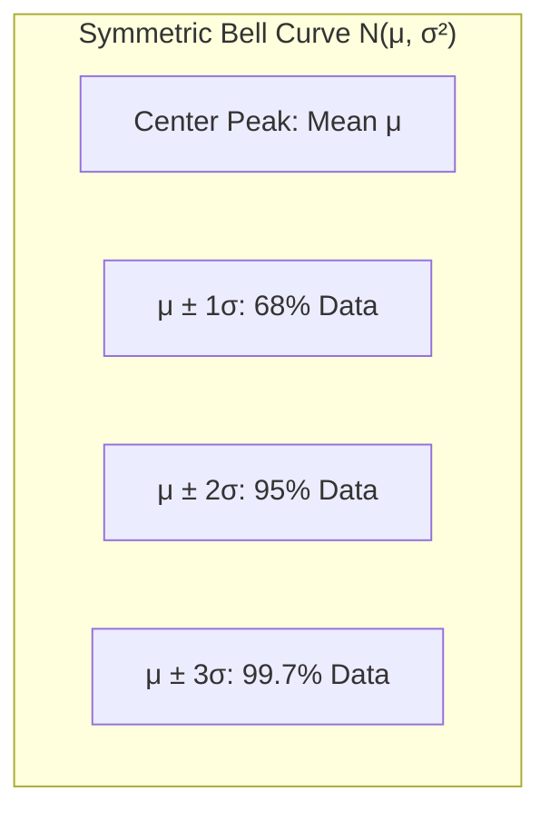

# Notes_20.20: Normal Distribution Aur Empirical Rule [Hinglish]

## 📌 Topic Overview
Is lecture mein Shraddha ma'am ne **Normal (Gaussian) Distribution** ka concept samjhaya hai: Bell curve ka shape, mean $\mu$ aur standard deviation $\sigma$ ka role, aur famous **68-95-99.7 Empirical Rule** ko visualize kiya hai.

---

### 📋 Is Topic Mein Hum Kya Seekhenge?
- Normal Distribution kya hai aur kyu yeh AI/ML ka sabse important distribution hai?
- Bell Curve ki shape: Peak par $\mu$ aur dono taraf symmetric dhalan.
- 68-95-99.7 Rule: 1, 2, aur 3 standard deviations ke andar kitna data hota hai.
- Z-Score standardization: $Z = \frac{x - \mu}{\sigma}$.

---

### 🔍 Har Ek Point Ka Simple & Detailed Explanation

#### 1. Normal Distribution Kya Hai?
Duniya mein zyada tar natural cheezein (jaise logon ki height, blood pressure, exam scores, model ke prediction errors) ek symmetric ghanti jaise curve (**Bell Curve**) ko follow karti hain.
Is curve ke center mein sabse zyada log hote hain, aur extreme ends (bohot chhote ya bohot bade) par bohot kam log hote hain.

Formula:

$$
f(x) = \frac{1}{\sigma \sqrt{2\pi}} e^{-\frac{(x - \mu)^2}{2\sigma^2}}
$$

#### 2. The 68-95-99.7 Rule:
- **$\mu \pm 1\sigma$:** Center ke $68.27\%$ log is range mein aate hain.
- **$\mu \pm 2\sigma$:** $95.45\%$ log is range mein aate hain.
- **$\mu \pm 3\sigma$:** $99.73\%$ log is range mein aate hain.

Agar koi point $\pm 3\sigma$ ke bhi bahar chala jaye, toh use pakka **Outlier / Anomaly** mana jata hai!

---

### 📊 Blackboard Diagram: Bell Curve Aur Standard Deviations



---

### 💻 Python Code Implementation

```python
import numpy as np
import matplotlib.pyplot as plt
from scipy.stats import norm

def plot_normal_distribution_empirical_rule(mean=0.0, std=1.0, show_plot=True):
    """
    Plots the Gaussian Normal Distribution curve and visualizes the
    Empirical Rule (68-95-99.7% rule) within 1, 2, and 3 standard deviations.
    
    Parameters:
        mean (float): Distribution mean mu.
        std (float): Distribution standard deviation sigma.
        show_plot (bool): Display control.
        
    Returns:
        dict: Empirical rule coverage percentages.
    """
    x = np.linspace(mean - 4 * std, mean + 4 * std, 1000)
    pdf = norm.pdf(x, loc=mean, scale=std)
    
    plt.figure(figsize=(10, 5))
    plt.plot(x, pdf, "b-", linewidth=2.5, label=f"N({mean}, {std}²)")
    
    # 68% band (mu ± 1 sigma)
    x1 = np.linspace(mean - std, mean + std, 300)
    plt.fill_between(x1, norm.pdf(x1, mean, std), color="blue", alpha=0.3, label="68.27% (μ ± 1σ)")
    
    # 95% band (mu ± 2 sigma)
    x2_left = np.linspace(mean - 2 * std, mean - std, 150)
    x2_right = np.linspace(mean + std, mean + 2 * std, 150)
    plt.fill_between(x2_left, norm.pdf(x2_left, mean, std), color="orange", alpha=0.25)
    plt.fill_between(x2_right, norm.pdf(x2_right, mean, std), color="orange", alpha=0.25, label="95.45% (μ ± 2σ)")
    
    plt.axvline(x=mean, color="black", linestyle="--", linewidth=1.5, label=f"Mean μ = {mean}")
    plt.title("Normal (Gaussian) Distribution & The Empirical 68-95-99.7 Rule", fontweight="bold")
    plt.xlabel("Z-Score / Values")
    plt.ylabel("Probability Density")
    plt.legend(loc="upper right")
    plt.grid(True, linestyle=":", alpha=0.5)
    
    plt.tight_layout()
    if show_plot:
        plt.show()
        
    # Exact CDF coverage calculations
    cov_1sigma = norm.cdf(mean + std, mean, std) - norm.cdf(mean - std, mean, std)
    cov_2sigma = norm.cdf(mean + 2 * std, mean, std) - norm.cdf(mean - 2 * std, mean, std)
    cov_3sigma = norm.cdf(mean + 3 * std, mean, std) - norm.cdf(mean - 3 * std, mean, std)
    
    return {
        "coverage_1_sigma": float(cov_1sigma),
        "coverage_2_sigma": float(cov_2sigma),
        "coverage_3_sigma": float(cov_3sigma)
    }

# --- Execution & Verification ---
cov = plot_normal_distribution_empirical_rule(mean=0.0, std=1.0, show_plot=False)
print(f"Coverage within ±1σ: {cov['coverage_1_sigma'] * 100:.2f}% (≈ 68%)")
print(f"Coverage within ±2σ: {cov['coverage_2_sigma'] * 100:.2f}% (≈ 95%)")
print(f"Coverage within ±3σ: {cov['coverage_3_sigma'] * 100:.2f}% (≈ 99.7%)")

```

---

### 🎯 Key Takeaways:
1. Normal distribution mein $\text{Mean} = \text{Median} = \text{Mode}$ teeno ek hi jagah center par hote hain.
2. Z-Score ($Z = \frac{x - \mu}{\sigma}$) se kisi bhi data point ko Standard Normal Distribution ($\mu=0, \sigma=1$) mein badla ja sakta hai.
