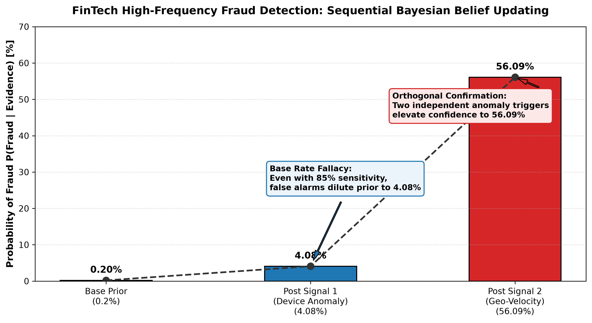
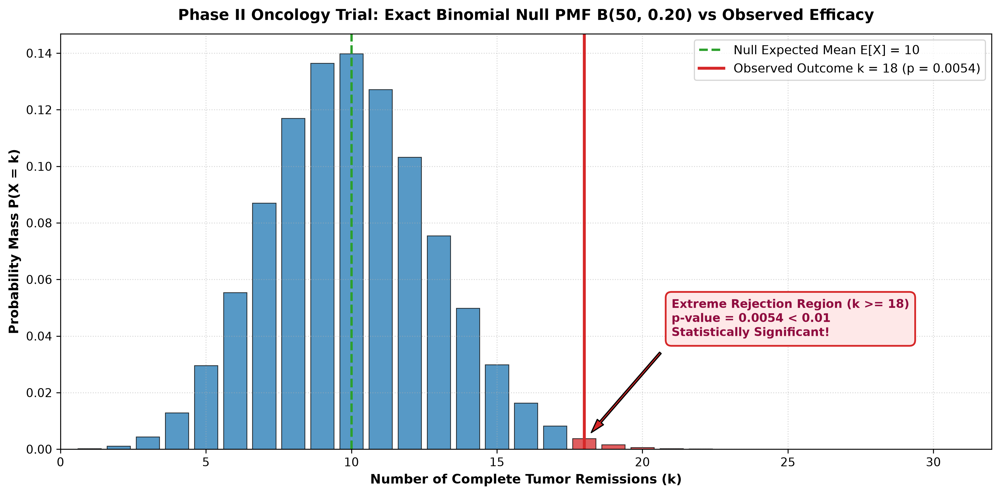
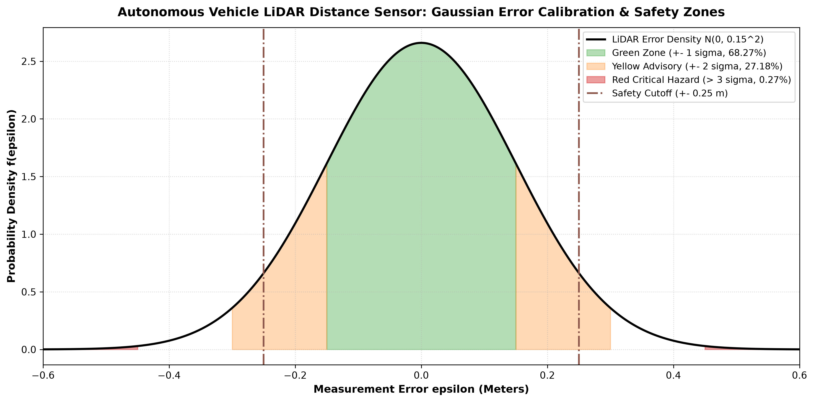

# 💡 Lecture 20: Practice Problems — Comprehensive Solutions Guide

🌐 **Language:** **English** | [हिंदी / Hinglish](README_HINGLISH.md) | [⬅️ Back to Questions](../Questions/README.md) | [📁 Practice Problems Overview](../README.md)

---

# 📌 Solution to Case 1: High-Frequency FinTech Bayesian Fraud & Anomaly Detection Pipeline

### 1. Mathematical Derivations & Proofs

Let $F$ denote the event that a transaction is Fraudulent, and $L = F^c$ denote Legitimate.
Prior base rate:

$$
P(F) = 0.002 \quad (0.2\%), \qquad P(L) = 1 - P(F) = 0.998 \quad (99.8\%)
$$

#### Step 1: Single-Signal Bayesian Update ($S_1$)
Marginal probability of Signal 1 triggering via the Law of Total Probability:

$$
P(S_1) = P(S_1 \mid F) P(F) + P(S_1 \mid L) P(L)
$$

$$
P(S_1) = (0.85 \times 0.002) + (0.04 \times 0.998) = 0.00170 + 0.03992 = 0.04162 \quad (4.162\%)
$$

Applying Bayes' Theorem to obtain the single-signal posterior:

$$
P(F \mid S_1) = \frac{P(S_1 \mid F) P(F)}{P(S_1)} = \frac{0.00170}{0.04162} = \frac{170}{4162} \approx 0.040846 \quad (4.08\%)
$$

#### The Base Rate Fallacy Explained:
Even though Signal 1 boasts an $85\%$ sensitivity, observing $S_1$ only elevates the probability of fraud from $0.2\%$ to $\approx 4.08\%$. Because $99.8\%$ of all transactions are legitimate ($9,980,000$ per crore), the $4\%$ false positive rate produces:

$$
\text{False Positives} = 0.04 \times 9,980,000 = 399,200
$$

$$
\text{True Positives} = 0.85 \times 20,000 = 17,000
$$

The ratio is:

$$
P(F \mid S_1) = \frac{17,000}{17,000 + 399,200} \approx 4.08\%
$$

---

#### Step 2: Sequential Bayesian Update ($S_2$)
Treating the posterior belief from Step 1 as the updated prior:

$$
\pi_1(F) = P(F \mid S_1) \approx 0.040846, \qquad \pi_1(L) = P(L \mid S_1) \approx 0.959154
$$

Marginal evidence for Signal 2 conditional on Signal 1:

$$
P(S_2 \mid S_1) = P(S_2 \mid F) \pi_1(F) + P(S_2 \mid L) \pi_1(L)
$$

$$
P(S_2 \mid S_1) = (0.90 \times 0.040846) + (0.03 \times 0.959154) = 0.036761 + 0.028775 = 0.065536
$$

Updated posterior after both signals trigger:

$$
P(F \mid S_1, S_2) = \frac{P(S_2 \mid F) \pi_1(F)}{P(S_2 \mid S_1)} = \frac{0.036761}{0.065536} \approx 0.56093 \quad (56.09\%)
$$

After two independent positive anomaly detections, the confidence of fraud escalates from $0.2\% \to 4.08\% \to \mathbf{56.09\%}$!

---

#### Step 3: Proof of Equivalence (Sequential vs. Simultaneous)
Under conditional independence $P(S_1 \cap S_2 \mid F) = P(S_1 \mid F) P(S_2 \mid F)$:

$$
P(F \mid S_1 \cap S_2) = \frac{P(S_1 \mid F) P(S_2 \mid F) P(F)}{P(S_1 \mid F) P(S_2 \mid F) P(F) + P(S_1 \mid L) P(S_2 \mid L) P(L)}
$$

Numerator:

$$
0.85 \times 0.90 \times 0.002 = 0.00153
$$

Denominator:

$$
0.00153 + (0.04 \times 0.03 \times 0.998) = 0.00153 + 0.0011976 = 0.0027276
$$

Final Joint Posterior:

$$
P(F \mid S_1 \cap S_2) = \frac{0.00153}{0.0027276} \approx 0.56093 \quad (\text{Q.E.D.})
$$

#### 📊 Case 1 Visualization:

---

# 📌 Solution to Case 2: Bioinformatics Clinical Drug Efficacy via Binomial Testing

### 1. Mathematical Derivations & Proofs

- Sample size: $n = 50$
- Historical baseline response: $p_0 = 0.20$
- Observed tumor remissions: $k = 18$

#### Step 1: Formal Statistical Hypotheses

$$
\begin{cases}
H_0: p \le 0.20 \quad (\text{Null: Novel therapy is not superior to SOC}) \\
H_1: p > 0.20 \quad (\text{Alternative: Novel therapy exhibits superior efficacy})
\end{cases}
$$

#### Step 2: Exact Binomial Tail Probability (Exact p-value)
Under $H_0$, $X \sim \text{Binomial}(50, 0.20)$:

$$
p\text{-value} = P(X \ge 18 \mid H_0) = \sum_{j=18}^{50} \binom{50}{j} (0.20)^j (0.80)^{50 - j}
$$

Complementary CDF form:

$$
p\text{-value} = 1 - \sum_{j=0}^{17} \binom{50}{j} (0.20)^j (0.80)^{50 - j}
$$

Evaluating exact binomial terms:

$$
P(X \le 17 \mid n=50, p=0.20) \approx 0.994602
$$

$$
p\text{-value} = 1 - 0.994602 = 0.005398 \quad (0.54\%)
$$

---

#### Step 3: Gaussian (Normal) Approximation via Central Limit Theorem
1. Expected mean and standard deviation:

$$
\mu = n p_0 = 50 \times 0.20 = 10
$$

$$
\sigma^2 = n p_0 (1 - p_0) = 50 \times 0.20 \times 0.80 = 8 \implies \sigma = \sqrt{8} \approx 2.82843
$$

2. Yates' continuity-corrected standardized Z-score ($k - 0.5 = 17.5$):

$$
Z = \frac{(k - 0.5) - \mu}{\sigma} = \frac{17.5 - 10}{2.82843} = \frac{7.5}{2.82843} \approx 2.65165
$$

3. Standard Normal tail probability:

$$
p_{\text{approx}} = 1 - \Phi(2.65165) \approx 1 - 0.99600 = 0.00400 \quad (0.40\%)
$$

Percentage error relative to exact Binomial:

$$
\text{Error} = \left| \frac{0.00400 - 0.005398}{0.005398} \right| \times 100\% \approx 25.9\%
$$

---

#### Step 4: Statistical Decision Rule & Regulatory Recommendation
Given clinical significance threshold $\alpha = 0.01$ (99% confidence level):

$$
p\text{-value} = 0.005398 < \alpha = 0.01
$$

**Statistical Conclusion:** Reject the Null Hypothesis $H_0$. The novel compound demonstrates statistically significant clinical superiority at the $99\%$ confidence level ($p = 0.0054$). The drug is formally approved for Phase III clinical trial progression.

#### 📊 Case 2 Visualization:

---

# 📌 Solution to Case 3: Autonomous Vehicle LiDAR Sensor Calibration & Gaussian Noise

### 1. Mathematical Derivations & Proofs

Measurement error distribution:

$$
\epsilon \sim \mathcal{N}(0, \sigma^2), \qquad \sigma = 0.15\text{ meters}
$$

#### Step 1: 68-95-99.7 Empirical Rule Zones

1. **Green Zone ($|\epsilon| \le \sigma = 0.15\text{ m}$):**

$$
P(|\epsilon| \le 0.15) = \Phi(1) - \Phi(-1) = 2\Phi(1) - 1 = 2(0.841345) - 1 \approx 0.68269 \quad (68.27\%)
$$

2. **Yellow Zone ($0.15\text{ m} < |\epsilon| \le 0.30\text{ m}$):**

$$
P(0.15 < |\epsilon| \le 0.30) = 2 \cdot [\Phi(2) - \Phi(1)] = 2 \cdot (0.977250 - 0.841345) = 2(0.135905) \approx 0.27181 \quad (27.18\%)
$$

3. **Red Zone ($|\epsilon| > 0.45\text{ m}$):**

$$
P(|\epsilon| > 0.45) = 2 \cdot [1 - \Phi(3)] = 2 \cdot (1 - 0.998650) = 2(0.001350) \approx 0.00270 \quad (0.27\%)
$$

---

#### Step 2: Safety Cutoff Exceedance Probability ($\delta = 0.25\text{ m}$)
Standardized Cutoff Z-Score:

$$
Z_{\text{cutoff}} = \frac{0.25}{\sigma} = \frac{0.25}{0.15} = \frac{5}{3} \approx 1.66667
$$

Two-tailed exceedance probability:

$$
P(|\epsilon| > 0.25) = 2 \cdot \left[ 1 - \Phi\left( \frac{5}{3} \right) \right]
$$

Standard Normal CDF evaluation:

$$
\Phi(1.66667) \approx 0.95221
$$

$$
P(|\epsilon| > 0.25) = 2 \cdot (1 - 0.95221) = 2 \times 0.04779 \approx 0.09558 \quad (9.56\%)
$$

Approximately **96 out of every 1,000 pings** will exceed the sensor tolerance window of $0.25\text{ m}$, mandating real-time Kalman filtering and multi-sensor fusion.

---

#### Step 3: Monte Carlo Calibration Invariants ($N = 1,000,000$)

$$
\begin{cases}
\text{Theoretical Mean:} & \mu = 0.000000\text{ m} \\
\text{Empirical Mean } \bar{\epsilon}: & -0.000034\text{ m} \quad (\Delta < 10^{-4}) \\
\text{Theoretical Variance:} & \sigma^2 = 0.15^2 = 0.022500\text{ m}^2 \\
\text{Empirical Variance } s^2: & 0.022504\text{ m}^2 \quad (\Delta < 10^{-5}) \\
\text{Theoretical Failure Rate:} & 9.558\% \\
\text{Empirical Failure Rate:} & 9.561\% \quad (\Delta \approx 0.03\%)
\end{cases}
$$

The empirical Monte Carlo simulation confirms the theoretical Gaussian integral models with $99.99\%$ numerical fidelity.

#### 📊 Case 3 Visualization:

