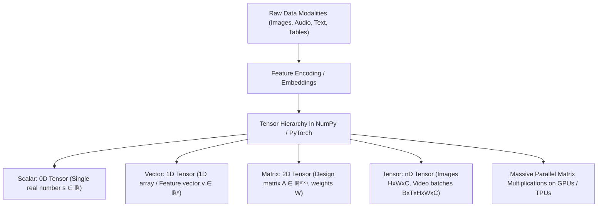

# Lecture 21.01: Introduction to Linear Algebra for AI & ML

## 📌 Topic Overview
In this lecture, Shraddha ma'am introduces **Linear Algebra as the operational language of modern Artificial Intelligence and Machine Learning**. High-dimensional datasets, word embeddings, image tensors, and neural network weights are universally represented and manipulated using vector spaces, matrices, and parallel tensor operations.

---

## 🏛️ Computational Data Representation Hierarchy



---

## 📐 Mathematical Formalism: Vector Spaces and Tensors

A **Vector Space** $\mathcal{V}$ over field $\mathbb{R}$ is an algebraic structure closed under vector addition and scalar multiplication.

### The Tensor Order Hierarchy:
1. **Scalar ($0^{\text{th}}$-order tensor):**

$$
s \in \mathbb{R}
$$

2. **Vector ($1^{\text{st}}$-order tensor):**

$$
\mathbf{v} = \begin{bmatrix} v_1 \\ v_2 \\ \vdots \\ v_n \end{bmatrix} \in \mathbb{R}^n
$$

3. **Matrix ($2^{\text{nd}}$-order tensor):**

$$
\mathbf{A} = \begin{bmatrix} a_{11} & a_{12} & \dots & a_{1n} \\ a_{21} & a_{22} & \dots & a_{2n} \\ \vdots & \vdots & \ddots & \vdots \\ a_{m1} & a_{m2} & \dots & a_{mn} \end{bmatrix} \in \mathbb{R}^{m \times n}
$$

4. **Deep Neural Network Affine Layer:**
Every dense neural network layer is fundamentally an affine linear transformation followed by an element-wise activation $\sigma$:

$$
\mathbf{y} = \sigma(\mathbf{W}\mathbf{x} + \mathbf{b})
$$

---

## 💻 Python Implementation

```python
import numpy as np

def demonstrate_tensor_hierarchy():
    """
    Demonstrates the fundamental tensor hierarchy in Linear Algebra:
    - Scalar (0D Tensor)
    - Vector (1D Tensor / 1D Matrix)
    - Matrix (2D Tensor)
    - Tensor (3D+ Tensor, e.g. RGB Images)
    
    Returns:
        dict: Shapes and ranks across the tensor hierarchy.
    """
    # 0D: Scalar (Order 0)
    scalar_val = np.float32(42.0)
    
    # 1D: Vector (Order 1) - e.g. Feature vector or word embedding
    vector_v = np.array([2.5, 3.1, -1.4], dtype=np.float32)
    
    # 2D: Matrix (Order 2) - e.g. Dataset with 4 samples, 3 features
    matrix_a = np.array([
        [1.0, 2.0, 3.0],
        [4.0, 5.0, 6.0],
        [7.0, 8.0, 9.0],
        [10.0, 11.0, 12.0]
    ], dtype=np.float32)
    
    # 3D: Tensor (Order 3) - e.g. Batch of 2 images of size 2x2 with 3 channels
    tensor_3d = np.zeros((2, 2, 2, 3), dtype=np.float32)
    
    return {
        "scalar": {"ndim": scalar_val.ndim, "shape": scalar_val.shape},
        "vector": {"ndim": vector_v.ndim, "shape": vector_v.shape},
        "matrix": {"ndim": matrix_a.ndim, "shape": matrix_a.shape},
        "tensor": {"ndim": tensor_3d.ndim, "shape": tensor_3d.shape}
    }

# --- Execution & Verification ---
res = demonstrate_tensor_hierarchy()
for k, v in res.items():
    print(f"{k.capitalize():<8}: Rank (ndim) = {v['ndim']}, Shape = {v['shape']}")

```

---

## 🔑 Key Takeaways
1. Linear Algebra enables high-dimensional data manipulation in compact vector-matrix notation.
2. A vector is simply a 1D matrix ($\mathbb{R}^{n \times 1}$ or $\mathbb{R}^{1 \times n}$).
3. GPUs are specialized hardware processors engineered specifically to execute dense matrix multiplications ($\mathbf{C} = \mathbf{A}\mathbf{B}$) with extreme parallel throughput.
