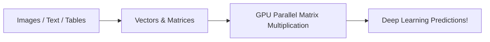

# Notes_21.01: AI Ke Liye Linear Algebra Ka Parichay [Hinglish]

## 📌 Topic Overview
Is lecture mein Shraddha ma'am ne samjhaya hai ki **Linear Algebra Artificial Intelligence aur Machine Learning ki foundation kyu hai**: kaise images, text, aur datasets ko Vectors aur Matrices mein store kiya jata hai aur GPUs inpar calculation kaise karte hain.

---

### 📋 Is Topic Mein Hum Kya Seekhenge?
- AI bina Linear Algebra ke kyu nahi chal sakta?
- Tensor Hierarchy: Scalar (0D), Vector (1D), Matrix (2D), aur Tensor (3D+).
- Neural Networks ka basic formula: $\mathbf{y} = \sigma(\mathbf{W}\mathbf{x} + \mathbf{b})$.
- Vector असल mein ek 1D Matrix hi hota hai!

---

### 🔍 Har Ek Point Ka Simple & Detailed Explanation

#### 1. Real Data Numbers Mein Kaise Badalta Hai?
- **Text:** Har word ko ek vector (embedding) mein badla jata hai (jaise 300 dimensions ka vector).
- **Image:** Ek photo asal mein pixel values ki 2D matrix hoti hai (Black & White) ya 3D tensor hoti hai (RGB: Height $\times$ Width $\times$ 3 Channels).
- **Table Data:** Rows samples hote hain aur columns features hote hain ($m \times n$ matrix).

#### 2. Tensor Hierarchy:
1. **Scalar (0D):** Ek single number, jaise `42`.
2. **Vector (1D):** Numbers ki ek line (list), jaise `[2.5, 3.1, -1.4]`. Ma'am ne blackboard par likha tha: *Vector = 1D Matrix*.
3. **Matrix (2D):** Rows aur columns ka table, jaise $4 \times 3$ grid.
4. **Tensor (3D+):** Matrices ka stack ya multidimensional cube.

Formula:

$$
\mathbf{y} = \sigma(\mathbf{W}\mathbf{x} + \mathbf{b})
$$

Jahan $\mathbf{W}$ weight matrix hai, $\mathbf{x}$ input vector hai, aur $\mathbf{b}$ bias hai.

---

### 📊 Blackboard Diagram: Linear Algebra Ka Flow



---

### 💻 Python Code Implementation

```python
import numpy as np

def demonstrate_tensor_hierarchy():
    """
    Demonstrates the fundamental tensor hierarchy in Linear Algebra:
    - Scalar (0D Tensor)
    - Vector (1D Tensor / 1D Matrix)
    - Matrix (2D Tensor)
    - Tensor (3D+ Tensor, e.g. RGB Images)
    
    Returns:
        dict: Shapes and ranks across the tensor hierarchy.
    """
    # 0D: Scalar (Order 0)
    scalar_val = np.float32(42.0)
    
    # 1D: Vector (Order 1) - e.g. Feature vector or word embedding
    vector_v = np.array([2.5, 3.1, -1.4], dtype=np.float32)
    
    # 2D: Matrix (Order 2) - e.g. Dataset with 4 samples, 3 features
    matrix_a = np.array([
        [1.0, 2.0, 3.0],
        [4.0, 5.0, 6.0],
        [7.0, 8.0, 9.0],
        [10.0, 11.0, 12.0]
    ], dtype=np.float32)
    
    # 3D: Tensor (Order 3) - e.g. Batch of 2 images of size 2x2 with 3 channels
    tensor_3d = np.zeros((2, 2, 2, 3), dtype=np.float32)
    
    return {
        "scalar": {"ndim": scalar_val.ndim, "shape": scalar_val.shape},
        "vector": {"ndim": vector_v.ndim, "shape": vector_v.shape},
        "matrix": {"ndim": matrix_a.ndim, "shape": matrix_a.shape},
        "tensor": {"ndim": tensor_3d.ndim, "shape": tensor_3d.shape}
    }

# --- Execution & Verification ---
res = demonstrate_tensor_hierarchy()
for k, v in res.items():
    print(f"{k.capitalize():<8}: Rank (ndim) = {v['ndim']}, Shape = {v['shape']}")

```

---

### 🎯 Key Takeaways:
1. Linear Algebra computational efficiency deta hai: loops ke bajaye matrix operations seconds mein execute hote hain.
2. Vector ek 1D matrix hota hai jo direction aur magnitude dono ko hold karta hai.
