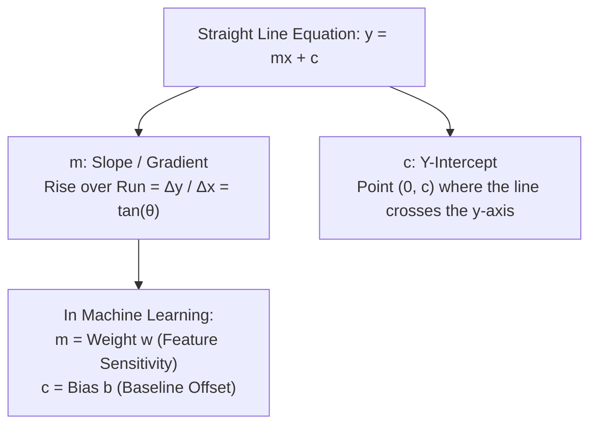

# Lecture 21.02: Straight Lines in Coordinate Geometry

## 📌 Topic Overview
In this lecture, Shraddha ma'am covers the foundational mathematics of **Straight Lines**, establishing the standard slope-intercept equation $y = mx + c$, deriving the geometric interpretation of slope $m = \tan(\theta) = \frac{y_2 - y_1}{x_2 - x_1}$, and connecting this directly to Simple Linear Regression.

---

## 🏛️ Slope-Intercept Geometry



---

## 📐 Mathematical Formulation

1. **Slope-Intercept Equation:**

$$
y = mx + c
$$

2. **Slope Calculation between two points $(x_1, y_1)$ and $(x_2, y_2)$:**

$$
m = \frac{\Delta y}{\Delta x} = \frac{y_2 - y_1}{x_2 - x_1} = \tan(\theta)
$$

where $\theta$ is the inclination angle measured counter-clockwise from the positive x-axis.

3. **Machine Learning Parameter Correspondence:**

$$
\hat{y} = w x + b
$$

- Slope $m \equiv w$: Controls the tilt/direction of the decision line.
- Intercept $c \equiv b$: Shifts the line vertically up or down.

---

## 💻 Python Implementation

```python
import numpy as np
import matplotlib.pyplot as plt

def compute_straight_line(m=2.0, c=3.0, x_range=(-5, 5), show_plot=True):
    """
    Computes and plots a straight line in slope-intercept form: y = mx + c.
    Demonstrates slope m = tan(theta) = dy/dx and y-intercept c.
    
    Parameters:
        m (float): Slope of the line (rate of change).
        c (float): Y-intercept (point where line intersects y-axis at x=0).
        x_range (tuple): (x_min, x_max) domain bounds.
        show_plot (bool): Display control.
        
    Returns:
        dict: Line parameters, inclination angle theta in degrees, and sample coordinates.
    """
    x = np.linspace(x_range[0], x_range[1], 100)
    y = m * x + c
    
    # Angle of inclination: theta = arctan(m)
    theta_deg = np.degrees(np.arctan(m))
    
    plt.figure(figsize=(7, 5))
    plt.plot(x, y, "b-", linewidth=2.0, label=f"y = {m:.1f}x + {c:.1f}")
    
    # Mark y-intercept (0, c)
    plt.plot(0, c, "ro", markersize=8, label=f"y-intercept (0, {c:.1f})")
    
    # Draw reference axes
    plt.axhline(0, color="black", linewidth=1.0)
    plt.axvline(0, color="black", linewidth=1.0)
    
    plt.title(f"Straight Line: y = {m}x + {c} (Slope m = {m}, Intercept c = {c})", fontweight="bold")
    plt.xlabel("x")
    plt.ylabel("y")
    plt.legend(loc="upper left")
    plt.grid(True, linestyle=":", alpha=0.6)
    
    plt.tight_layout()
    if show_plot:
        plt.show()
        
    return {
        "slope_m": m,
        "intercept_c": c,
        "angle_theta_degrees": float(theta_deg),
        "point_at_x0": (0.0, float(c)),
        "point_at_x2": (2.0, float(m * 2.0 + c))
    }

# --- Execution & Verification ---
line_info = compute_straight_line(m=2.0, c=3.0, show_plot=False)
print(f"Equation : y = {line_info['slope_m']}x + {line_info['intercept_c']}")
print(f"Slope (m): {line_info['slope_m']} (Angle with x-axis: {line_info['angle_theta_degrees']:.1f}°)")
print(f"Y-Intercept (c): Line passes through {line_info['point_at_x0']}")

```

---

## 🔑 Key Takeaways
1. A positive slope ($m > 0$) means $y$ increases as $x$ increases; negative slope ($m < 0$) indicates an inverse relationship.
2. A horizontal line has slope $m = 0$ ($y = c$); a vertical line has undefined infinite slope.
3. Every single-variable linear regression model is fundamentally solving for optimal $m$ (weight) and $c$ (bias).
