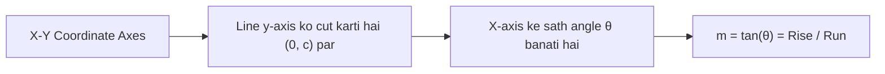

# Notes_21.02: Seedhi Rekha (Straight Lines) [Hinglish]

## 📌 Topic Overview
Is lecture mein Shraddha ma'am ne **Straight Line ki equation ($y = mx + c$)** blackboard par samjhayi hai: Slope ($m$) kya hota hai, Intercept ($c$) kya hota hai, aur Machine Learning ke Linear Regression se iska kya seedha connection hai.

---

### 📋 Is Topic Mein Hum Kya Seekhenge?
- Straight line ki standard equation: $y = mx + c$.
- Slope ($m$): Dhalan kya hoti hai aur $m = \frac{y_2 - y_1}{x_2 - x_1} = \tan(\theta)$ kaise nikalta hai?
- Y-Intercept ($c$): Line y-axis ko kahan kaat-ti hai.
- Machine Learning connection: $y = wx + b$ (Weight aur Bias).

---

### 🔍 Har Ek Point Ka Simple & Detailed Explanation

#### 1. Straight Line Ki Equation:
Blackboard par ma'am ne draw karke bataya:

$$
y = mx + c
$$

- **$m$ is Slope (Dhalan):** Yeh batata hai ki line kitni tezi se upar ya niche ja rahi hai:

$$
m = \frac{\Delta y}{\Delta x} = \frac{y_2 - y_1}{x_2 - x_1} = \tan(\theta)
$$

Agar $x$ ko 1 badhane par $y$, 2 badhta hai, toh slope $m = 2$.
- **$c$ is Y-Intercept:** Jab $x = 0$ hota hai, tab $y$ ki value kya hai? Yaani line y-axis ko kis point $(0, c)$ par cut karti hai.

#### 2. Machine Learning Se Connection:
Linear Regression mein jo hum best fit line banate hain:

$$
\hat{y} = w x + b
$$

Yeh bilkul wahi $y = mx + c$ hai!
- $m$ model ka **Weight ($w$)** hota hai.
- $c$ model ka **Bias ($b$)** hota hai.

---

### 📊 Blackboard Diagram: Straight Line On Coordinate Plane



---

### 💻 Python Code Implementation

```python
import numpy as np
import matplotlib.pyplot as plt

def compute_straight_line(m=2.0, c=3.0, x_range=(-5, 5), show_plot=True):
    """
    Computes and plots a straight line in slope-intercept form: y = mx + c.
    Demonstrates slope m = tan(theta) = dy/dx and y-intercept c.
    
    Parameters:
        m (float): Slope of the line (rate of change).
        c (float): Y-intercept (point where line intersects y-axis at x=0).
        x_range (tuple): (x_min, x_max) domain bounds.
        show_plot (bool): Display control.
        
    Returns:
        dict: Line parameters, inclination angle theta in degrees, and sample coordinates.
    """
    x = np.linspace(x_range[0], x_range[1], 100)
    y = m * x + c
    
    # Angle of inclination: theta = arctan(m)
    theta_deg = np.degrees(np.arctan(m))
    
    plt.figure(figsize=(7, 5))
    plt.plot(x, y, "b-", linewidth=2.0, label=f"y = {m:.1f}x + {c:.1f}")
    
    # Mark y-intercept (0, c)
    plt.plot(0, c, "ro", markersize=8, label=f"y-intercept (0, {c:.1f})")
    
    # Draw reference axes
    plt.axhline(0, color="black", linewidth=1.0)
    plt.axvline(0, color="black", linewidth=1.0)
    
    plt.title(f"Straight Line: y = {m}x + {c} (Slope m = {m}, Intercept c = {c})", fontweight="bold")
    plt.xlabel("x")
    plt.ylabel("y")
    plt.legend(loc="upper left")
    plt.grid(True, linestyle=":", alpha=0.6)
    
    plt.tight_layout()
    if show_plot:
        plt.show()
        
    return {
        "slope_m": m,
        "intercept_c": c,
        "angle_theta_degrees": float(theta_deg),
        "point_at_x0": (0.0, float(c)),
        "point_at_x2": (2.0, float(m * 2.0 + c))
    }

# --- Execution & Verification ---
line_info = compute_straight_line(m=2.0, c=3.0, show_plot=False)
print(f"Equation : y = {line_info['slope_m']}x + {line_info['intercept_c']}")
print(f"Slope (m): {line_info['slope_m']} (Angle with x-axis: {line_info['angle_theta_degrees']:.1f}°)")
print(f"Y-Intercept (c): Line passes through {line_info['point_at_x0']}")

```

---

### 🎯 Key Takeaways:
1. Agar $m > 0$ hai, toh line upar ki taraf badhegi. Agar $m < 0$ hai, toh niche giregi.
2. $c$ line ko upar ya niche shift karta hai bina uske angle ko badle.
