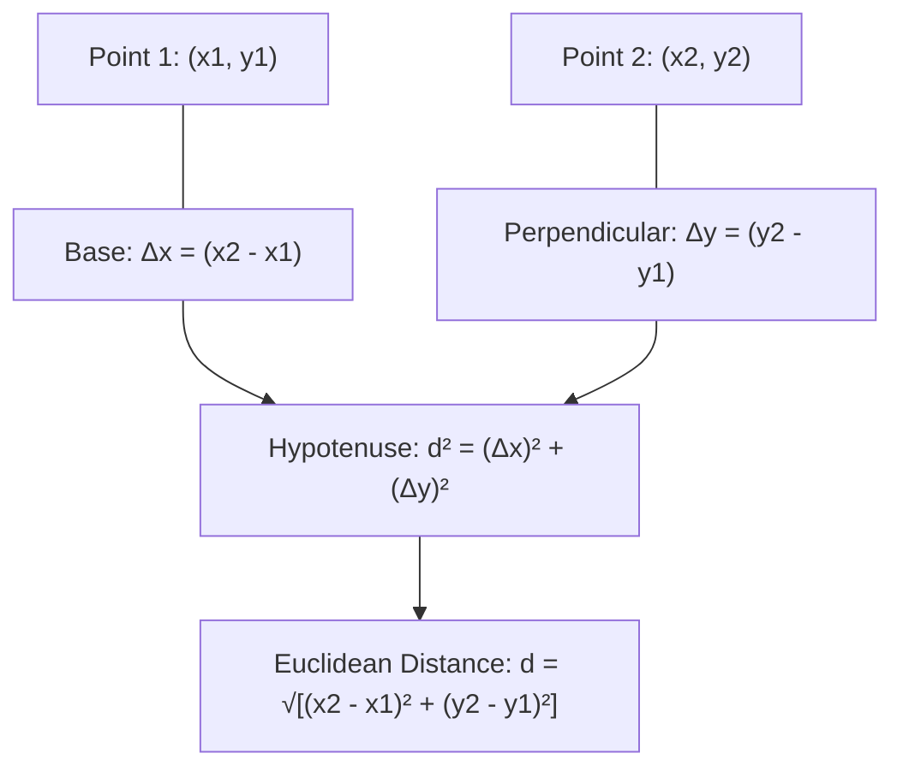

# Lecture 21.03: Distance between 2 Points

## 📌 Topic Overview
In this lecture, Shraddha ma'am covers the **Distance formula between two points in coordinate space**, deriving it from the Pythagorean Theorem and explaining its role as the $L_2$ Euclidean Norm foundational to K-Nearest Neighbors (k-NN) and K-Means Clustering algorithms.

---

## 🏛️ Pythagorean Distance Geometry



---

## 📐 Mathematical Formulation

1. **2D Euclidean Distance:**
Given two points $P_1(x_1, y_1)$ and $P_2(x_2, y_2)$:

$$
d = \sqrt{(x_2 - x_1)^2 + (y_2 - y_1)^2}
$$

2. **Generalization to $n$-Dimensional Feature Space ($L_2$ Norm):**
Given two feature vectors $\mathbf{u}, \mathbf{v} \in \mathbb{R}^n$:

$$
\|\mathbf{u} - \mathbf{v}\|_2 = \sqrt{\sum_{i=1}^n (u_i - v_i)^2}
$$

### Machine Learning Applications:
- **K-Nearest Neighbors (k-NN):** Finds the $k$ training points with minimum Euclidean distance to a query vector.
- **K-Means Clustering:** Assigns each observation to the nearest cluster centroid based on squared Euclidean distance.

---

## 💻 Python Implementation

```python
import numpy as np

def compute_euclidean_distance_2d(p1=(1, 2), p2=(4, 6)):
    """
    Computes Euclidean distance between two points in 2D space
    using the Pythagorean theorem formula: d = sqrt((x2 - x1)^2 + (y2 - y1)^2).
    Connects to L2 norm ||p2 - p1||_2 in higher dimensions.
    
    Parameters:
        p1 (tuple): Coordinates (x1, y1).
        p2 (tuple): Coordinates (x2, y2).
        
    Returns:
        dict: Delta x, Delta y, and exact Euclidean distance.
    """
    x1, y1 = p1
    x2, y2 = p2
    
    dx = x2 - x1
    dy = y2 - y1
    
    distance_squared = dx**2 + dy**2
    distance = np.sqrt(distance_squared)
    
    return {
        "point_1": p1,
        "point_2": p2,
        "delta_x": dx,
        "delta_y": dy,
        "distance_squared": distance_squared,
        "euclidean_distance": float(distance)
    }

# --- Execution & Verification ---
# Classic 3-4-5 right triangle: (1, 2) to (4, 6) -> dx = 3, dy = 4 -> d = 5
dist_res = compute_euclidean_distance_2d(p1=(1, 2), p2=(4, 6))
print(f"P1: {dist_res['point_1']}, P2: {dist_res['point_2']}")
print(f"dx = {dist_res['delta_x']}, dy = {dist_res['delta_y']}")
print(f"Distance = sqrt({dist_res['delta_x']}² + {dist_res['delta_y']}²) = sqrt({dist_res['distance_squared']}) = {dist_res['euclidean_distance']:.1f}")

```

---

## 🔑 Key Takeaways
1. The distance formula is simply the Pythagorean theorem applied to cartesian coordinates.
2. In $n$-dimensional space, this formula defines the Euclidean distance metric ($L_2$ norm).
3. Distance calculations are sensitive to feature scales; features must always be standardized ($Z$-score) before computing distances in ML.
