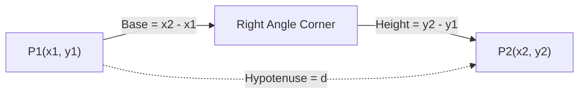

# Notes_21.03: Do Points Ke Beech Ki Doori [Hinglish]

## 📌 Topic Overview
Is lecture mein Shraddha ma'am ne **Do points ke beech distance nikalne ka formula** blackboard par derive kiya hai: Pythagoras theorem ka use karke $d = \sqrt{(x_2 - x_1)^2 + (y_2 - y_1)^2}$ kaise banta hai aur k-NN / K-Means algorithms mein iska kya use hai.

---

### 📋 Is Topic Mein Hum Kya Seekhenge?
- Do points $(x_1, y_1)$ aur $(x_2, y_2)$ ke beech ka distance formula.
- Pythagoras Theorem ($a^2 + b^2 = c^2$) se iska derivation.
- Higher dimensions ($n$-D) mein $L_2$ norm kaise banta hai.
- Machine Learning algorithms (k-NN, K-Means clustering) mein iska role.

---

### 🔍 Har Ek Point Ka Simple & Detailed Explanation

#### 1. Formula Aur Derivation:
Maan lijiye graph par do points hain: $P_1(x_1, y_1)$ aur $P_2(x_2, y_2)$.
Agar hum inke beech ek right-angled triangle banayein:
- Base (Horizontal distance): $\Delta x = (x_2 - x_1)$
- Height (Vertical distance): $\Delta y = (y_2 - y_1)$
- Hypotenuse (Seedhi doori): $d$

Pythagoras Theorem lagane par:

$$
d^2 = (x_2 - x_1)^2 + (y_2 - y_1)^2
$$

Square root lene par:

$$
d = \sqrt{(x_2 - x_1)^2 + (y_2 - y_1)^2}
$$

#### 2. Example:
$(1, 2)$ aur $(4, 6)$ ke beech:
$\Delta x = 4 - 1 = 3$
$\Delta y = 6 - 2 = 4$

$$
d = \sqrt{3^2 + 4^2} = \sqrt{9 + 16} = \sqrt{25} = 5
$$

---

### 📊 Blackboard Diagram: Right Triangle Distance



---

### 💻 Python Code Implementation

```python
import numpy as np

def compute_euclidean_distance_2d(p1=(1, 2), p2=(4, 6)):
    """
    Computes Euclidean distance between two points in 2D space
    using the Pythagorean theorem formula: d = sqrt((x2 - x1)^2 + (y2 - y1)^2).
    Connects to L2 norm ||p2 - p1||_2 in higher dimensions.
    
    Parameters:
        p1 (tuple): Coordinates (x1, y1).
        p2 (tuple): Coordinates (x2, y2).
        
    Returns:
        dict: Delta x, Delta y, and exact Euclidean distance.
    """
    x1, y1 = p1
    x2, y2 = p2
    
    dx = x2 - x1
    dy = y2 - y1
    
    distance_squared = dx**2 + dy**2
    distance = np.sqrt(distance_squared)
    
    return {
        "point_1": p1,
        "point_2": p2,
        "delta_x": dx,
        "delta_y": dy,
        "distance_squared": distance_squared,
        "euclidean_distance": float(distance)
    }

# --- Execution & Verification ---
# Classic 3-4-5 right triangle: (1, 2) to (4, 6) -> dx = 3, dy = 4 -> d = 5
dist_res = compute_euclidean_distance_2d(p1=(1, 2), p2=(4, 6))
print(f"P1: {dist_res['point_1']}, P2: {dist_res['point_2']}")
print(f"dx = {dist_res['delta_x']}, dy = {dist_res['delta_y']}")
print(f"Distance = sqrt({dist_res['delta_x']}² + {dist_res['delta_y']}²) = sqrt({dist_res['distance_squared']}) = {dist_res['euclidean_distance']:.1f}")

```

---

### 🎯 Key Takeaways:
1. Distance formula Pythagoras theorem ka direct application hai.
2. Machine learning mein jab hum similarity naapte hain (k-NN ya clustering), toh yahi $L_2$ distance use hota hai.
