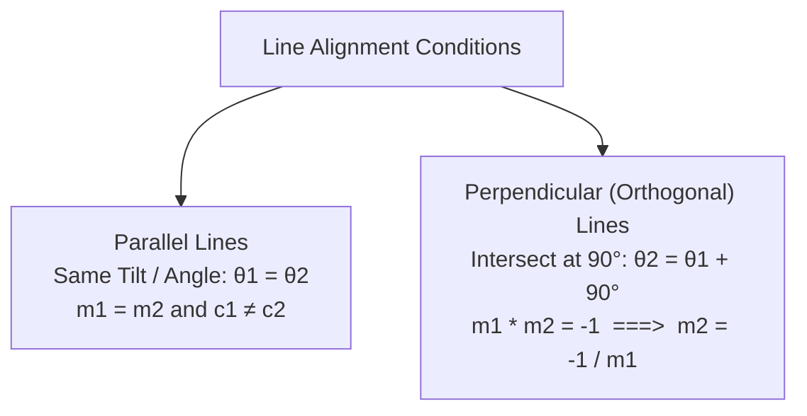

# Lecture 21.04: Parallel & Perpendicular Lines

## 📌 Topic Overview
In this lecture, Shraddha ma'am covers the geometric conditions for **Parallel and Perpendicular Lines**, showing how slope relationships govern spatial parallelism ($m_1 = m_2$) and orthogonality ($m_1 \cdot m_2 = -1$).

---

## 🏛️ Slope Conditions for Spatial Alignment



---

## 📐 Mathematical Formalism

### 1. Parallel Lines:
Two lines $L_1: y = m_1 x + c_1$ and $L_2: y = m_2 x + c_2$ are parallel if and only if they have identical slopes and distinct intercepts:

$$
m_1 = m_2 \qquad \text{and} \qquad c_1 \neq c_2
$$

Parallel lines never intersect in the 2D Euclidean plane.

### 2. Perpendicular (Orthogonal) Lines:
Two lines are perpendicular (meeting at an angle of $90^\circ$) if and only if the product of their slopes equals $-1$:

$$
m_1 \cdot m_2 = -1 \iff m_2 = -\frac{1}{m_1}
$$

The slope of the second line is the negative reciprocal of the first line.

---

## 💻 Python Implementation

```python
import numpy as np

def analyze_line_relationships(line1=(2.0, 3.0), line2=(2.0, -1.0), line3=(-0.5, 4.0)):
    """
    Analyzes mathematical relationships between pairs of lines given in (m, c) form.
    - Parallel lines: m1 == m2 and c1 != c2
    - Identical lines: m1 == m2 and c1 == c2
    - Perpendicular lines: m1 * m2 == -1
    
    Parameters:
        line1 (tuple): (m1, c1)
        line2 (tuple): (m2, c2)
        line3 (tuple): (m3, c3)
        
    Returns:
        dict: Relationship classifications for (line1, line2) and (line1, line3).
    """
    m1, c1 = line1
    m2, c2 = line2
    m3, c3 = line3
    
    # Pair 1: Line 1 vs Line 2
    is_parallel_1_2 = np.isclose(m1, m2) and not np.isclose(c1, c2)
    is_perpendicular_1_2 = np.isclose(m1 * m2, -1.0)
    
    # Pair 2: Line 1 vs Line 3
    is_parallel_1_3 = np.isclose(m1, m3)
    is_perpendicular_1_3 = np.isclose(m1 * m3, -1.0)
    
    return {
        "line1": f"y = {m1}x + {c1}",
        "line2": f"y = {m2}x + {c2}",
        "line3": f"y = {m3}x + {c3}",
        "line1_vs_line2": {
            "m1_m2_equal": bool(np.isclose(m1, m2)),
            "parallel": bool(is_parallel_1_2),
            "perpendicular": bool(is_perpendicular_1_2)
        },
        "line1_vs_line3": {
            "product_slopes": float(m1 * m3),
            "perpendicular": bool(is_perpendicular_1_3)
        }
    }

# --- Execution & Verification ---
rel = analyze_line_relationships(line1=(2.0, 3.0), line2=(2.0, -1.0), line3=(-0.5, 4.0))
print(f"Line 1: {rel['line1']}")
print(f"Line 2: {rel['line2']}")
print(f"Line 3: {rel['line3']}")
print("Line 1 vs Line 2:", "PARALLEL" if rel['line1_vs_line2']['parallel'] else "NOT PARALLEL")
print("Line 1 vs Line 3:", "PERPENDICULAR (90°)" if rel['line1_vs_line3']['perpendicular'] else "NOT PERPENDICULAR")

```

---

## 🔑 Key Takeaways
1. Parallel lines have identical slopes $m_1 = m_2$; they share the same directional vector.
2. Perpendicular lines have negative reciprocal slopes $m_2 = -1/m_1$; their normal vectors are orthogonal.
3. In Support Vector Machines (SVM), the margin boundaries are strictly parallel to the central decision hyperplane.
