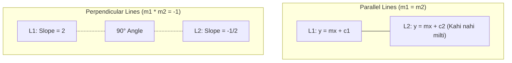

# Notes_21.04: Parallel Aur Perpendicular Lines [Hinglish]

## 📌 Topic Overview
Is lecture mein Shraddha ma'am ne **Parallel lines (Samantar rekhaayein)** aur **Perpendicular lines (Lamba rekhaayein)** ki geometric shartein samjhayi hain: kab do lines ka slope barabar hota hai ($m_1 = m_2$) aur kab unka product $-1$ hota hai ($m_1 \cdot m_2 = -1$).

---

### 📋 Is Topic Mein Hum Kya Seekhenge?
- Parallel lines ki condition: Slopes hamesha barabar hote hain ($m_1 = m_2$).
- Perpendicular lines ki condition: $m_1 \cdot m_2 = -1$ ya $m_2 = -\frac{1}{m_1}$.
- Intercepts ($c_1 \neq c_2$) ka role.
- Support Vector Machine (SVM) mein parallel margins ka use.

---

### 🔍 Har Ek Point Ka Simple & Detailed Explanation

#### 1. Parallel Lines (Samantar Rekhaayein):
Agar do lines train ki patriyon ki tarah bilkul ek hi disha mein ja rahi hon aur aapas mein kabhi na milein:
- Dono ka dhalan (slope) barabar hoga: $m_1 = m_2 = m$.
- Lekin dono alag-alag jagah par y-axis ko kaat-ti hain: $c_1 \neq c_2$.

$$
L_1: y = mx + c_1
$$

$$
L_2: y = mx + c_2
$$

#### 2. Perpendicular Lines ($90^\circ$ Angle):
Jab do lines ek doosre ko $90^\circ$ ke angle par cut karti hain:

$$
m_1 \cdot m_2 = -1 \implies m_2 = -\frac{1}{m_1}
$$

Example: Agar Line 1 ka slope $m_1 = 2$ hai, toh uske perpendicular line ka slope $m_2 = -\frac{1}{2} = -0.5$ hoga.

---

### 📊 Blackboard Diagram: Parallel vs Perpendicular Lines



---

### 💻 Python Code Implementation

```python
import numpy as np

def analyze_line_relationships(line1=(2.0, 3.0), line2=(2.0, -1.0), line3=(-0.5, 4.0)):
    """
    Analyzes mathematical relationships between pairs of lines given in (m, c) form.
    - Parallel lines: m1 == m2 and c1 != c2
    - Identical lines: m1 == m2 and c1 == c2
    - Perpendicular lines: m1 * m2 == -1
    
    Parameters:
        line1 (tuple): (m1, c1)
        line2 (tuple): (m2, c2)
        line3 (tuple): (m3, c3)
        
    Returns:
        dict: Relationship classifications for (line1, line2) and (line1, line3).
    """
    m1, c1 = line1
    m2, c2 = line2
    m3, c3 = line3
    
    # Pair 1: Line 1 vs Line 2
    is_parallel_1_2 = np.isclose(m1, m2) and not np.isclose(c1, c2)
    is_perpendicular_1_2 = np.isclose(m1 * m2, -1.0)
    
    # Pair 2: Line 1 vs Line 3
    is_parallel_1_3 = np.isclose(m1, m3)
    is_perpendicular_1_3 = np.isclose(m1 * m3, -1.0)
    
    return {
        "line1": f"y = {m1}x + {c1}",
        "line2": f"y = {m2}x + {c2}",
        "line3": f"y = {m3}x + {c3}",
        "line1_vs_line2": {
            "m1_m2_equal": bool(np.isclose(m1, m2)),
            "parallel": bool(is_parallel_1_2),
            "perpendicular": bool(is_perpendicular_1_2)
        },
        "line1_vs_line3": {
            "product_slopes": float(m1 * m3),
            "perpendicular": bool(is_perpendicular_1_3)
        }
    }

# --- Execution & Verification ---
rel = analyze_line_relationships(line1=(2.0, 3.0), line2=(2.0, -1.0), line3=(-0.5, 4.0))
print(f"Line 1: {rel['line1']}")
print(f"Line 2: {rel['line2']}")
print(f"Line 3: {rel['line3']}")
print("Line 1 vs Line 2:", "PARALLEL" if rel['line1_vs_line2']['parallel'] else "NOT PARALLEL")
print("Line 1 vs Line 3:", "PERPENDICULAR (90°)" if rel['line1_vs_line3']['perpendicular'] else "NOT PERPENDICULAR")

```

---

### 🎯 Key Takeaways:
1. Parallel lines ka slope identical ($m_1 = m_2$) hota hai.
2. Perpendicular line ka slope hamesha negative reciprocal ($m_2 = -1/m_1$) hota hai.
