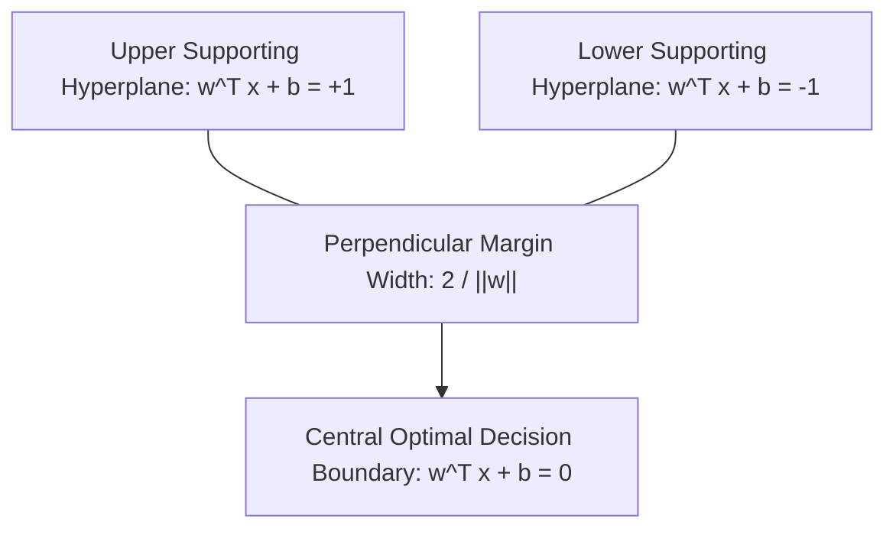

# Lecture 21.05: Distance between Parallel Lines

## 📌 Topic Overview
In this lecture, Shraddha ma'am covers the mathematical derivation and formula for the **perpendicular distance between two parallel lines**, explaining its geometric importance and direct application in establishing the **Maximum Margin Classifier in Support Vector Machines (SVM)**.

---

## 🏛️ SVM Margin Band Geometry



---

## 📐 Mathematical Formulation

### 1. Slope-Intercept Form:
For two parallel lines $L_1: y = mx + c_1$ and $L_2: y = mx + c_2$:

$$
d = \frac{|c_1 - c_2|}{\sqrt{1 + m^2}}
$$

### 2. General Cartesian Form:
For two parallel lines $Ax + By + C_1 = 0$ and $Ax + By + C_2 = 0$:

$$
d = \frac{|C_1 - C_2|}{\sqrt{A^2 + B^2}}
$$

### Connection to SVM (Support Vector Machines):
In SVM classification, the data points closest to the decision boundary lie on the parallel planes $\mathbf{w}^T \mathbf{x} + b = 1$ and $\mathbf{w}^T \mathbf{x} + b = -1$.
The total perpendicular distance (margin width) between these two parallel hyperplanes is:

$$
\text{Margin Width } M = \frac{|1 - (-1)|}{\|\mathbf{w}\|} = \frac{2}{\|\mathbf{w}\|}
$$

Maximizing this margin is equivalent to minimizing $\frac{1}{2} \|\mathbf{w}\|^2$!

---

## 💻 Python Implementation

```python
import numpy as np

def compute_distance_between_parallel_lines(m=2.0, c1=5.0, c2=1.0):
    """
    Computes perpendicular distance between two parallel lines:
    L1: y = mx + c1
    L2: y = mx + c2
    Formula: d = |c1 - c2| / sqrt(1 + m^2)
    
    Parameters:
        m (float): Shared slope.
        c1 (float): Y-intercept of line 1.
        c2 (float): Y-intercept of line 2.
        
    Returns:
        dict: Intercept difference, denominator factor, and perpendicular distance.
    """
    numerator = abs(c1 - c2)
    denominator = np.sqrt(1.0 + m**2)
    distance = numerator / denominator
    
    return {
        "slope_m": m,
        "c1": c1,
        "c2": c2,
        "numerator_|c1-c2|": numerator,
        "denominator_sqrt(1+m²)": float(denominator),
        "perpendicular_distance": float(distance)
    }

# --- Execution & Verification ---
# L1: y = 2x + 5, L2: y = 2x + 1 -> |5 - 1| / sqrt(1 + 4) = 4 / sqrt(5) ≈ 1.7889
res = compute_distance_between_parallel_lines(m=2.0, c1=5.0, c2=1.0)
print(f"L1: y = {res['slope_m']}x + {res['c1']}")
print(f"L2: y = {res['slope_m']}x + {res['c2']}")
print(f"Numerator |c1 - c2|       = {res['numerator_|c1-c2|']}")
print(f"Denominator sqrt(1 + m²) = {res['denominator_sqrt(1+m²)']:.4f}")
print(f"Perpendicular Distance d = {res['perpendicular_distance']:.4f}")

```

---

## 🔑 Key Takeaways
1. The distance between parallel lines is constant everywhere along their length.
2. The formula divides the vertical intercept separation $|c_1 - c_2|$ by $\sqrt{1 + m^2}$ to project onto the perpendicular normal vector.
3. In SVM, maximizing the distance between parallel boundary planes maximizes generalization and prevents overfitting.
