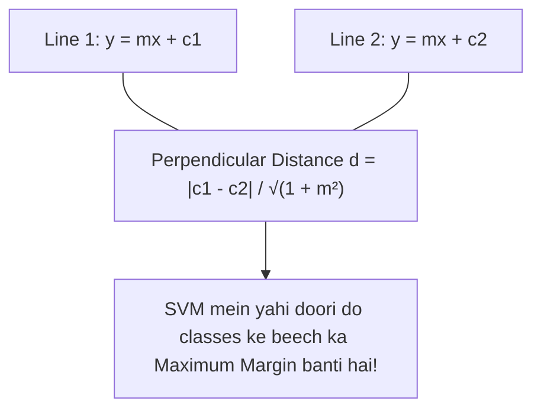

# Notes_21.05: Parallel Lines Ke Beech Ki Doori [Hinglish]

## 📌 Topic Overview
Is lecture mein Shraddha ma'am ne **Do parallel lines ke beech perpendicular distance** nikalne ka formula samjhaya hai: $d = \frac{|c_1 - c_2|}{\sqrt{1 + m^2}}$ kaise kaam karta hai aur Support Vector Machine (SVM) mein maximum margin classifier banane mein iska kya use hai.

---

### 📋 Is Topic Mein Hum Kya Seekhenge?
- Do parallel lines ke beech distance ka formula: $d = \frac{|c_1 - c_2|}{\sqrt{1 + m^2}}$.
- General form ($Ax + By + C = 0$) ke liye formula: $d = \frac{|C_1 - C_2|}{\sqrt{A^2 + B^2}}$.
- Shraddha ma'am ka blackboard numerical example.
- Machine Learning link: SVM ka Margin Width $\frac{2}{\|\mathbf{w}\|}$ isi formula se banta hai!

---

### 🔍 Har Ek Point Ka Simple & Detailed Explanation

#### 1. Formula:
Agar do parallel lines hain:
$L_1: y = mx + c_1$
$L_2: y = mx + c_2$

Inke beech ki seedhi (perpendicular) doori:

$$
d = \frac{|c_1 - c_2|}{\sqrt{1 + m^2}}
$$

#### 2. Example:
Maan lijiye do lines hain:
$L_1: y = 2x + 5$ ($c_1 = 5$)
$L_2: y = 2x + 1$ ($c_2 = 1$)
Slope $m = 2$.

$$
d = \frac{|5 - 1|}{\sqrt{1 + 2^2}} = \frac{4}{\sqrt{1 + 4}} = \frac{4}{\sqrt{5}} \approx \frac{4}{2.236} \approx 1.7889
$$

#### 3. SVM (Support Vector Machine) Se Rishta:
SVM classifier do classes ke beech do parallel boundary lines khinchta hai:
- Positive line: $\mathbf{w}^T \mathbf{x} + b = +1$
- Negative line: $\mathbf{w}^T \mathbf{x} + b = -1$

In dono parallel lines ke beech ki total doori (margin) hoti hai:

$$
\text{Margin} = \frac{|1 - (-1)|}{\|\mathbf{w}\|} = \frac{2}{\|\mathbf{w}\|}
$$

SVM ka pura objective yahi hota hai ki is margin ko maximize kiya jaye!

---

### 📊 Blackboard Diagram: Parallel Lines Distance & SVM Margin



---

### 💻 Python Code Implementation

```python
import numpy as np

def compute_distance_between_parallel_lines(m=2.0, c1=5.0, c2=1.0):
    """
    Computes perpendicular distance between two parallel lines:
    L1: y = mx + c1
    L2: y = mx + c2
    Formula: d = |c1 - c2| / sqrt(1 + m^2)
    
    Parameters:
        m (float): Shared slope.
        c1 (float): Y-intercept of line 1.
        c2 (float): Y-intercept of line 2.
        
    Returns:
        dict: Intercept difference, denominator factor, and perpendicular distance.
    """
    numerator = abs(c1 - c2)
    denominator = np.sqrt(1.0 + m**2)
    distance = numerator / denominator
    
    return {
        "slope_m": m,
        "c1": c1,
        "c2": c2,
        "numerator_|c1-c2|": numerator,
        "denominator_sqrt(1+m²)": float(denominator),
        "perpendicular_distance": float(distance)
    }

# --- Execution & Verification ---
# L1: y = 2x + 5, L2: y = 2x + 1 -> |5 - 1| / sqrt(1 + 4) = 4 / sqrt(5) ≈ 1.7889
res = compute_distance_between_parallel_lines(m=2.0, c1=5.0, c2=1.0)
print(f"L1: y = {res['slope_m']}x + {res['c1']}")
print(f"L2: y = {res['slope_m']}x + {res['c2']}")
print(f"Numerator |c1 - c2|       = {res['numerator_|c1-c2|']}")
print(f"Denominator sqrt(1 + m²) = {res['denominator_sqrt(1+m²)']:.4f}")
print(f"Perpendicular Distance d = {res['perpendicular_distance']:.4f}")

```

---

### 🎯 Key Takeaways:
1. Parallel lines ke beech ki doori har jagah barabar rehti hai.
2. SVM algorithm classes ko alag karne ke liye parallel hyperplanes ke beech ka distance maximize karta hai.
