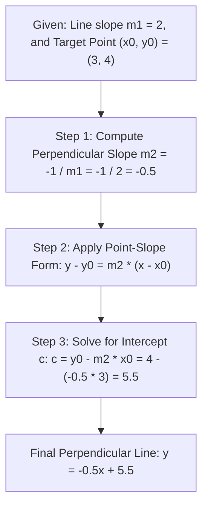

# Lecture 21.06: Practice Problem (Coordinate Geometry)

## 📌 Topic Overview
In this lecture, Shraddha ma'am walks through a complete **step-by-step Coordinate Geometry problem** on the blackboard: finding the exact equation of a line perpendicular to a given line passing through a designated point $(x_0, y_0)$, and calculating distances between intersecting geometries.

---

## 🏛️ Problem Solving Workflow



---

## 📐 Mathematical Formulation

### Problem Statement:
Find the equation of the line passing through point $(3, 4)$ that is perpendicular to the line $y = 2x + 1$.

### Step 1: Perpendicular Slope Condition
Since the given line has slope $m_1 = 2$:

$$
m_2 = -\frac{1}{m_1} = -\frac{1}{2} = -0.5
$$

### Step 2: Point-Slope Formula
Using the known coordinates $(x_0, y_0) = (3, 4)$:

$$
y - y_0 = m_2(x - x_0) \implies y - 4 = -0.5(x - 3)
$$

$$
y - 4 = -0.5x + 1.5 \implies y = -0.5x + 5.5
$$

The perpendicular line intersects the y-axis at $(0, 5.5)$ and meets the original line at exactly $90^\circ$.

---

## 💻 Python Implementation

```python
def solve_perpendicular_line_through_point(m_original=2.0, point=(3, 4)):
    """
    Solves the classic coordinate geometry problem:
    Find the equation of the line passing through point (x0, y0)
    perpendicular to a line with slope m_original.
    
    Parameters:
        m_original (float): Slope of the given line.
        point (tuple): Coordinates (x0, y0) that the perpendicular line must cross.
        
    Returns:
        dict: Original slope, perpendicular slope, computed intercept, and equation string.
    """
    x0, y0 = point
    
    # 1. Perpendicular slope: m_perp = -1 / m_original
    m_perp = -1.0 / m_original
    
    # 2. Intercept: y0 = m_perp * x0 + c_perp ==> c_perp = y0 - m_perp * x0
    c_perp = y0 - (m_perp * x0)
    
    return {
        "original_slope": m_original,
        "perpendicular_slope": m_perp,
        "point_passed": point,
        "computed_intercept_c": c_perp,
        "equation_str": f"y = {m_perp:.2f}x + {c_perp:.2f}"
    }

# --- Execution & Verification ---
# Given line has slope m = 2. Find perpendicular line passing through (3, 4):
# m_perp = -1/2 = -0.5. c = 4 - (-0.5 * 3) = 4 + 1.5 = 5.5
res = solve_perpendicular_line_through_point(m_original=2.0, point=(3, 4))
print(f"Original Slope m       : {res['original_slope']}")
print(f"Perpendicular Slope m' : {res['perpendicular_slope']}")
print(f"Point Passed           : {res['point_passed']}")
print(f"Perpendicular Equation : {res['equation_str']}")

```

---

## 🔑 Key Takeaways
1. Any line perpendicular to slope $m$ has slope $-1/m$.
2. Substituting known point coordinates $(x_0, y_0)$ into $y = mx + c$ uniquely determines the intercept $c$.
3. In machine learning, computing the normal vector to a decision hyperplane follows this exact perpendicular algebraic principle.
