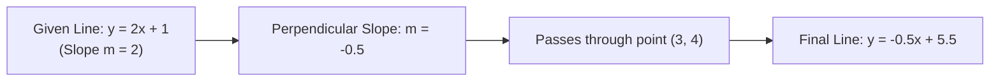

# Notes_21.06: Coordinate Geometry Par Practice Problem [Hinglish]

## 📌 Topic Overview
Is lecture mein Shraddha ma'am ne **Coordinate Geometry ka numerical problem** blackboard par solve karwaya hai: kisi di gayi line ke perpendicular rekha ki equation nikaalna jo ek specific point $(3, 4)$ se hokar guzarti hai.

---

### 📋 Is Topic Mein Hum Kya Seekhenge?
- Perpendicular line ki equation step-by-step kaise banayein?
- $m_2 = -\frac{1}{m_1}$ ka practical use.
- Point-slope formula: $y - y_0 = m(x - x_0)$.
- Y-intercept $c = 5.5$ solve karne ka tarika.

---

### 🔍 Har Ek Point Ka Simple & Detailed Explanation

#### 1. Question:
Ek line di gayi hai: $y = 2x + 1$ (Iska slope $m_1 = 2$ hai).
Humein ek aisi line ki equation nikaalni hai jo iske **Perpendicular ($90^\circ$)** ho aur point **$(3, 4)$** se guzre.

#### 2. Step-by-Step Solution:
**Step 1: Nayi line ka slope ($m_2$) nikaalein:**
Perpendicular condition: $m_1 \cdot m_2 = -1$

$$
m_2 = -\frac{1}{m_1} = -\frac{1}{2} = -0.5
$$

**Step 2: Point $(3, 4)$ ko satisfy karayein:**
Line ki general form: $y = m_2 x + c$
$x = 3$ aur $y = 4$ rakhne par:

$$
4 = (-0.5 \times 3) + c
$$

$$
4 = -1.5 + c \implies c = 4 + 1.5 = 5.5
$$

**Step 3: Final Equation:**

$$
y = -0.5x + 5.5
$$

---

### 📊 Blackboard Diagram: Perpendicular Line Solution



---

### 💻 Python Code Implementation

```python
def solve_perpendicular_line_through_point(m_original=2.0, point=(3, 4)):
    """
    Solves the classic coordinate geometry problem:
    Find the equation of the line passing through point (x0, y0)
    perpendicular to a line with slope m_original.
    
    Parameters:
        m_original (float): Slope of the given line.
        point (tuple): Coordinates (x0, y0) that the perpendicular line must cross.
        
    Returns:
        dict: Original slope, perpendicular slope, computed intercept, and equation string.
    """
    x0, y0 = point
    
    # 1. Perpendicular slope: m_perp = -1 / m_original
    m_perp = -1.0 / m_original
    
    # 2. Intercept: y0 = m_perp * x0 + c_perp ==> c_perp = y0 - m_perp * x0
    c_perp = y0 - (m_perp * x0)
    
    return {
        "original_slope": m_original,
        "perpendicular_slope": m_perp,
        "point_passed": point,
        "computed_intercept_c": c_perp,
        "equation_str": f"y = {m_perp:.2f}x + {c_perp:.2f}"
    }

# --- Execution & Verification ---
# Given line has slope m = 2. Find perpendicular line passing through (3, 4):
# m_perp = -1/2 = -0.5. c = 4 - (-0.5 * 3) = 4 + 1.5 = 5.5
res = solve_perpendicular_line_through_point(m_original=2.0, point=(3, 4))
print(f"Original Slope m       : {res['original_slope']}")
print(f"Perpendicular Slope m' : {res['perpendicular_slope']}")
print(f"Point Passed           : {res['point_passed']}")
print(f"Perpendicular Equation : {res['equation_str']}")

```

---

### 🎯 Key Takeaways:
1. Perpendicular line ka slope hamesha $-1/m$ hota hai.
2. Point ke coordinates put karke intercept $c$ aasani se nikal jata hai.
