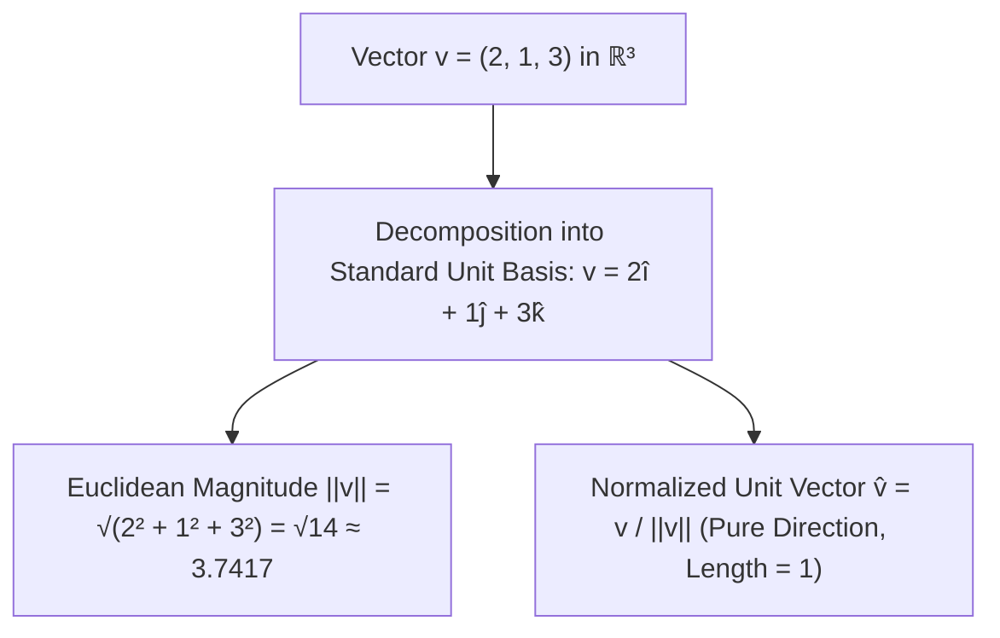

# Lecture 21.07: Vectors (Magnitude & Direction)

## 📌 Topic Overview
In this lecture, Shraddha ma'am introduces **Vectors**, establishing that a vector is a mathematical quantity possessing both **magnitude (length)** and **direction**, showing the component basis notation $\vec{v} = v_1\hat{i} + v_2\hat{j} + v_3\hat{k}$ and deriving the Euclidean norm and unit vector.

---

## 🏛️ Vector Decomposition & Basis Coordinates



---

## 📐 Mathematical Formulation

1. **Vector Notation:**
A vector originating at the origin $(0, 0, 0)$ terminating at point $(v_1, v_2, v_3)$ is written as:

$$
\vec{v} = v_1 \hat{i} + v_2 \hat{j} + v_3 \hat{k}
$$

where $\hat{i}, \hat{j}, \hat{k}$ are orthogonal unit basis vectors along the $x, y, z$ axes.

2. **Magnitude (Euclidean Norm / Length):**

$$
\|\vec{v}\| = \sqrt{v_1^2 + v_2^2 + v_3^2}
$$

For $\vec{A} = (2, 1, 3)$:

$$
\|\vec{A}\| = \sqrt{2^2 + 1^2 + 3^2} = \sqrt{4 + 1 + 9} = \sqrt{14} \approx 3.7417
$$

3. **Unit Vector ($\hat{v}$):**
A dimensionless vector pointing in the identical direction with length strictly equal to 1:

$$
\hat{v} = \frac{\vec{v}}{\|\vec{v}\|} = \frac{1}{\sqrt{14}} (2\hat{i} + \hat{j} + 3\hat{k})
$$

---

## 💻 Python Implementation

```python
import numpy as np

def analyze_vector_properties(v=(2, 1, 3)):
    """
    Analyzes mathematical properties of a vector v:
    - Component form: v1*i + v2*j + v3*k
    - Euclidean magnitude (L2 Norm): ||v|| = sqrt(v1^2 + v2^2 + v3^2)
    - Unit vector: v_hat = v / ||v||
    
    Parameters:
        v (tuple or list): Vector components.
        
    Returns:
        dict: Components, magnitude, and unit vector components.
    """
    v_arr = np.array(v, dtype=float)
    
    # Euclidean magnitude (norm)
    magnitude = float(np.linalg.norm(v_arr))
    
    # Unit vector (normalized direction)
    unit_v = (v_arr / magnitude).tolist()
    
    return {
        "components": list(v),
        "notation_str": f"{v[0]}i + {v[1]}j + {v[2]}k",
        "magnitude_||v||": magnitude,
        "unit_vector_v_hat": unit_v,
        "unit_vector_norm_check": float(np.linalg.norm(unit_v))
    }

# --- Execution & Verification ---
# Shraddha ma'am's chalkboard vector A = (2, 1, 3)
res = analyze_vector_properties(v=(2, 1, 3))
print(f"Vector Components : {res['components']}")
print(f"Component Notation: {res['notation_str']}")
print(f"Magnitude ||v||   : sqrt(2² + 1² + 3²) = sqrt(4 + 1 + 9) = sqrt(14) ≈ {res['magnitude_||v||']:.4f}")
print(f"Unit Vector v_hat : {[round(x, 4) for x in res['unit_vector_v_hat']]}")
print(f"Unit Vector Norm  : {res['unit_vector_norm_check']:.1f}")

```

---

## 🔑 Key Takeaways
1. A vector has both magnitude (how much) and direction (which way); a scalar only has magnitude.
2. In machine learning, feature representations are vectors where each dimension represents an observed attribute.
3. Normalizing vectors into unit vectors ($\|\hat{v}\| = 1$) is standard practice in text embeddings (e.g. Word2Vec, BERT) to compare cosine similarity without length bias.
