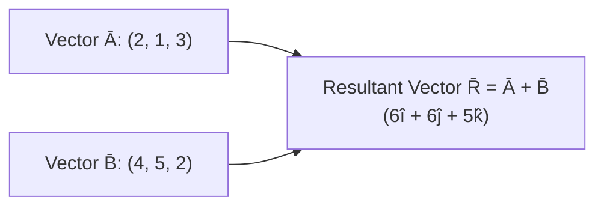

# Notes_21.08: Vector Addition (Vectors Ka Jod) [Hinglish]

## 📌 Topic Overview
Is lecture mein Shraddha ma'am ne **Vector Addition** ko blackboard par step-by-step sikhaya hai: do vectors $\vec{A} = (2, 1, 3)$ aur $\vec{B} = (4, 5, 2)$ ko component-wise jod kar resultant $\vec{R} = (6, 6, 5)$ kaise banta hai, aur Parallelogram Law kya hota hai.

---

### 📋 Is Topic Mein Hum Kya Seekhenge?
- Vector Addition ka golden rule: Component-wise jodna ($\hat{i}$ ko $\hat{i}$ se, $\hat{j}$ ko $\hat{j}$ se).
- Shraddha ma'am ka blackboard example: $\vec{A} = (2, 1, 3)$ aur $\vec{B} = (4, 5, 2)$.
- Parallelogram Law aur Triangle Law of vectors.
- Deep Learning mein Residual Connections (ResNet: $F(x) + x$) ka concept.

---

### 🔍 Har Ek Point Ka Simple & Detailed Explanation

#### 1. Component-Wise Jodna:
Vectors ko jodna bohot aasan hai! Aapko bas matching components ko aapas mein jodna hota hai:

$$
\vec{R} = (a_1 + a_2)\hat{i} + (b_1 + b_2)\hat{j} + (c_1 + c_2)\hat{k}
$$

#### 2. Blackboard Example:
- $\vec{A} = 2\hat{i} + 1\hat{j} + 3\hat{k}$
- $\vec{B} = 4\hat{i} + 5\hat{j} + 2\hat{k}$

Dono ko jodne par:
- $\hat{i}$ component: $2 + 4 = 6$
- $\hat{j}$ component: $1 + 5 = 6$
- $\hat{k}$ component: $3 + 2 = 5$

Resultant Vector:

$$
\vec{R} = 6\hat{i} + 6\hat{j} + 5\hat{k} = (6, 6, 5)
$$

Magnitude:

$$
\|\vec{R}\| = \sqrt{6^2 + 6^2 + 5^2} = \sqrt{36 + 36 + 25} = \sqrt{97} \approx 9.85
$$

---

### 📊 Blackboard Diagram: Parallelogram Law



---

### 💻 Python Code Implementation

```python
import numpy as np

def add_vectors_componentwise(vec_a=(2, 1, 3), vec_b=(4, 5, 2)):
    """
    Performs component-wise vector addition for two vectors A and B:
    R = A + B = (a1 + b1)i + (a2 + b2)j + (a3 + b3)k
    Demonstrates both analytical component math and NumPy vectorization.
    
    Parameters:
        vec_a (tuple): First vector components.
        vec_b (tuple): Second vector components.
        
    Returns:
        dict: Components of A, B, and the resultant vector R.
    """
    a_arr = np.array(vec_a)
    b_arr = np.array(vec_b)
    
    # Vectorized element-wise addition
    resultant = a_arr + b_arr
    
    return {
        "vector_A": list(vec_a),
        "vector_B": list(vec_b),
        "resultant_R": list(resultant),
        "R_notation_str": f"{resultant[0]}i + {resultant[1]}j + {resultant[2]}k",
        "magnitude_R": float(np.linalg.norm(resultant))
    }

# --- Execution & Verification ---
# Shraddha ma'am's exact chalkboard example: A = (2, 1, 3), B = (4, 5, 2)
res = add_vectors_componentwise(vec_a=(2, 1, 3), vec_b=(4, 5, 2))
print("Vector A:", res["vector_A"], "-> 2i + 1j + 3k")
print("Vector B:", res["vector_B"], "-> 4i + 5j + 2k")
print("Resultant R = A + B:", res["resultant_R"])
print(f"Component Form: {res['R_notation_str']}")
print(f"Resultant Magnitude: ||R|| = {res['magnitude_R']:.4f}")

```

---

### 🎯 Key Takeaways:
1. Vector addition component-wise hota hai: $X$ with $X$, $Y$ with $Y$, $Z$ with $Z$.
2. Python NumPy mein `a + b` likhte hi poora vectorized addition ek line mein ho jata hai.
