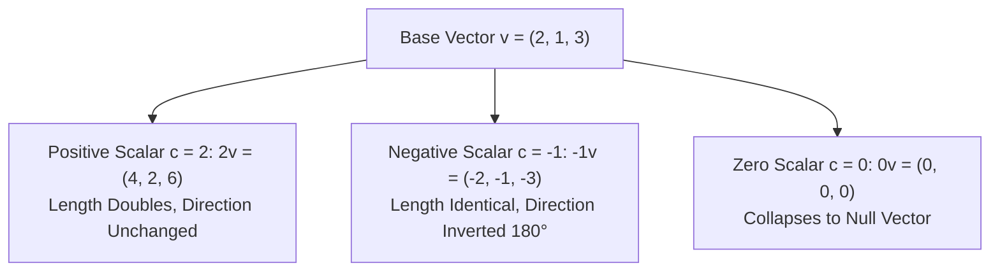

# Lecture 21.09: Scalar Multiplication of Vectors

## 📌 Topic Overview
In this lecture, Shraddha ma'am covers **Scalar Multiplication**, showing how multiplying a vector $\vec{v}$ by a real number $c$ modifies its magnitude by factor $|c|$, preserves direction if $c > 0$, or reverses direction by $180^\circ$ if $c < 0$, connecting this directly to learning rate scaling in Gradient Descent.

---

## 🏛️ Vector Scaling & Inversion Geometry



---

## 📐 Mathematical Formulation

Given vector $\vec{v} = v_1\hat{i} + v_2\hat{j} + v_3\hat{k}$ and scalar $c \in \mathbb{R}$:

$$
c \cdot \vec{v} = (c v_1)\hat{i} + (c v_2)\hat{j} + (c v_3)\hat{k}
$$

### Magnitude Transformation Law:

$$
\|c \cdot \vec{v}\| = |c| \cdot \|\vec{v}\|
$$

### Connection to Gradient Descent Optimization:
In Machine Learning parameter updates, the gradient vector $\nabla \mathcal{L}(\mathbf{w})$ points in the direction of steepest loss ascent.
The parameter update step performs scalar multiplication by $-\eta$ (negative learning rate):

$$
\Delta \mathbf{w} = -\eta \cdot \nabla \mathcal{L}(\mathbf{w})
$$

- The scalar $\eta > 0$ controls the step length.
- The negative sign $-1$ reverses direction toward the minimum!

---

## 💻 Python Implementation

```python
import numpy as np

def scale_vector(v=(2.0, 1.0, 3.0), scalar=2.5):
    """
    Demonstrates scalar multiplication of a vector: c * v = (c*v1, c*v2, c*v3).
    Analyzes magnitude scaling ||c*v|| = |c| * ||v|| and direction preservation/inversion.
    
    Parameters:
        v (tuple): Original vector components.
        scalar (float): Real scaling factor c.
        
    Returns:
        dict: Original and scaled vectors, magnitudes, and direction status.
    """
    v_arr = np.array(v, dtype=float)
    scaled_arr = scalar * v_arr
    
    orig_norm = float(np.linalg.norm(v_arr))
    scaled_norm = float(np.linalg.norm(scaled_arr))
    
    if scalar > 0:
        direction = "Preserved (Same Direction)"
    elif scalar < 0:
        direction = "Inverted (Opposite Direction, 180° Flip)"
    else:
        direction = "Collapsed to Null Vector (0, 0, 0)"
        
    return {
        "original_vector": list(v),
        "scalar_c": scalar,
        "scaled_vector": list(scaled_arr),
        "original_norm": orig_norm,
        "scaled_norm": scaled_norm,
        "theoretical_scaled_norm": abs(scalar) * orig_norm,
        "direction_status": direction
    }

# --- Execution & Verification ---
res_pos = scale_vector(v=(2, 1, 3), scalar=2.0)
print(f"Original v = {res_pos['original_vector']}, Norm = {res_pos['original_norm']:.4f}")
print(f"Scaled 2*v = {res_pos['scaled_vector']}, Norm = {res_pos['scaled_norm']:.4f} ({res_pos['direction_status']})")

res_neg = scale_vector(v=(2, 1, 3), scalar=-1.0)
print(f"Inverted -1*v = {res_neg['scaled_vector']} ({res_neg['direction_status']})")

```

---

## 🔑 Key Takeaways
1. Scalar multiplication scales each component independently: $c(x, y, z) = (cx, cy, cz)$.
2. If $c > 0$, direction is unchanged; if $c < 0$, direction is flipped by $180^\circ$.
3. Learning rate scaling in neural network optimization ($-\eta \nabla \mathcal{L}$) is fundamentally scalar multiplication of a gradient vector.
