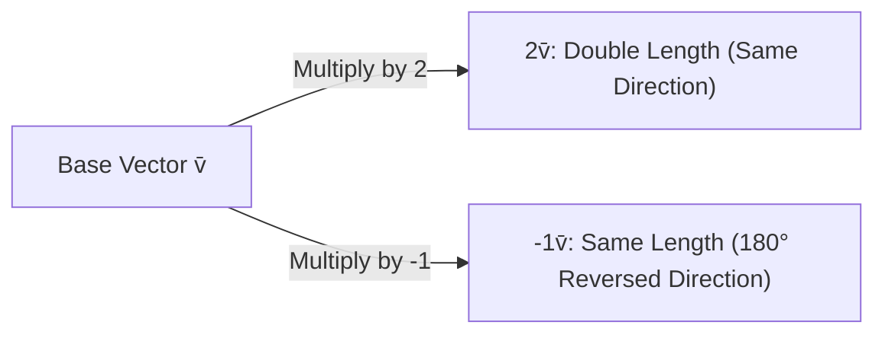

# Notes_21.09: Scalar Multiplication [Hinglish]

## 📌 Topic Overview
Is lecture mein Shraddha ma'am ne **Scalar Multiplication** samjhaya hai: kisi vector ko scalar number ($c$) se multiply karne par uski lambai (magnitude) par kya asar padta hai, positive number se disha wahi kyu rehti hai, aur negative number se disha $180^\circ$ ulti kyu ho jaati hai.

---

### 📋 Is Topic Mein Hum Kya Seekhenge?
- Scalar Multiplication ka rule: $c \cdot \vec{v} = (c v_1, c v_2, c v_3)$.
- Magnitude scaling law: $\|c \vec{v}\| = |c| \cdot \|\vec{v}\|$.
- Negative number se multiply karne par direction ka reverse ($180^\circ$) hona.
- Gradient Descent mein Learning Rate ($-\eta \nabla \mathcal{L}$) se iska direct rishta!

---

### 🔍 Har Ek Point Ka Simple & Detailed Explanation

#### 1. Concept:
Agar aapke paas ek vector hai $\vec{v} = 2\hat{i} + \hat{j} + 3\hat{k}$:
- **$c = 2$ se multiply kiya:** $2\vec{v} = 4\hat{i} + 2\hat{j} + 6\hat{k}$. Vector ki lambai double ho gayi, lekin disha wahi rahi.
- **$c = -1$ se multiply kiya:** $-\vec{v} = -2\hat{i} - \hat{j} - 3\hat{k}$. Lambai wahi rahi, lekin disha bilkul ulati ($180^\circ$ opposite) ho gayi!

Formula:

$$
c \cdot \vec{v} = (c v_1)\hat{i} + (c v_2)\hat{j} + (c v_3)\hat{k}
$$

#### 2. Gradient Descent Se Connection:
Machine Learning mein model ke weights update karne ka formula hota hai:

$$
\mathbf{w}_{\text{new}} = \mathbf{w}_{\text{old}} - \eta \cdot \nabla \mathcal{L}
$$

Yahan $\nabla \mathcal{L}$ ek vector hai (Gradient).
Usme hum scalar $\eta$ (learning rate) se multiply karte hain taaki step chhota ya bada ho sake, aur minus sign se multiply karte hain taaki loss badhne ke bajaye ghate!

---

### 📊 Blackboard Diagram: Vector Scaling & Flip



---

### 💻 Python Code Implementation

```python
import numpy as np

def scale_vector(v=(2.0, 1.0, 3.0), scalar=2.5):
    """
    Demonstrates scalar multiplication of a vector: c * v = (c*v1, c*v2, c*v3).
    Analyzes magnitude scaling ||c*v|| = |c| * ||v|| and direction preservation/inversion.
    
    Parameters:
        v (tuple): Original vector components.
        scalar (float): Real scaling factor c.
        
    Returns:
        dict: Original and scaled vectors, magnitudes, and direction status.
    """
    v_arr = np.array(v, dtype=float)
    scaled_arr = scalar * v_arr
    
    orig_norm = float(np.linalg.norm(v_arr))
    scaled_norm = float(np.linalg.norm(scaled_arr))
    
    if scalar > 0:
        direction = "Preserved (Same Direction)"
    elif scalar < 0:
        direction = "Inverted (Opposite Direction, 180° Flip)"
    else:
        direction = "Collapsed to Null Vector (0, 0, 0)"
        
    return {
        "original_vector": list(v),
        "scalar_c": scalar,
        "scaled_vector": list(scaled_arr),
        "original_norm": orig_norm,
        "scaled_norm": scaled_norm,
        "theoretical_scaled_norm": abs(scalar) * orig_norm,
        "direction_status": direction
    }

# --- Execution & Verification ---
res_pos = scale_vector(v=(2, 1, 3), scalar=2.0)
print(f"Original v = {res_pos['original_vector']}, Norm = {res_pos['original_norm']:.4f}")
print(f"Scaled 2*v = {res_pos['scaled_vector']}, Norm = {res_pos['scaled_norm']:.4f} ({res_pos['direction_status']})")

res_neg = scale_vector(v=(2, 1, 3), scalar=-1.0)
print(f"Inverted -1*v = {res_neg['scaled_vector']} ({res_neg['direction_status']})")

```

---

### 🎯 Key Takeaways:
1. Scalar har component ko barabar scale karta hai.
2. Negative scalar direction ko palat deta hai; zero scalar vector ko $(0, 0, 0)$ bana deta hai.
