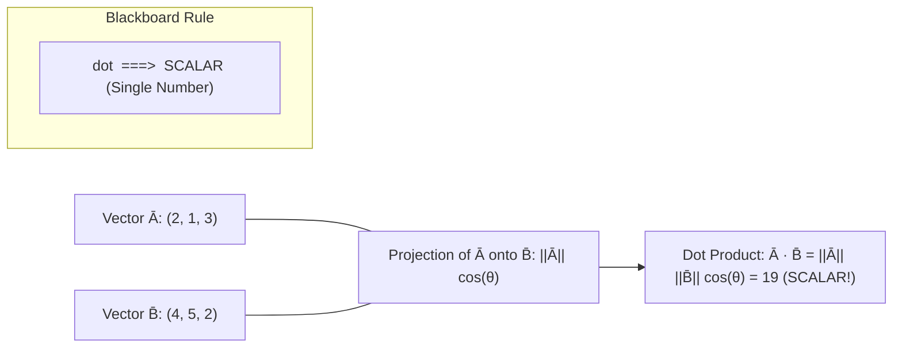

# Lecture 21.10: Dot Product (Scalar Product)

## 📌 Topic Overview
In this lecture, Shraddha ma'am covers the **Dot Product (Scalar Product)**, emphasizing her primary blackboard distinction: **"dot $\to$ scalar"** (the result is always a single real number, never a vector). She calculates the algebraic sum of products with vectors $\vec{A} = (2, 1, 3)$ and $\vec{B} = (4, 5, 2)$ to obtain $19$, and connects the geometric formula to **Cosine Similarity** in NLP and recommendation systems.

---

## 🏛️ Dot Product Geometric Projection



---

## 📐 Mathematical Formulation

### 1. Algebraic Definition:

$$
\vec{A} \cdot \vec{B} = \sum_{i=1}^n a_i b_i = a_1 b_1 + a_2 b_2 + \dots + a_n b_n
$$

### 2. Geometric Definition:

$$
\vec{A} \cdot \vec{B} = \|\vec{A}\| \|\vec{B}\| \cos(\theta)
$$

where $\theta$ is the angle between the two vectors.

### Blackboard Calculation:
- $\vec{A} = (2, 1, 3) = 2\hat{i} + \hat{j} + 3\hat{k}$
- $\vec{B} = (4, 5, 2) = 4\hat{i} + 5\hat{j} + 2\hat{k}$

$$
\vec{A} \cdot \vec{B} = (2 \times 4) + (1 \times 5) + (3 \times 2) = 8 + 5 + 6 = 19
$$

### 3. Orthogonality Condition:
Two non-zero vectors are perpendicular ($90^\circ$) if and only if their dot product vanishes:

$$
\vec{A} \cdot \vec{B} = 0 \iff \theta = 90^\circ \quad (\text{Orthogonal})
$$

### 4. Cosine Similarity in AI:
Used to compare document and text embeddings:

$$
\text{Cosine Similarity} = \cos(\theta) = \frac{\vec{A} \cdot \vec{B}}{\|\vec{A}\| \|\vec{B}\|}
$$

---

## 💻 Python Implementation

```python
import numpy as np

def compute_dot_product_and_angle(a=(2, 1, 3), b=(4, 5, 2)):
    """
    Computes Dot Product (Scalar Product) between vectors a and b:
    Algebraic: a . b = a1*b1 + a2*b2 + a3*b3
    Geometric: a . b = ||a|| * ||b|| * cos(theta)
    Computes Cosine Similarity cos(theta) = (a . b) / (||a|| * ||b||).
    
    Parameters:
        a (tuple): Vector A components.
        b (tuple): Vector B components.
        
    Returns:
        dict: Dot product, norms, cosine similarity, and angle in degrees.
    """
    a_arr = np.array(a, dtype=float)
    b_arr = np.array(b, dtype=float)
    
    # 1. Algebraic Dot Product (yields SCALAR)
    dot_val = float(np.dot(a_arr, b_arr))
    
    # 2. Magnitudes
    norm_a = float(np.linalg.norm(a_arr))
    norm_b = float(np.linalg.norm(b_arr))
    
    # 3. Cosine Similarity & Angle
    cos_theta = dot_val / (norm_a * norm_b)
    # Clip for floating point safety in [-1, 1]
    cos_theta_clipped = np.clip(cos_theta, -1.0, 1.0)
    angle_rad = np.arccos(cos_theta_clipped)
    angle_deg = np.degrees(angle_rad)
    
    return {
        "vector_A": list(a),
        "vector_B": list(b),
        "dot_product_scalar": dot_val,
        "norm_A": norm_a,
        "norm_B": norm_b,
        "cosine_similarity": float(cos_theta_clipped),
        "angle_degrees": float(angle_deg),
        "is_orthogonal": bool(np.isclose(dot_val, 0.0))
    }

# --- Execution & Verification ---
# Shraddha ma'am's exact blackboard example: A = (2, 1, 3), B = (4, 5, 2)
# a . b = 2(4) + 1(5) + 3(2) = 8 + 5 + 6 = 19 (Scalar!)
res = compute_dot_product_and_angle(a=(2, 1, 3), b=(4, 5, 2))
print("Vector A:", res["vector_A"])
print("Vector B:", res["vector_B"])
print(f"Dot Product (Scalar) A . B = 2*4 + 1*5 + 3*2 = {res['dot_product_scalar']:.1f}")
print(f"Cosine Similarity cos(theta): {res['cosine_similarity']:.4f}")
print(f"Angle between vectors       : {res['angle_degrees']:.2f}°")

```

---

## 🔑 Key Takeaways
1. The Dot Product always produces a **scalar** (single number), never a vector.
2. If $\vec{a} \cdot \vec{b} > 0$, the angle is acute ($< 90^\circ$); if $< 0$, obtuse ($> 90^\circ$); if $= 0$, orthogonal ($90^\circ$).
3. Cosine similarity in vector search engines (e.g. Pinecone, ChromaDB) computes this exact normalized dot product.
