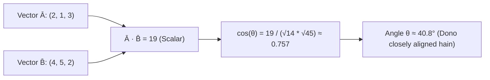

# Notes_21.10: Dot Product (Scalar Product) [Hinglish]

## 📌 Topic Overview
Is lecture mein Shraddha ma'am ne **Dot Product (Scalar Product)** blackboard par step-by-step sikhaya hai: ma'am ne blackboard par clear likha tha — **"dot $\to$ scalar"** (iska answer hamesha ek single number aata hai, vector nahi), do vectors $\vec{A} = (2, 1, 3)$ aur $\vec{B} = (4, 5, 2)$ ka dot product $19$ calculate kiya, aur Cosine Similarity ka concept samjhaya.

---

### 📋 Is Topic Mein Hum Kya Seekhenge?
- Dot Product ka sabse bada rule: Iska result hamesha ek **Scalar** hota hai.
- Algebraic formula: $\vec{A} \cdot \vec{B} = a_1 a_2 + b_1 b_2 + c_1 c_2$.
- Shraddha ma'am ka blackboard example: $(2, 1, 3) \cdot (4, 5, 2) = 19$.
- Orthogonality: Jab dot product $0$ ho, toh angle $90^\circ$ hota hai.
- AI & NLP mein Cosine Similarity $\cos(\theta) = \frac{\vec{A} \cdot \vec{B}}{\|\vec{A}\| \|\vec{B}\|}$.

---

### 🔍 Har Ek Point Ka Simple & Detailed Explanation

#### 1. "Dot Se Milta Hai Scalar":
Blackboard par ma'am ne right side mein highlight kiya:
- $\text{dot} \to \text{scalar}$
- $\text{cross} \to \text{vector}$

Iska matlab dot product karne ke baad $\hat{i}, \hat{j}, \hat{k}$ gayab ho jaate hain aur sirf ek real number bachta hai!

#### 2. Blackboard Calculation:
- $\vec{A} = 2\hat{i} + 1\hat{j} + 3\hat{k}$
- $\vec{B} = 4\hat{i} + 5\hat{j} + 2\hat{k}$

Matching components ko multiply karke jod dein:

$$
\vec{A} \cdot \vec{B} = (2 \times 4) + (1 \times 5) + (3 \times 2) = 8 + 5 + 6 = 19
$$

#### 3. AI Mein Cosine Similarity:
Jab ChatGPT ya search engine do sentences ki meaning compare karta hai, toh woh unke embeddings ka Cosine Similarity nikaalta hai:

$$
\cos(\theta) = \frac{\vec{A} \cdot \vec{B}}{\|\vec{A}\| \|\vec{B}\|}
$$

Agar do vectors bilkul ek disha mein hon ($\theta = 0^\circ$), toh $\cos(0) = 1$ (100% similar)!

---

### 📊 Blackboard Diagram: Dot Product Se Angle



---

### 💻 Python Code Implementation

```python
import numpy as np

def compute_dot_product_and_angle(a=(2, 1, 3), b=(4, 5, 2)):
    """
    Computes Dot Product (Scalar Product) between vectors a and b:
    Algebraic: a . b = a1*b1 + a2*b2 + a3*b3
    Geometric: a . b = ||a|| * ||b|| * cos(theta)
    Computes Cosine Similarity cos(theta) = (a . b) / (||a|| * ||b||).
    
    Parameters:
        a (tuple): Vector A components.
        b (tuple): Vector B components.
        
    Returns:
        dict: Dot product, norms, cosine similarity, and angle in degrees.
    """
    a_arr = np.array(a, dtype=float)
    b_arr = np.array(b, dtype=float)
    
    # 1. Algebraic Dot Product (yields SCALAR)
    dot_val = float(np.dot(a_arr, b_arr))
    
    # 2. Magnitudes
    norm_a = float(np.linalg.norm(a_arr))
    norm_b = float(np.linalg.norm(b_arr))
    
    # 3. Cosine Similarity & Angle
    cos_theta = dot_val / (norm_a * norm_b)
    # Clip for floating point safety in [-1, 1]
    cos_theta_clipped = np.clip(cos_theta, -1.0, 1.0)
    angle_rad = np.arccos(cos_theta_clipped)
    angle_deg = np.degrees(angle_rad)
    
    return {
        "vector_A": list(a),
        "vector_B": list(b),
        "dot_product_scalar": dot_val,
        "norm_A": norm_a,
        "norm_B": norm_b,
        "cosine_similarity": float(cos_theta_clipped),
        "angle_degrees": float(angle_deg),
        "is_orthogonal": bool(np.isclose(dot_val, 0.0))
    }

# --- Execution & Verification ---
# Shraddha ma'am's exact blackboard example: A = (2, 1, 3), B = (4, 5, 2)
# a . b = 2(4) + 1(5) + 3(2) = 8 + 5 + 6 = 19 (Scalar!)
res = compute_dot_product_and_angle(a=(2, 1, 3), b=(4, 5, 2))
print("Vector A:", res["vector_A"])
print("Vector B:", res["vector_B"])
print(f"Dot Product (Scalar) A . B = 2*4 + 1*5 + 3*2 = {res['dot_product_scalar']:.1f}")
print(f"Cosine Similarity cos(theta): {res['cosine_similarity']:.4f}")
print(f"Angle between vectors       : {res['angle_degrees']:.2f}°")

```

---

### 🎯 Key Takeaways:
1. Dot product hamesha ek scalar number deta hai.
2. Agar do vectors perpendicular ($90^\circ$) hain, toh unka dot product hamesha $0$ hoga.
