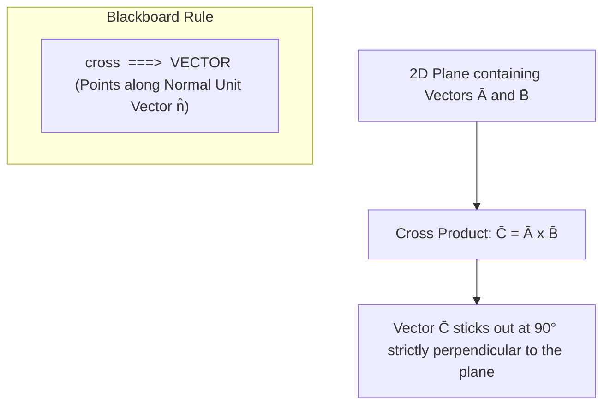

# Lecture 21.11: Cross Product (Vector Product)

## 📌 Topic Overview
In this lecture, Shraddha ma'am covers the **Cross Product (Vector Product)**, contrasting it with the dot product: **"cross $\to$ vector"** (the result is a vector pointing perpendicular to both inputs according to the Right-Hand Rule). She calculates $\vec{A} \times \vec{B}$ via the $3 \times 3$ determinant expansion.

---

## 🏛️ Orthogonal Normal Vector & Right-Hand Rule



---

## 📐 Mathematical Formulation

### 1. Determinant Form:

$$
\vec{A} \times \vec{B} = \begin{vmatrix} \hat{i} & \hat{j} & \hat{k} \\ a_1 & b_1 & c_1 \\ a_2 & b_2 & c_2 \end{vmatrix} = \hat{i}(b_1 c_2 - c_1 b_2) - \hat{j}(a_1 c_2 - c_1 a_2) + \hat{k}(a_1 b_2 - b_1 a_2)
$$

### 2. Geometric Form:

$$
\vec{A} \times \vec{B} = (\|\vec{A}\| \|\vec{B}\| \sin\theta) \, \hat{n}
$$

where $\hat{n}$ is the unit normal vector determined by the right-hand grip rule.

### Blackboard Calculation:
For $\vec{A} = (2, 1, 3)$ and $\vec{B} = (4, 5, 2)$:

$$
\vec{C} = \hat{i}(1 \cdot 2 - 3 \cdot 5) - \hat{j}(2 \cdot 2 - 3 \cdot 4) + \hat{k}(2 \cdot 5 - 1 \cdot 4)
$$

$$
\vec{C} = \hat{i}(2 - 15) - \hat{j}(4 - 12) + \hat{k}(10 - 4) = -13\hat{i} + 8\hat{j} + 6\hat{k}
$$

Verification of mutual orthogonality:
- $\vec{C} \cdot \vec{A} = -13(2) + 8(1) + 6(3) = -26 + 8 + 18 = 0$
- $\vec{C} \cdot \vec{B} = -13(4) + 8(5) + 6(2) = -52 + 40 + 12 = 0$

Both dot products are exactly zero!

---

## 💻 Python Implementation

```python
import numpy as np

def compute_cross_product(a=(2, 1, 3), b=(4, 5, 2)):
    """
    Computes Cross Product (Vector Product) between 3D vectors a and b:
    C = a x b = det([i, j, k; a1, a2, a3; b1, b2, b3])
    Result is a VECTOR strictly orthogonal (perpendicular) to both a and b.
    
    Parameters:
        a (tuple): Vector A.
        b (tuple): Vector B.
        
    Returns:
        dict: Resultant vector C, magnitude, and orthogonality verification.
    """
    a_arr = np.array(a, dtype=float)
    b_arr = np.array(b, dtype=float)
    
    # 1. NumPy cross product (yields 3D VECTOR)
    c_arr = np.cross(a_arr, b_arr)
    
    # 2. Magnitude represents area of parallelogram formed by A and B
    mag_c = float(np.linalg.norm(c_arr))
    
    # 3. Orthogonality check: C . A == 0 and C . B == 0
    dot_c_a = float(np.dot(c_arr, a_arr))
    dot_c_b = float(np.dot(c_arr, b_arr))
    
    return {
        "vector_A": list(a),
        "vector_B": list(b),
        "cross_product_vector_C": list(c_arr),
        "notation_str": f"{int(c_arr[0])}i + {int(c_arr[1])}j + {int(c_arr[2])}k",
        "magnitude_||C||": mag_c,
        "is_perpendicular_to_A": bool(np.isclose(dot_c_a, 0.0)),
        "is_perpendicular_to_B": bool(np.isclose(dot_c_b, 0.0))
    }

# --- Execution & Verification ---
# Blackboard example: A = (2, 1, 3), B = (4, 5, 2)
# C = (1*2 - 3*5)i - (2*2 - 3*4)j + (2*5 - 1*4)k
#   = (2 - 15)i - (4 - 12)j + (10 - 4)k = -13i + 8j + 6k
res = compute_cross_product(a=(2, 1, 3), b=(4, 5, 2))
print("Vector A:", res["vector_A"])
print("Vector B:", res["vector_B"])
print(f"Cross Product Vector C = A x B: {res['cross_product_vector_C']}")
print(f"Component Form: {res['notation_str']}")
print(f"Perpendicular to A? {res['is_perpendicular_to_A']} (C . A = 0)")
print(f"Perpendicular to B? {res['is_perpendicular_to_B']} (C . B = 0)")

```

---

## 🔑 Key Takeaways
1. Cross product produces a **vector**, unlike dot product which produces a scalar.
2. The cross product vector is always strictly perpendicular ($90^\circ$) to both input vectors.
3. If two vectors are parallel ($\theta = 0^\circ$), their cross product is zero ($\vec{A} \times \vec{B} = \vec{0}$).
