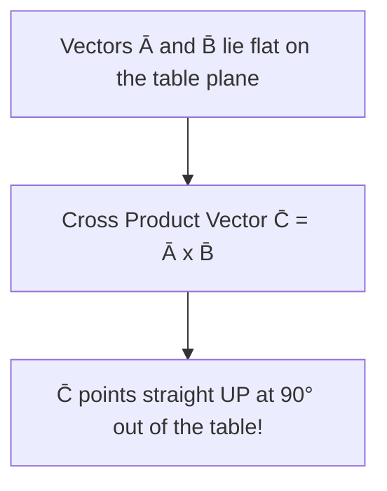

# Notes_21.11: Cross Product (Vector Product) [Hinglish]

## 📌 Topic Overview
Is lecture mein Shraddha ma'am ne **Cross Product (Vector Product)** blackboard par step-by-step calculate karwaya hai: ma'am ka blackboard rule tha — **"cross $\to$ vector"** (iska result ek naya vector aata hai jo dono vectors ke perpendicular hota hai), aur $3 \times 3$ determinant method se $\vec{A} \times \vec{B} = -13\hat{i} + 8\hat{j} + 6\hat{k}$ nikalna sikhaya.

---

### 📋 Is Topic Mein Hum Kya Seekhenge?
- Cross Product ka basic rule: Result hamesha ek **Vector** hota hai.
- Determinant formula: $\begin{vmatrix} \hat{i} & \hat{j} & \hat{k} \\ a_1 & b_1 & c_1 \\ a_2 & b_2 & c_2 \end{vmatrix}$.
- Shraddha ma'am ka blackboard calculation: $(2, 1, 3) \times (4, 5, 2) = (-13, 8, 6)$.
- Right-Hand Rule: Naya vector plane se $90^\circ$ bahar nikalta hai.
- Verification: $\vec{C} \cdot \vec{A} = 0$ aur $\vec{C} \cdot \vec{B} = 0$.

---

### 🔍 Har Ek Point Ka Simple & Detailed Explanation

#### 1. Dot vs Cross Ka Farq:
- Dot Product: $\vec{A} \cdot \vec{B} = \text{Scalar (Number)}$
- Cross Product: $\vec{A} \times \vec{B} = \text{Vector (Disha waala)}$

#### 2. Blackboard Calculation:
$\vec{A} = (2, 1, 3)$ aur $\vec{B} = (4, 5, 2)$

Determinant ko expand karte hain:

$$
\vec{C} = \hat{i}(1 \times 2 - 3 \times 5) - \hat{j}(2 \times 2 - 3 \times 4) + \hat{k}(2 \times 5 - 1 \times 4)
$$

$$
\vec{C} = \hat{i}(2 - 15) - \hat{j}(4 - 12) + \hat{k}(10 - 4)
$$

$$
\vec{C} = -13\hat{i} + 8\hat{j} + 6\hat{k} = (-13, 8, 6)
$$

#### 3. Right-Hand Rule:
Agar aap apne daayein haath (right hand) ki ungliyon ko $\vec{A}$ se $\vec{B}$ ki taraf modenge, toh aapka angutha (thumb) $\vec{C}$ ki disha dikhayega jo dono vectors se bilkul $90^\circ$ lamba (perpendicular) hoga!

---

### 📊 Blackboard Diagram: Perpendicular Cross Product



---

### 💻 Python Code Implementation

```python
import numpy as np

def compute_cross_product(a=(2, 1, 3), b=(4, 5, 2)):
    """
    Computes Cross Product (Vector Product) between 3D vectors a and b:
    C = a x b = det([i, j, k; a1, a2, a3; b1, b2, b3])
    Result is a VECTOR strictly orthogonal (perpendicular) to both a and b.
    
    Parameters:
        a (tuple): Vector A.
        b (tuple): Vector B.
        
    Returns:
        dict: Resultant vector C, magnitude, and orthogonality verification.
    """
    a_arr = np.array(a, dtype=float)
    b_arr = np.array(b, dtype=float)
    
    # 1. NumPy cross product (yields 3D VECTOR)
    c_arr = np.cross(a_arr, b_arr)
    
    # 2. Magnitude represents area of parallelogram formed by A and B
    mag_c = float(np.linalg.norm(c_arr))
    
    # 3. Orthogonality check: C . A == 0 and C . B == 0
    dot_c_a = float(np.dot(c_arr, a_arr))
    dot_c_b = float(np.dot(c_arr, b_arr))
    
    return {
        "vector_A": list(a),
        "vector_B": list(b),
        "cross_product_vector_C": list(c_arr),
        "notation_str": f"{int(c_arr[0])}i + {int(c_arr[1])}j + {int(c_arr[2])}k",
        "magnitude_||C||": mag_c,
        "is_perpendicular_to_A": bool(np.isclose(dot_c_a, 0.0)),
        "is_perpendicular_to_B": bool(np.isclose(dot_c_b, 0.0))
    }

# --- Execution & Verification ---
# Blackboard example: A = (2, 1, 3), B = (4, 5, 2)
# C = (1*2 - 3*5)i - (2*2 - 3*4)j + (2*5 - 1*4)k
#   = (2 - 15)i - (4 - 12)j + (10 - 4)k = -13i + 8j + 6k
res = compute_cross_product(a=(2, 1, 3), b=(4, 5, 2))
print("Vector A:", res["vector_A"])
print("Vector B:", res["vector_B"])
print(f"Cross Product Vector C = A x B: {res['cross_product_vector_C']}")
print(f"Component Form: {res['notation_str']}")
print(f"Perpendicular to A? {res['is_perpendicular_to_A']} (C . A = 0)")
print(f"Perpendicular to B? {res['is_perpendicular_to_B']} (C . B = 0)")

```

---

### 🎯 Key Takeaways:
1. Cross product sirf 3D vectors ke liye define hota hai.
2. Resultant vector $\vec{C}$ dono original vectors se perpendicular hota hai ($\vec{C} \cdot \vec{A} = 0$).
