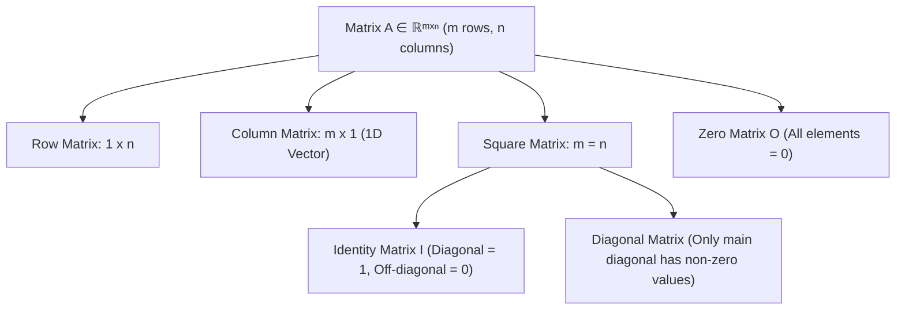

# Lecture 21.12: Matrix Fundamentals

## 📌 Topic Overview
In this lecture, Shraddha ma'am introduces **Matrices**, defining an $m \times n$ array of numbers (with $m$ rows and $n$ columns), illustrating her blackboard note that **"vector = 1D matrix"**, and detailing the taxonomy of special matrices (Row, Column, Square, Identity, and Zero matrices).

---

## 🏛️ Matrix Dimension & Structural Taxonomy



---

## 📐 Mathematical Formalism: Matrix Representation

A matrix $\mathbf{A} \in \mathbb{R}^{m \times n}$ has $m$ rows and $n$ columns:

$$
\mathbf{A} = \begin{bmatrix} a_{11} & a_{12} & \dots & a_{1n} \\ a_{21} & a_{22} & \dots & a_{2n} \\ \vdots & \vdots & \ddots & \vdots \\ a_{m1} & a_{m2} & \dots & a_{mn} \end{bmatrix}
$$

### Special Matrices:
1. **Column Matrix / Vector:**

$$
\mathbf{x} = \begin{bmatrix} x_1 \\ x_2 \\ \vdots \\ x_m \end{bmatrix} \in \mathbb{R}^{m \times 1}
$$

2. **Identity Matrix ($\mathbf{I}$):**
Satisfies $\mathbf{A} \mathbf{I} = \mathbf{I} \mathbf{A} = \mathbf{A}$ (the matrix equivalent of the number 1):

$$
\mathbf{I}_3 = \begin{bmatrix} 1 & 0 & 0 \\ 0 & 1 & 0 \\ 0 & 0 & 1 \end{bmatrix}
$$

---

## 💻 Python Implementation

```python
import numpy as np

def inspect_matrix_taxonomy():
    """
    Demonstrates matrix definitions, dimensions (m x n), and special types:
    - Row Matrix (1 x n)
    - Column Matrix (m x 1) - Note: vector is a 1D matrix!
    - Square Matrix (n x n)
    - Identity Matrix (I)
    - Zero / Null Matrix (O)
    
    Returns:
        dict: Shapes and representations of each special matrix.
    """
    # 1. General Rectangular Matrix (2 x 3)
    A = np.array([
        [1, 2, 3],
        [4, 5, 6]
    ])
    
    # 2. Row Matrix (1 x 3)
    row_mat = np.array([[10, 20, 30]])
    
    # 3. Column Matrix (3 x 1) - Shraddha ma'am note: "vector = 1D matrix"
    col_mat = np.array([[1], [2], [3]])
    
    # 4. Square Matrix (2 x 2)
    square_mat = np.array([[4, 7], [2, 6]])
    
    # 5. Identity Matrix (3 x 3)
    identity_mat = np.eye(3)
    
    # 6. Zero Matrix (2 x 2)
    zero_mat = np.zeros((2, 2))
    
    return {
        "rectangular_A_shape": A.shape,
        "row_matrix_shape": row_mat.shape,
        "column_matrix_shape": col_mat.shape,
        "square_matrix_shape": square_mat.shape,
        "identity_diagonal": list(np.diag(identity_mat)),
        "zero_matrix": zero_mat.tolist()
    }

# --- Execution & Verification ---
res = inspect_matrix_taxonomy()
print("General 2x3 Matrix Shape:", res["rectangular_A_shape"])
print("Row Matrix (1 x 3) Shape :", res["row_matrix_shape"])
print("Column Matrix (3 x 1)    :", res["column_matrix_shape"], "(Vector is a 1D matrix!)")
print("Square Matrix (2 x 2)    :", res["square_matrix_shape"])
print("Identity Matrix Diag     :", res["identity_diagonal"])

```

---

## 🔑 Key Takeaways
1. Dimensions are always specified as **Rows $\times$ Columns** ($m \times n$).
2. A feature vector in machine learning is treated algebraically as an $n \times 1$ column matrix.
3. The Identity matrix $\mathbf{I}$ preserves any vector or matrix upon multiplication: $\mathbf{A}\mathbf{I} = \mathbf{A}$.
