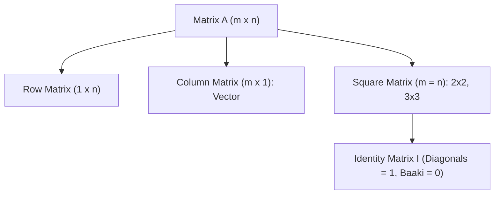

# Notes_21.12: Matrix Ka Parichay [Hinglish]

## 📌 Topic Overview
Is lecture mein Shraddha ma'am ne **Matrix** ka concept samjhaya hai: Matrix rows aur columns ka rectangular array hota hai ($m \times n$), blackboard par likha gaya note — **"vector = 1D matrix"**, aur special matrices (Row, Column, Square, Identity, aur Zero matrix) kya hote hain.

---

### 📋 Is Topic Mein Hum Kya Seekhenge?
- Matrix ki paribhasha aur dimensions: $m \text{ rows} \times n \text{ columns}$.
- Vector असल mein ek 1D Matrix hi hota hai!
- Row Matrix vs Column Matrix.
- Square Matrix aur Identity Matrix ($\mathbf{I}$) ka role.

---

### 🔍 Har Ek Point Ka Simple & Detailed Explanation

#### 1. Matrix Kya Hai?
Numbers ko jab hum rows (horizontal lines) aur columns (vertical lines) mein ek bracket ke andar organize karte hain, toh use **Matrix** kehte hain:

$$
\mathbf{A} = \begin{bmatrix} a_{11} & a_{12} & a_{13} \\ a_{21} & a_{22} & a_{23} \end{bmatrix}_{2 \times 3}
$$

Yahan 2 rows hain aur 3 columns hain ($2 \times 3$).

#### 2. Vector = 1D Matrix:
Blackboard par ma'am ne likha tha: *vector = 1D matrix*.
- Agar matrix mein sirf 1 row ho: $[10, 20, 30]_{1 \times 3} \to$ **Row Matrix**.
- Agar matrix mein sirf 1 column ho: $\begin{bmatrix} 1 \\ 2 \\ 3 \end{bmatrix}_{3 \times 1} \to$ **Column Matrix (Vector)**.

#### 3. Identity Matrix ($\mathbf{I}$):
Jaise aam ganit mein number $1$ hota hai (jisse kisi ko bhi multiply karo wahi rehta hai), waise hi linear algebra mein **Identity Matrix** hoti hai:

$$
\mathbf{I} = \begin{bmatrix} 1 & 0 & 0 \\ 0 & 1 & 0 \\ 0 & 0 & 1 \end{bmatrix}
$$

$$
\mathbf{A} \cdot \mathbf{I} = \mathbf{A}
$$

---

### 📊 Blackboard Diagram: Matrix Types



---

### 💻 Python Code Implementation

```python
import numpy as np

def inspect_matrix_taxonomy():
    """
    Demonstrates matrix definitions, dimensions (m x n), and special types:
    - Row Matrix (1 x n)
    - Column Matrix (m x 1) - Note: vector is a 1D matrix!
    - Square Matrix (n x n)
    - Identity Matrix (I)
    - Zero / Null Matrix (O)
    
    Returns:
        dict: Shapes and representations of each special matrix.
    """
    # 1. General Rectangular Matrix (2 x 3)
    A = np.array([
        [1, 2, 3],
        [4, 5, 6]
    ])
    
    # 2. Row Matrix (1 x 3)
    row_mat = np.array([[10, 20, 30]])
    
    # 3. Column Matrix (3 x 1) - Shraddha ma'am note: "vector = 1D matrix"
    col_mat = np.array([[1], [2], [3]])
    
    # 4. Square Matrix (2 x 2)
    square_mat = np.array([[4, 7], [2, 6]])
    
    # 5. Identity Matrix (3 x 3)
    identity_mat = np.eye(3)
    
    # 6. Zero Matrix (2 x 2)
    zero_mat = np.zeros((2, 2))
    
    return {
        "rectangular_A_shape": A.shape,
        "row_matrix_shape": row_mat.shape,
        "column_matrix_shape": col_mat.shape,
        "square_matrix_shape": square_mat.shape,
        "identity_diagonal": list(np.diag(identity_mat)),
        "zero_matrix": zero_mat.tolist()
    }

# --- Execution & Verification ---
res = inspect_matrix_taxonomy()
print("General 2x3 Matrix Shape:", res["rectangular_A_shape"])
print("Row Matrix (1 x 3) Shape :", res["row_matrix_shape"])
print("Column Matrix (3 x 1)    :", res["column_matrix_shape"], "(Vector is a 1D matrix!)")
print("Square Matrix (2 x 2)    :", res["square_matrix_shape"])
print("Identity Matrix Diag     :", res["identity_diagonal"])

```

---

### 🎯 Key Takeaways:
1. Matrix dimension hamesha **Row $\times$ Column** order mein likha jata hai.
2. Machine learning mein dataset rows (samples) aur columns (features) ki ek badi 2D matrix hoti hai.
