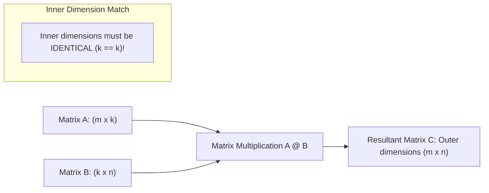

# Lecture 21.13: Operations on Matrices

## 📌 Topic Overview
In this lecture, Shraddha ma'am covers the core **Operations on Matrices**: Addition, Subtraction, Scalar Multiplication, the inner dimension compatibility rule for **Matrix Multiplication** ($(m \times k) \times (k \times n) \to m \times n$), and the **Transpose** operation ($\mathbf{A}^T$).

---

## 🏛️ Matrix Multiplication Compatibility Dimension Rule



---

## 📐 Mathematical Formulation

### 1. Matrix Multiplication (Row-by-Column Dot Product):
For $\mathbf{A} \in \mathbb{R}^{m \times k}$ and $\mathbf{B} \in \mathbb{R}^{k \times n}$, element $c_{ij}$ is the dot product of row $i$ of $\mathbf{A}$ and column $j$ of $\mathbf{B}$:

$$
c_{ij} = \sum_{p=1}^k a_{ip} b_{pj}
$$

Example with $2 \times 2$ matrices:

$$
\begin{bmatrix} 1 & 2 \\ 3 & 4 \end{bmatrix} \begin{bmatrix} 5 & 6 \\ 7 & 8 \end{bmatrix} = \begin{bmatrix} 1(5) + 2(7) & 1(6) + 2(8) \\ 3(5) + 4(7) & 3(6) + 4(8) \end{bmatrix} = \begin{bmatrix} 19 & 22 \\ 43 & 50 \end{bmatrix}
$$

> **Crucial Property:** Matrix multiplication is non-commutative: $\mathbf{A}\mathbf{B} \neq \mathbf{B}\mathbf{A}$ in general!

### 2. Transpose ($\mathbf{A}^T$):
Swaps rows and columns: $(\mathbf{A}^T)_{ij} = \mathbf{A}_{ji}$.
- $(\mathbf{A} + \mathbf{B})^T = \mathbf{A}^T + \mathbf{B}^T$
- $(\mathbf{A}\mathbf{B})^T = \mathbf{B}^T \mathbf{A}^T$ (Order inverts!)

---

## 💻 Python Implementation

```python
import numpy as np

def perform_matrix_operations():
    """
    Demonstrates fundamental matrix operations:
    1. Matrix Addition & Subtraction (dimensions must match identically).
    2. Scalar Multiplication (c * A).
    3. Matrix Multiplication (inner dimensions must match: (m x k) @ (k x n) -> (m x n)).
    4. Transpose (A^T: swapping rows and columns).
    
    Returns:
        dict: Results of matrix operations.
    """
    A = np.array([
        [1, 2],
        [3, 4]
    ])
    
    B = np.array([
        [5, 6],
        [7, 8]
    ])
    
    # 1. Addition & Subtraction
    mat_sum = A + B
    mat_diff = A - B
    
    # 2. Scalar Multiplication
    mat_scaled = 2 * A
    
    # 3. Matrix Multiplication (Row-by-Column Dot Product)
    # [1*5 + 2*7, 1*6 + 2*8; 3*5 + 4*7, 3*6 + 4*8] = [19, 22; 43, 50]
    mat_product = np.matmul(A, B)
    
    # 4. Transpose
    mat_transpose = A.T
    
    return {
        "A": A.tolist(),
        "B": B.tolist(),
        "A_plus_B": mat_sum.tolist(),
        "A_minus_B": mat_diff.tolist(),
        "2_times_A": mat_scaled.tolist(),
        "A_dot_B": mat_product.tolist(),
        "A_transpose": mat_transpose.tolist()
    }

# --- Execution & Verification ---
res = perform_matrix_operations()
print("Matrix A + B:")
print(np.array(res["A_plus_B"]))
print("Matrix Multiplication A @ B:")
print(np.array(res["A_dot_B"]))
print("Matrix Transpose A^T:")
print(np.array(res["A_transpose"]))

```

---

## 🔑 Key Takeaways
1. Addition/Subtraction requires identical dimensions $(m \times n)$.
2. Matrix multiplication requires inner dimensions to match: $\text{Cols}(A) = \text{Rows}(B)$.
3. In Python, use `A @ B` or `np.matmul(A, B)` for true matrix multiplication (`A * B` performs element-wise Hadamard multiplication).
