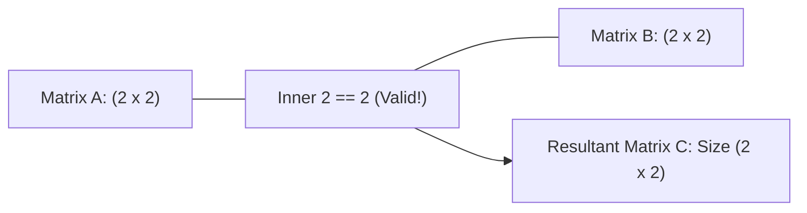

# Notes_21.13: Matrices Par Operations [Hinglish]

## 📌 Topic Overview
Is lecture mein Shraddha ma'am ne **Matrices par mathematical operations** sikhaye hain: Addition, Subtraction, Scalar Multiplication, Matrix Multiplication ki inner-dimension shart ($(m \times k) \times (k \times n) \to m \times n$), aur Transpose ($\mathbf{A}^T$).

---

### 📋 Is Topic Mein Hum Kya Seekhenge?
- Matrix Addition aur Subtraction kab possible hota hai?
- Matrix Multiplication ka golden rule: Row $\times$ Column Dot Product.
- Inner dimension match: Matrix A ke columns = Matrix B ke rows hone chahiye.
- Transpose ($\mathbf{A}^T$): Rows ko columns banana.

---

### 🔍 Har Ek Point Ka Simple & Detailed Explanation

#### 1. Addition & Subtraction:
Do matrices tabhi jud ya ghat sakti hain jab dono ka **Dimension bilkul barabar** ho ($2 \times 2$ judegi $2 \times 2$ se). Element-by-element direct jodte hain.

#### 2. Matrix Multiplication (Sabse Zaroori Rule!):
Agar Matrix A ka size $m \times k$ hai aur Matrix B ka size $k \times n$ hai:
- Beech ke dono numbers barabar hone chahiye ($k = k$).
- Resultant matrix ka size bahar waale numbers honge ($m \times n$).

Calculation (Row by Column):

$$
\begin{bmatrix} 1 & 2 \\ 3 & 4 \end{bmatrix} \begin{bmatrix} 5 & 6 \\ 7 & 8 \end{bmatrix} = \begin{bmatrix} 1(5) + 2(7) & 1(6) + 2(8) \\ 3(5) + 4(7) & 3(6) + 4(8) \end{bmatrix} = \begin{bmatrix} 19 & 22 \\ 43 & 50 \end{bmatrix}
$$

*Dhyan dein:* Matrix multiplication commutative nahi hota: $\mathbf{A} \cdot \mathbf{B} \neq \mathbf{B} \cdot \mathbf{A}$.

#### 3. Transpose ($\mathbf{A}^T$):
Rows ko columns bana dena aur columns ko rows bana dena.
Agar $A = \begin{bmatrix} 1 & 2 \\ 3 & 4 \end{bmatrix}$ hai, toh $A^T = \begin{bmatrix} 1 & 3 \\ 2 & 4 \end{bmatrix}$.

---

### 📊 Blackboard Diagram: Matrix Dimension Matching



---

### 💻 Python Code Implementation

```python
import numpy as np

def perform_matrix_operations():
    """
    Demonstrates fundamental matrix operations:
    1. Matrix Addition & Subtraction (dimensions must match identically).
    2. Scalar Multiplication (c * A).
    3. Matrix Multiplication (inner dimensions must match: (m x k) @ (k x n) -> (m x n)).
    4. Transpose (A^T: swapping rows and columns).
    
    Returns:
        dict: Results of matrix operations.
    """
    A = np.array([
        [1, 2],
        [3, 4]
    ])
    
    B = np.array([
        [5, 6],
        [7, 8]
    ])
    
    # 1. Addition & Subtraction
    mat_sum = A + B
    mat_diff = A - B
    
    # 2. Scalar Multiplication
    mat_scaled = 2 * A
    
    # 3. Matrix Multiplication (Row-by-Column Dot Product)
    # [1*5 + 2*7, 1*6 + 2*8; 3*5 + 4*7, 3*6 + 4*8] = [19, 22; 43, 50]
    mat_product = np.matmul(A, B)
    
    # 4. Transpose
    mat_transpose = A.T
    
    return {
        "A": A.tolist(),
        "B": B.tolist(),
        "A_plus_B": mat_sum.tolist(),
        "A_minus_B": mat_diff.tolist(),
        "2_times_A": mat_scaled.tolist(),
        "A_dot_B": mat_product.tolist(),
        "A_transpose": mat_transpose.tolist()
    }

# --- Execution & Verification ---
res = perform_matrix_operations()
print("Matrix A + B:")
print(np.array(res["A_plus_B"]))
print("Matrix Multiplication A @ B:")
print(np.array(res["A_dot_B"]))
print("Matrix Transpose A^T:")
print(np.array(res["A_transpose"]))

```

---

### 🎯 Key Takeaways:
1. Python mein Matrix multiplication ke liye `A @ B` ya `np.matmul(A, B)` use karte hain.
2. `A * B` sirf element-wise multiply karta hai, matrix multiplication nahi karta.
