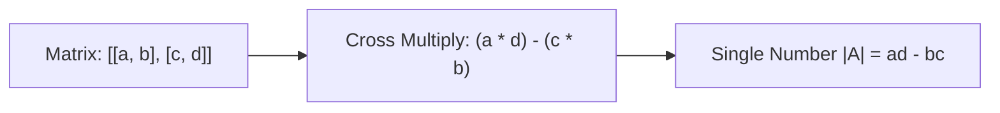

# Notes_21.14: Determinants [Hinglish]

## 📌 Topic Overview
Is lecture mein Shraddha ma'am ne **Determinants** ka concept blackboard par samjhaya hai: Determinant $|A|$ kisi square matrix se nikla hua **ek single number** hota hai, $2 \times 2$ matrix ke liye $|A| = ad - bc$ formula kaise nikalta hai, aur agar $|A| = 0$ ho toh matrix invert kyu nahi ho sakti.

---

### 📋 Is Topic Mein Hum Kya Seekhenge?
- Determinant kya hota hai? (Square matrix se nikla ek single scalar number).
- $2 \times 2$ formula: $|A| = ad - bc$.
- $3 \times 3$ matrix ka cofactor expansion.
- Geometric meaning: Area ya Volume ka scaling factor.
- Machine Learning link: OLS Linear Regression mein $(\mathbf{X}^T \mathbf{X})^{-1}$ nikaalna.

---

### 🔍 Har Ek Point Ka Simple & Detailed Explanation

#### 1. Determinant Kya Hai?
Blackboard par ma'am ne likha:
*A determinant ($|A|$) is a single number calculated from a square matrix.*
Yeh sirf square matrices ($2 \times 2, 3 \times 3$) ke liye calculate hota hai.

#### 2. $2 \times 2$ Matrix Ka Formula:
Agar $A = \begin{bmatrix} a & b \\ c & d \end{bmatrix}$ hai, toh:

$$
|A| = a \cdot d - b \cdot c
$$

Example:
$A = \begin{bmatrix} 4 & 2 \\ 1 & 3 \end{bmatrix}$

$$
|A| = (4 \times 3) - (2 \times 1) = 12 - 2 = 10
$$

#### 3. Invertibility & Linear Regression:
Machine learning mein Linear Regression solve karne ke liye formula lagta hai:

$$
\mathbf{w}^* = (\mathbf{X}^T \mathbf{X})^{-1} \mathbf{X}^T \mathbf{y}
$$

Agar $(\mathbf{X}^T \mathbf{X})$ ka determinant zero ho gaya ($|A| = 0$), toh matrix ka inverse nikal hi nahi sakta! Is condition ko **Singular Matrix** ya **Multicollinearity** kehte hain.

---

### 📊 Blackboard Diagram: 2x2 Determinant Calculation



---

### 💻 Python Code Implementation

```python
import numpy as np

def compute_determinant_with_steps(matrix_2x2=None, matrix_3x3=None):
    """
    Computes determinants of 2x2 and 3x3 square matrices.
    2x2 formula: det(A) = a*d - b*c
    3x3 cofactor expansion across the first row.
    Explains geometric area/volume scaling and matrix invertibility.
    
    Returns:
        dict: Determinant values and invertibility flags.
    """
    if matrix_2x2 is None:
        # Shraddha ma'am's blackboard formula: A = [[a, b], [c, d]] -> ad - bc
        matrix_2x2 = np.array([
            [4, 2],
            [1, 3]
        ])
    if matrix_3x3 is None:
        matrix_3x3 = np.array([
            [1, 2, 3],
            [0, 1, 4],
            [5, 6, 0]
        ])
        
    # 2x2 Determinant
    a, b = matrix_2x2[0, 0], matrix_2x2[0, 1]
    c, d = matrix_2x2[1, 0], matrix_2x2[1, 1]
    det_2x2_formula = float(a * d - b * c)
    det_2x2_numpy = float(np.linalg.det(matrix_2x2))
    
    # 3x3 Determinant via NumPy
    det_3x3_numpy = float(np.linalg.det(matrix_3x3))
    
    return {
        "matrix_2x2": matrix_2x2.tolist(),
        "det_2x2_formula": det_2x2_formula,
        "det_2x2_numpy": det_2x2_numpy,
        "is_2x2_invertible": bool(not np.isclose(det_2x2_numpy, 0.0)),
        "matrix_3x3": matrix_3x3.tolist(),
        "det_3x3_numpy": det_3x3_numpy,
        "is_3x3_invertible": bool(not np.isclose(det_3x3_numpy, 0.0))
    }

# --- Execution & Verification ---
res = compute_determinant_with_steps()
print("2x2 Matrix:")
print(np.array(res["matrix_2x2"]))
print(f"det(A) = ad - bc = 4*3 - 2*1 = 12 - 2 = {res['det_2x2_formula']:.1f}")
print("Is 2x2 Invertible (det != 0)?", res["is_2x2_invertible"])
print(f"3x3 Matrix Determinant: {res['det_3x3_numpy']:.2f}")

```

---

### 🎯 Key Takeaways:
1. Determinant sirf square matrices ka nikalta hai.
2. Agar $|A| = 0$ hai, toh matrix singular hoti hai aur uska inverse $A^{-1}$ exist nahi karta.
