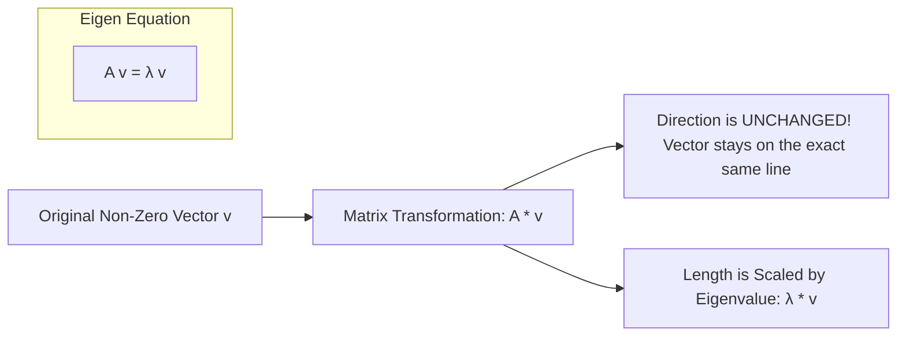

# Lecture 21.15: Eigenvectors & Eigenvalues

## 📌 Topic Overview
In this lecture, Shraddha ma'am covers **Eigenvectors and Eigenvalues**, defining that an eigenvector of a matrix is a non-zero vector that, when transformed by the matrix, does not change its spatial direction but is merely scaled by factor $\lambda$ ($A\mathbf{v} = \lambda \mathbf{v}$). She details the characteristic equation $\det(A - \lambda I) = 0$ and explains its foundational role in Principal Component Analysis (PCA).

---

## 🏛️ Invariant Direction Transformation Geometry



---

## 📐 Mathematical Formulation

### 1. The Fundamental Eigen Equation:

$$
\mathbf{A}\mathbf{v} = \lambda \mathbf{v}
$$

where:
- $\mathbf{A} \in \mathbb{R}^{n \times n}$: Square matrix
- $\mathbf{v} \neq \mathbf{0}$: Eigenvector (invariant direction)
- $\lambda \in \mathbb{R}$: Eigenvalue (scalar scaling factor)

### 2. The Characteristic Equation:
Rearranging the equation:

$$
\mathbf{A}\mathbf{v} - \lambda \mathbf{I}\mathbf{v} = \mathbf{0} \implies (\mathbf{A} - \lambda \mathbf{I})\mathbf{v} = \mathbf{0}
$$

For a non-trivial solution ($\mathbf{v} \neq \mathbf{0}$) to exist, the matrix $(\mathbf{A} - \lambda \mathbf{I})$ must be singular:

$$
\det(\mathbf{A} - \lambda \mathbf{I}) = 0
$$

Solving this polynomial yields the eigenvalues $\lambda_1, \lambda_2, \dots, \lambda_n$.

### Machine Learning Connection: PCA (Principal Component Analysis)
In unsupervised dimensionality reduction:
1. Compute the data covariance matrix $\mathbf{\Sigma} = \frac{1}{n} \mathbf{X}^T \mathbf{X}$.
2. Perform Eigen-decomposition on $\mathbf{\Sigma}$.
3. The **eigenvectors** with the largest **eigenvalues** point along the directions of maximum feature variance (Principal Components)!

---

## 💻 Python Implementation

```python
import numpy as np

def compute_eigen_decomposition(A=None):
    """
    Computes Eigenvalues and Eigenvectors of a square matrix A:
    A * v = lambda * v
    Demonstrates that eigenvector v maintains its direction under transformation A,
    merely getting scaled by eigenvalue lambda.
    
    Parameters:
        A (np.ndarray): Square matrix (2x2).
        
    Returns:
        dict: Eigenvalues, Eigenvectors, and verification of A*v == lambda*v.
    """
    if A is None:
        # Standard symmetric matrix
        A = np.array([
            [4.0, 1.0],
            [1.0, 4.0]
        ])
        
    # Compute eigenvalues and right eigenvectors
    eigenvalues, eigenvectors = np.linalg.eig(A)
    
    # Verification for first eigenpair
    lam0 = eigenvalues[0]
    v0 = eigenvectors[:, 0]
    
    lhs = np.dot(A, v0)
    rhs = lam0 * v0
    
    is_verified = bool(np.allclose(lhs, rhs))
    
    return {
        "matrix_A": A.tolist(),
        "eigenvalues": eigenvalues.tolist(),
        "eigenvector_0": v0.tolist(),
        "eigenvalue_0": float(lam0),
        "is_Av_equal_lambdav": is_verified
    }

# --- Execution & Verification ---
res = compute_eigen_decomposition()
print("Matrix A:")
print(np.array(res["matrix_A"]))
print(f"Eigenvalues (lambda): {[round(x, 4) for x in res['eigenvalues']]}")
print(f"Eigenvector v0      : {[round(x, 4) for x in res['eigenvector_0']]}")
print(f"Verification A*v == lambda*v? {res['is_Av_equal_lambdav']}")

```

---

## 🔑 Key Takeaways
1. Most vectors change direction when multiplied by a matrix; eigenvectors are the rare vectors that only stretch or shrink.
2. The eigenvalue $\lambda$ specifies how much the eigenvector stretches ($\lambda > 1$), shrinks ($0 < \lambda < 1$), or reverses ($\lambda < 0$).
3. Principal Component Analysis (PCA) uses eigenvectors of the covariance matrix to compress high-dimensional data while retaining maximum information.
