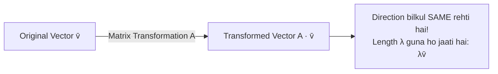

# Notes_21.15: Eigenvectors Aur Eigenvalues [Hinglish]

## 📌 Topic Overview
Is lecture mein Shraddha ma'am ne **Eigenvectors aur Eigenvalues** ka concept blackboard par diagram bana kar samjhaya hai: Eigenvector ek aisa non-zero vector hota hai jo matrix multiplication ke baad apni disha (direction) nahi badalta, bas stretch ya shrink hota hai ($A\mathbf{v} = \lambda \mathbf{v}$), aur PCA dimensionality reduction se iska kya connection hai.

---

### 📋 Is Topic Mein Hum Kya Seekhenge?
- Shraddha ma'am ki blackboard definition: *An eigenvector is a non-zero vector that does not change direction - it only gets scaled.*
- Fundamental formula: $A\mathbf{v} = \lambda \mathbf{v}$.
- Characteristic equation: $\det(A - \lambda I) = 0$.
- Machine Learning link: PCA (Principal Component Analysis) mein covariance matrix ke eigenvectors ka use.

---

### 🔍 Har Ek Point Ka Simple & Detailed Explanation

#### 1. Blackboard Par Ma'am Ka Diagram:
Aam taur par jab aap kisi vector $\mathbf{v}$ ko matrix $A$ se multiply karte hain, toh vector ghum jata hai (uski disha badal jaati hai).
Lekin kuch khaas vectors hote hain jo ghumte nahi hain!
Matrix $A$ se multiply hone ke baad bhi woh **usi straight line par rehte hain**, bas unki lambai badh ya ghat jaati hai:

$$
A\mathbf{v} = \lambda \mathbf{v}
$$

- $A$: Square matrix
- $\mathbf{v}$: Eigenvector (Direction jo badli nahi)
- $\lambda$ (Lambda): Eigenvalue (Kitna guna stretch ya shrink hua)

#### 2. Characteristic Equation:
$\lambda$ nikalne ke liye hum characteristic equation solve karte hain:

$$
\det(A - \lambda I) = 0
$$

#### 3. Machine Learning Mein PCA Se Connection:
Jab hamare paas 100 features waala bada dataset hota hai aur humein use 2 features mein convert karna hota hai (**Dimensionality Reduction**):
1. Hum dataset ki Covariance Matrix banate hain.
2. Us matrix ke Eigenvectors aur Eigenvalues nikalte hain.
3. Jis eigenvector ki eigenvalue sabse badi hoti hai, wahi hamara **First Principal Component (PC1)** hota hai jo data ki sabse zyada information preserve karta hai!

---

### 📊 Blackboard Diagram: Eigenvector Direction Preservation



---

### 💻 Python Code Implementation

```python
import numpy as np

def compute_eigen_decomposition(A=None):
    """
    Computes Eigenvalues and Eigenvectors of a square matrix A:
    A * v = lambda * v
    Demonstrates that eigenvector v maintains its direction under transformation A,
    merely getting scaled by eigenvalue lambda.
    
    Parameters:
        A (np.ndarray): Square matrix (2x2).
        
    Returns:
        dict: Eigenvalues, Eigenvectors, and verification of A*v == lambda*v.
    """
    if A is None:
        # Standard symmetric matrix
        A = np.array([
            [4.0, 1.0],
            [1.0, 4.0]
        ])
        
    # Compute eigenvalues and right eigenvectors
    eigenvalues, eigenvectors = np.linalg.eig(A)
    
    # Verification for first eigenpair
    lam0 = eigenvalues[0]
    v0 = eigenvectors[:, 0]
    
    lhs = np.dot(A, v0)
    rhs = lam0 * v0
    
    is_verified = bool(np.allclose(lhs, rhs))
    
    return {
        "matrix_A": A.tolist(),
        "eigenvalues": eigenvalues.tolist(),
        "eigenvector_0": v0.tolist(),
        "eigenvalue_0": float(lam0),
        "is_Av_equal_lambdav": is_verified
    }

# --- Execution & Verification ---
res = compute_eigen_decomposition()
print("Matrix A:")
print(np.array(res["matrix_A"]))
print(f"Eigenvalues (lambda): {[round(x, 4) for x in res['eigenvalues']]}")
print(f"Eigenvector v0      : {[round(x, 4) for x in res['eigenvector_0']]}")
print(f"Verification A*v == lambda*v? {res['is_Av_equal_lambdav']}")

```

---

### 🎯 Key Takeaways:
1. $A\mathbf{v} = \lambda \mathbf{v}$ Linear Algebra ki sabse famous equation hai.
2. PCA algorithm dataset ke covariance matrix ke eigenvectors nikaal kar hi dimensionality reduce karta hai.
