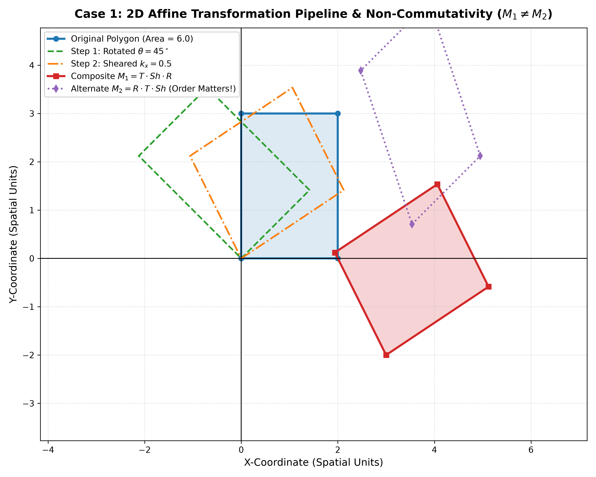
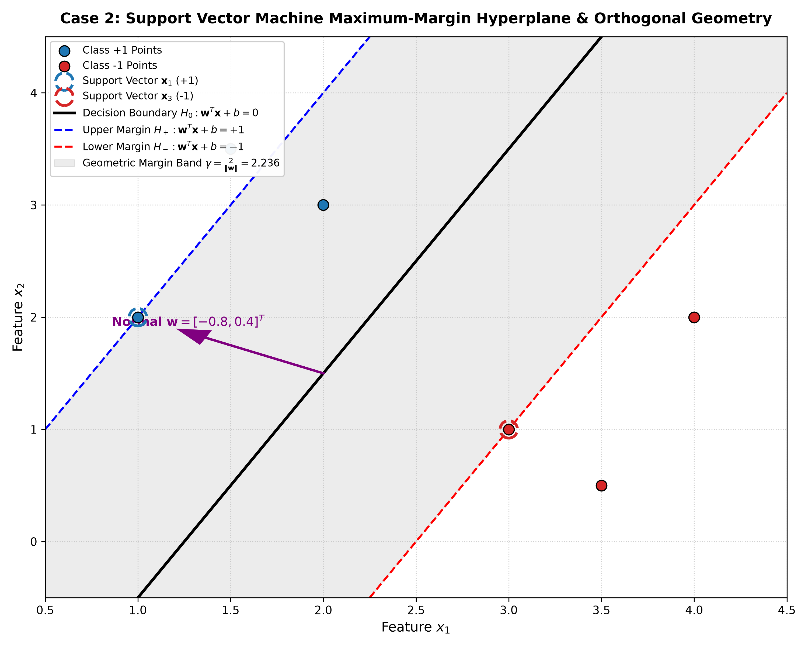
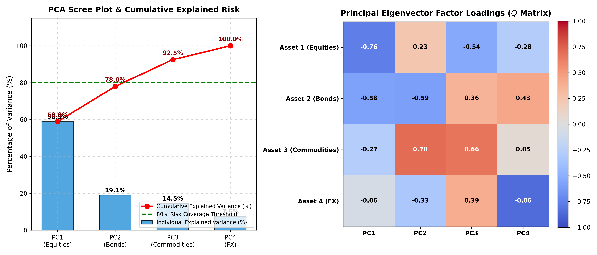

# 💡 Lecture 21: Practice Problems — Comprehensive Solutions Guide [Hinglish]

[](solutions.ipynb)
[](solutions.pdf)
[](../Questions/README_HINGLISH.md)
[](case1_affine_transformation_grid.png)
[](case2_svm_maximum_margin.png)
[](case3_pca_covariance_eigenvectors.png)

🌐 **Language / भाषा:** [English](README.md) | **हिंदी / Hinglish** | [⬅️ Questions Par Wapas Jayein](../Questions/README_HINGLISH.md) | [📁 Overview](../README_HINGLISH.md)

---

## 📌 Executive Architecture & Solution Blueprint

Is document mein **Lecture 21** ke teeno industry case studies ke liye complete, step-by-step mathematical proofs, exact numerical calculations, pure Hinglish conceptual explanations, aur production-grade Python code diya gaya hai.

Har case study ko first-principles mathematics ke sath solve kiya gaya hai taaki har ek formula ka origin, uske peeche ka physical intuition, aur practical implementation aapko crystal clear samajh aaye.

---

# 📌 Solution to Case 1: Computer Vision 2D Affine Transformations & Homogeneous Coordinates

### 🎯 Is Case Study Mein Pucha Kya Gaya Tha? (Quick Recap)
Hume ek autonomous robot camera se mile 2D rectangle polygon $V$ ko transform karna tha:
- Origin ke around $\theta = 45^\circ = \frac{\pi}{4}$ counter-clockwise rotation.
- Horizontal shear $k_x = 0.5$.
- Translation offset $\mathbf{t} = [3, -2]^T$.

Polygon ke initial vertices homogeneous coordinates mein yeh hain:

$$
V = \begin{bmatrix} 0 & 2 & 2 & 0 \\ 0 & 0 & 3 & 3 \\ 1 & 1 & 1 & 1 \end{bmatrix}
$$

---

### 1. Step-by-Step Mathematical Derivations & Calculations

#### 🔹 Task 1: Elementary Homogeneous Matrices Construct Karna

##### (A) Rotation Matrix $R(\theta)$
Jab hum kisi 2D coordinate $(x, y)$ ko origin ke around angle $\theta$ se counter-clockwise rotate karte hain, toh naye coordinates trigonometry se nikalte hain:

$$
x' = x\cos\theta - y\sin\theta, \quad y' = x\sin\theta + y\cos\theta
$$

Homogeneous coordinates $\tilde{\mathbf{x}} = [x, y, 1]^T$ mein iska $3 \times 3$ matrix banta hai:

$$
R(\theta) = \begin{bmatrix} \cos\theta & -\sin\theta & 0 \\ \sin\theta & \cos\theta & 0 \\ 0 & 0 & 1 \end{bmatrix}
$$

Yahan $\theta = 45^\circ = \frac{\pi}{4}$, jahan $\cos\left(\frac{\pi}{4}\right) = \sin\left(\frac{\pi}{4}\right) = \frac{\sqrt{2}}{2} \approx 0.707107$:

$$
R\left(\frac{\pi}{4}\right) = \begin{bmatrix} \frac{\sqrt{2}}{2} & -\frac{\sqrt{2}}{2} & 0 \\ \frac{\sqrt{2}}{2} & \frac{\sqrt{2}}{2} & 0 \\ 0 & 0 & 1 \end{bmatrix} \approx \begin{bmatrix} 0.7071 & -0.7071 & 0 \\ 0.7071 & 0.7071 & 0 \\ 0 & 0 & 1 \end{bmatrix}
$$

##### (B) Horizontal Shear Matrix $Sh(k_x)$
Horizontal shear ka matlab hai ki $x$-coordinate $y$-coordinate ke proportional shift hota hai ($x' = x + k_x y$), jabki $y$-coordinate unchanged rehta hai ($y' = y$). Iska homogeneous matrix:

$$
Sh(k_x) = \begin{bmatrix} 1 & k_x & 0 \\ 0 & 1 & 0 \\ 0 & 0 & 1 \end{bmatrix}
$$

Shear factor $k_x = 0.5$ substitute karne par:

$$
Sh(0.5) = \begin{bmatrix} 1 & 0.5 & 0 \\ 0 & 1 & 0 \\ 0 & 0 & 1 \end{bmatrix}
$$

##### (C) Translation Matrix $T(t_x, t_y)$
Translation mein coordinates directly add hote hain: $x' = x + t_x$ aur $y' = y + t_y$. Standard $2 \times 2$ matrix addition nahi kar sakta, lekin homogeneous coordinates mein 3rd row aur 3rd column ki madad se yeh linear multiplication ban jaata hai:

$$
T(t_x, t_y) = \begin{bmatrix} 1 & 0 & t_x \\ 0 & 1 & t_y \\ 0 & 0 & 1 \end{bmatrix}
$$

Yahan $t_x = 3.0$ aur $t_y = -2.0$ substitute karne par:

$$
T(3, -2) = \begin{bmatrix} 1 & 0 & 3 \\ 0 & 1 & -2 \\ 0 & 0 & 1 \end{bmatrix}
$$

---

#### 🔹 Task 2: Matrix Composition & Non-Commutativity Proof

##### Step 1: Standard Pipeline Matrix $M_1 = T \cdot Sh \cdot R$ Calculate Karna
Transformation order: Pehle Rotation, fir Shear, fir Translation.
Pehle hum $Sh \cdot R$ calculate karte hain:

$$
Sh \cdot R = \begin{bmatrix} 1 & 0.5 & 0 \\ 0 & 1 & 0 \\ 0 & 0 & 1 \end{bmatrix} \begin{bmatrix} \frac{\sqrt{2}}{2} & -\frac{\sqrt{2}}{2} & 0 \\ \frac{\sqrt{2}}{2} & \frac{\sqrt{2}}{2} & 0 \\ 0 & 0 & 1 \end{bmatrix}
$$

Row-by-column multiplication:
- Row 1: $\left[1\cdot\frac{\sqrt{2}}{2} + 0.5\cdot\frac{\sqrt{2}}{2}, \; 1\cdot\left(-\frac{\sqrt{2}}{2}\right) + 0.5\cdot\frac{\sqrt{2}}{2}, \; 0\right] = \left[\frac{3\sqrt{2}}{4}, \; -\frac{\sqrt{2}}{4}, \; 0\right]$
- Row 2: $\left[0\cdot\frac{\sqrt{2}}{2} + 1\cdot\frac{\sqrt{2}}{2}, \; 0\cdot\left(-\frac{\sqrt{2}}{2}\right) + 1\cdot\frac{\sqrt{2}}{2}, \; 0\right] = \left[\frac{\sqrt{2}}{2}, \; \frac{\sqrt{2}}{2}, \; 0\right]$
- Row 3: $[0, \; 0, \; 1]$

Ab is product ko left se $T$ se multiply karte hain:

$$
M_1 = T \cdot (Sh \cdot R) = \begin{bmatrix} 1 & 0 & 3 \\ 0 & 1 & -2 \\ 0 & 0 & 1 \end{bmatrix} \begin{bmatrix} \frac{3\sqrt{2}}{4} & -\frac{\sqrt{2}}{4} & 0 \\ \frac{\sqrt{2}}{2} & \frac{\sqrt{2}}{2} & 0 \\ 0 & 0 & 1 \end{bmatrix} = \begin{bmatrix} \frac{3\sqrt{2}}{4} & -\frac{\sqrt{2}}{4} & 3 \\ \frac{\sqrt{2}}{2} & \frac{\sqrt{2}}{2} & -2 \\ 0 & 0 & 1 \end{bmatrix}
$$

Decimal approximations:

$$
M_1 \approx \begin{bmatrix} 1.0607 & -0.3536 & 3.0 \\ 0.7071 & 0.7071 & -2.0 \\ 0 & 0 & 1.0 \end{bmatrix}
$$

##### Step 2: Alternate Pipeline Matrix $M_2 = R \cdot T \cdot Sh$ Calculate Karna
Yahan hum order badal rahe hain: Pehle Shear, fir Translation, aur sabse aakhiri mein Rotation.
Pehle $T \cdot Sh$ calculate karte hain:

$$
T \cdot Sh = \begin{bmatrix} 1 & 0 & 3 \\ 0 & 1 & -2 \\ 0 & 0 & 1 \end{bmatrix} \begin{bmatrix} 1 & 0.5 & 0 \\ 0 & 1 & 0 \\ 0 & 0 & 1 \end{bmatrix} = \begin{bmatrix} 1 & 0.5 & 3 \\ 0 & 1 & -2 \\ 0 & 0 & 1 \end{bmatrix}
$$

Ab isko left se $R$ se multiply karte hain:

$$
M_2 = R \cdot (T \cdot Sh) = \begin{bmatrix} \frac{\sqrt{2}}{2} & -\frac{\sqrt{2}}{2} & 0 \\ \frac{\sqrt{2}}{2} & \frac{\sqrt{2}}{2} & 0 \\ 0 & 0 & 1 \end{bmatrix} \begin{bmatrix} 1 & 0.5 & 3 \\ 0 & 1 & -2 \\ 0 & 0 & 1 \end{bmatrix}
$$

Row-by-column multiplication:
- Row 1: $\left[\frac{\sqrt{2}}{2}, \; \frac{\sqrt{2}}{4} - \frac{\sqrt{2}}{2}, \; 3\frac{\sqrt{2}}{2} - (-2)\frac{\sqrt{2}}{2}\right] = \left[\frac{\sqrt{2}}{2}, \; -\frac{\sqrt{2}}{4}, \; \frac{5\sqrt{2}}{2}\right] \approx [0.7071, -0.3536, 3.5355]$
- Row 2: $\left[\frac{\sqrt{2}}{2}, \; \frac{\sqrt{2}}{4} + \frac{\sqrt{2}}{2}, \; 3\frac{\sqrt{2}}{2} + (-2)\frac{\sqrt{2}}{2}\right] = \left[\frac{\sqrt{2}}{2}, \; \frac{3\sqrt{2}}{4}, \; \frac{\sqrt{2}}{2}\right] \approx [0.7071, 1.0607, 0.7071]$
- Row 3: $[0, 0, 1]$

$$
M_2 \approx \begin{bmatrix} 0.7071 & -0.3536 & 3.5355 \\ 0.7071 & 1.0607 & 0.7071 \\ 0 & 0 & 1.0 \end{bmatrix}
$$

##### Step 3: Non-Commutativity Proof & Intuition ($M_1 \ne M_2$)
Clearly:

$$
M_1 = \begin{bmatrix} 1.0607 & -0.3536 & 3.0 \\ 0.7071 & 0.7071 & -2.0 \\ 0 & 0 & 1.0 \end{bmatrix} \ne M_2 = \begin{bmatrix} 0.7071 & -0.3536 & 3.5355 \\ 0.7071 & 1.0607 & 0.7071 \\ 0 & 0 & 1.0 \end{bmatrix}
$$

**Physical Meaning (Kyu Aisa Hua?):**
$M_1$ mein translation sabse last mein apply hua, isliye object pure rotation aur shear ke baad exactly $[3, -2]^T$ shift hua.
Lekin $M_2$ mein translation rotation se pehle execute ho gaya! Jab translation ke baad rotation $R$ lagaya gaya, toh translation vector $[3, -2]^T$ khud bhi $45^\circ$ rotate ho kar $[3.5355, 0.7071]^T$ ban gaya!
Isliye computer vision aur robotics pipelines mein transformations ka order change karne se objects galat positions par land karte hain.

##### Step 4: Transformed Vertices Calculate Karna ($V' = M_1 V$)
Original vertices matrix $V$ ko $M_1$ se multiply karte hain:

$$
V' = M_1 V = \begin{bmatrix} 1.06066 & -0.35355 & 3.0 \\ 0.70711 & 0.70711 & -2.0 \\ 0 & 0 & 1.0 \end{bmatrix} \begin{bmatrix} 0 & 2 & 2 & 0 \\ 0 & 0 & 3 & 3 \\ 1 & 1 & 1 & 1 \end{bmatrix}
$$

Har vertex ka exact coordinate trace:
1. **Vertex 1: $(0, 0)$**
   $$
   \mathbf{v}'_1 = \begin{bmatrix} 1.06066(0) - 0.35355(0) + 3.0 \\ 0.70711(0) + 0.70711(0) - 2.0 \\ 1 \end{bmatrix} = \begin{bmatrix} 3.0000 \\ -2.0000 \\ 1 \end{bmatrix}
   $$
2. **Vertex 2: $(2, 0)$**
   $$
   \mathbf{v}'_2 = \begin{bmatrix} 1.06066(2) - 0.35355(0) + 3.0 \\ 0.70711(2) + 0.70711(0) - 2.0 \\ 1 \end{bmatrix} = \begin{bmatrix} 5.1213 \\ -0.5858 \\ 1 \end{bmatrix}
   $$
3. **Vertex 3: $(2, 3)$**
   $$
   \mathbf{v}'_3 = \begin{bmatrix} 1.06066(2) - 0.35355(3) + 3.0 \\ 0.70711(2) + 0.70711(3) - 2.0 \\ 1 \end{bmatrix} = \begin{bmatrix} 2.12132 - 1.06066 + 3.0 \\ 1.41421 + 2.12132 - 2.0 \\ 1 \end{bmatrix} = \begin{bmatrix} 4.0607 \\ 1.5355 \\ 1 \end{bmatrix}
   $$
4. **Vertex 4: $(0, 3)$**
   $$
   \mathbf{v}'_4 = \begin{bmatrix} 1.06066(0) - 0.35355(3) + 3.0 \\ 0.70711(0) + 0.70711(3) - 2.0 \\ 1 \end{bmatrix} = \begin{bmatrix} -1.06066 + 3.0 \\ 2.12132 - 2.0 \\ 1 \end{bmatrix} = \begin{bmatrix} 1.9393 \\ 0.1213 \\ 1 \end{bmatrix}
   $$

---

#### 🔹 Task 3: Determinant & Area Scaling Factor

Kisi bhi affine transformation matrix $M$ ka structure block form mein hota hai:

$$
M = \begin{bmatrix} A & \mathbf{t} \\ \mathbf{0}^T & 1 \end{bmatrix}
$$

Block determinant formula ke mutabiq:

$$
\det(M) = \det(A) \cdot \det(1) - \mathbf{0}^T = \det(A)
$$

Yahan $M_1$ ka linear transformation block $A = Sh \cdot R$ hai:

$$
A = \begin{bmatrix} \frac{3\sqrt{2}}{4} & -\frac{\sqrt{2}}{4} \\ \frac{\sqrt{2}}{2} & \frac{\sqrt{2}}{2} \end{bmatrix}
$$

Determinant evaluate karte hain:

$$
\det(A) = \left(\frac{3\sqrt{2}}{4}\right)\left(\frac{\sqrt{2}}{2}\right) - \left(-\frac{\sqrt{2}}{4}\right)\left(\frac{\sqrt{2}}{2}\right)
$$

$$
\det(A) = \frac{3 \cdot 2}{8} - \left(-\frac{2}{8}\right) = \frac{6}{8} + \frac{2}{8} = \frac{8}{8} = 1.0000
$$

##### Area Scaling Factor:
$$
\text{Area Scaling Factor} = |\det(A)| = 1.0
$$

Iska matlab yeh hai ki:
- Rotation pure rigid transformation hai: $\det(R) = \cos^2\theta + \sin^2\theta = 1$.
- Horizontal shear base aur height ko alter nahi karta (Cavalieri's principle): $\det(Sh) = 1 \cdot 1 - k_x \cdot 0 = 1$.
- Translation sirf coordinate shift karta hai, volume/area expand ya contract nahi karta: $\det(T) = 1$.

Original polygon ka area $= 2 \times 3 = 6.0$ square units tha. Transformed polygon ka area bhi exactly **$6.0$ square units** rehta hai!

---

#### 🔹 Task 4: Backward Warping & Inverse Matrix $M_1^{-1}$

##### Forward Warping Ka Problem (Holes / Gaps):
Digital images discrete pixels (integer grids $(x, y) \in \mathbb{Z}^2$) se bani hoti hain. Jab hum forward warping $\mathbf{x}_{\text{dst}} = M_1 \mathbf{x}_{\text{src}}$ karte hain:
1. Source pixels transform ho kar floating-point coordinates par land karte hain (jaise $(5.1213, -0.5858)$).
2. Jab unhe nearest integer pixel par round kiya jata hai, toh kuch destination pixels par ek se zyada source pixels map ho jaate hain (aliasing collision), jabki kayi destination pixels par koi bhi source pixel map nahi hota (khali holes ya moiré artifacts ban jaate hain).

##### Backward Warping Solution:
Backward warping destination image ke har discrete pixel coordinate $(x_{\text{dst}}, y_{\text{dst}})$ par loop run karta hai aur inverse matrix se source coordinate find karta hai:

$$
\tilde{\mathbf{x}}_{\text{src}} = M_1^{-1} \tilde{\mathbf{x}}_{\text{dst}}
$$

Is continuous source coordinate par bilinear interpolation apply karke pixel value compute kar li jaati hai. Isse destination image mein ek bhi hole nahi banta!

##### Analytical Inverse Matrix $M_1^{-1}$ Derivation:
Matrix inverse property ke according $(A B C)^{-1} = C^{-1} B^{-1} A^{-1}$:

$$
M_1^{-1} = (T \cdot Sh \cdot R)^{-1} = R^{-1} \cdot Sh^{-1} \cdot T^{-1}
$$

Elementary inverses:
- $R^{-1}(\theta) = R(-\theta) = R^T$:
  $$
  R^{-1} = \begin{bmatrix} \frac{\sqrt{2}}{2} & \frac{\sqrt{2}}{2} & 0 \\ -\frac{\sqrt{2}}{2} & \frac{\sqrt{2}}{2} & 0 \\ 0 & 0 & 1 \end{bmatrix}
  $$
- $Sh^{-1}(k_x) = Sh(-k_x)$:
  $$
  Sh^{-1} = \begin{bmatrix} 1 & -0.5 & 0 \\ 0 & 1 & 0 \\ 0 & 0 & 1 \end{bmatrix}
  $$
- $T^{-1}(\mathbf{t}) = T(-\mathbf{t})$:
  $$
  T^{-1} = \begin{bmatrix} 1 & 0 & -3 \\ 0 & 1 & 2 \\ 0 & 0 & 1 \end{bmatrix}
  $$

Multiplication karne par explicit inverse matrix:

$$
M_1^{-1} = \begin{bmatrix} \frac{\sqrt{2}}{2} & \frac{\sqrt{2}}{4} & -\sqrt{2} \\ -\frac{\sqrt{2}}{2} & \frac{3\sqrt{2}}{4} & 3\sqrt{2} \\ 0 & 0 & 1 \end{bmatrix} \approx \begin{bmatrix} 0.7071 & 0.3536 & -1.4142 \\ -0.7071 & 1.0607 & 4.2426 \\ 0 & 0 & 1.0 \end{bmatrix}
$$

Identity Verification: $M_1 \cdot M_1^{-1} = I_{3 \times 3}$.

---

### 2. Visual Analysis & Python Implementation

Niche diye gaye plot mein transformation pipeline ka har stage visual grid par dikhaya gaya hai:



```python
import numpy as np
import matplotlib.pyplot as plt

# 1. Define original rectangle polygon in homogeneous coordinates
# Vertices: (0,0), (2,0), (2,3), (0,3)
V = np.array([
    [0.0, 2.0, 2.0, 0.0],
    [0.0, 0.0, 3.0, 3.0],
    [1.0, 1.0, 1.0, 1.0]
])

# 2. Elementary Transformation Matrices
theta = np.pi / 4
kx = 0.5
tx, ty = 3.0, -2.0

R = np.array([
    [np.cos(theta), -np.sin(theta), 0.0],
    [np.sin(theta),  np.cos(theta), 0.0],
    [0.0,            0.0,           1.0]
])

Sh = np.array([
    [1.0, kx,  0.0],
    [0.0, 1.0, 0.0],
    [0.0, 0.0, 1.0]
])

T = np.array([
    [1.0, 0.0, tx],
    [0.0, 1.0, ty],
    [0.0, 0.0, 1.0]
])

# 3. Composite Forward & Inverse Matrices
M1 = T @ Sh @ R
M2 = R @ T @ Sh
M1_inv = np.linalg.inv(M1)

# 4. Transform Vertices
V_transformed = M1 @ V

print("--- Case 1 Numerical Results ---")
print("Composite Matrix M1:\n", np.round(M1, 4))
print("\nAlternate Matrix M2:\n", np.round(M2, 4))
print("\nIs M1 equal to M2? :", np.allclose(M1, M2))
print("Area Scaling Factor (|det(A)|):", np.round(np.linalg.det(M1[:2, :2]), 4))
print("\nTransformed Vertices (X, Y):\n", np.round(V_transformed[:2, :], 4))
print("\nInverse Matrix M1_inv:\n", np.round(M1_inv, 4))
```

---

# 📌 Solution to Case 2: Support Vector Machine (SVM) Maximum-Margin Hyperplane & Vector Projections

### 🎯 Is Case Study Mein Pucha Kya Gaya Tha? (Quick Recap)
Hume 2D dataset diya gaya tha:
- Class $+1$: $\mathbf{x}_1 = [1, 2]^T$, $\mathbf{x}_2 = [1, 3]^T$
- Class $-1$: $\mathbf{x}_3 = [3, 1]^T$, $\mathbf{x}_4 = [4, 2]^T$

Hume first principles se prove karna tha:
1. Weight vector $\mathbf{w}$ decision boundary ke perpendicular hota hai.
2. Point-to-hyperplane distance formula $d(\mathbf{x}_0, H) = \frac{\mathbf{w}^T \mathbf{x}_0 + b}{\|\mathbf{w}\|_2}$.
3. Total margin width $\gamma = \frac{2}{\|\mathbf{w}\|_2}$.
4. Support vectors $\mathbf{x}_1$ aur $\mathbf{x}_3$ se optimal parameters $\mathbf{w}^*, b^*, \gamma$ analytically calculate karna.

---

### 1. Step-by-Step Mathematical Derivations & Calculations

#### 🔹 Task 1: Normal Vector Orthogonality Proof

Separating hyperplane ki definition:

$$
H = \{\mathbf{x} \in \mathbb{R}^n \mid \mathbf{w}^T \mathbf{x} + b = 0\}
$$

Maan lijiye $\mathbf{x}_a$ aur $\mathbf{x}_b$ do alag-alag points hain jo is hyperplane $H$ ke upar lie karte hain.
Kyunki dono points hyperplane par hain, isliye dono hyperplane ki equation ko satisfy karenge:

$$
\mathbf{w}^T \mathbf{x}_a + b = 0 \quad \text{--- (Equation 1)}
$$

$$
\mathbf{w}^T \mathbf{x}_b + b = 0 \quad \text{--- (Equation 2)}
$$

Ab Equation 1 mein se Equation 2 ko subtract karte hain:

$$
(\mathbf{w}^T \mathbf{x}_a + b) - (\mathbf{w}^T \mathbf{x}_b + b) = 0 - 0
$$

$$
\mathbf{w}^T (\mathbf{x}_a - \mathbf{x}_b) = 0
$$

**Mathematical Consequence:**
Vector $\mathbf{v} = (\mathbf{x}_a - \mathbf{x}_b)$ hyperplane ke surface par lie karne wala ek arbitrary displacement vector hai.
Linear algebra mein do vectors ka dot product zero tabhi hota hai jab unke beech ka angle $90^\circ$ ho ($\cos 90^\circ = 0$).
Kyunki $\mathbf{w}^T \mathbf{v} = 0$ hyperplane par lie karne wale *har* vector $\mathbf{v}$ ke liye sach hai, isliye weight vector $\mathbf{w}$ hyperplane $H$ ke strictly **perpendicular (orthogonal normal)** hota hai. $\quad \blacksquare$

---

#### 🔹 Task 2: Orthogonal Point-to-Hyperplane Distance Formula Derivation

Maan lijiye $\mathbf{x}_0$ feature space ka koi bhi point hai. Hume $\mathbf{x}_0$ se hyperplane $H$ tak ka shortest perpendicular distance $d(\mathbf{x}_0, H)$ nikaalna hai.

Maan lijiye $\mathbf{x}_p$ hyperplane $H$ par $\mathbf{x}_0$ ka orthogonal projection point hai.
Iska matlab displacement vector $(\mathbf{x}_0 - \mathbf{x}_p)$ strictly normal vector $\mathbf{w}$ ke parallel hoga:

$$
\mathbf{x}_0 - \mathbf{x}_p = d \cdot \hat{\mathbf{w}}
$$

Jahan $\hat{\mathbf{w}}$ normal vector ki direction mein unit vector hai:

$$
\hat{\mathbf{w}} = \frac{\mathbf{w}}{\|\mathbf{w}\|_2}
$$

Dono taraf unit vector $\hat{\mathbf{w}}$ se dot product (projection) lete hain:

$$
\hat{\mathbf{w}}^T (\mathbf{x}_0 - \mathbf{x}_p) = d \cdot (\hat{\mathbf{w}}^T \hat{\mathbf{w}}) = d \cdot 1 = d
$$

$$
d = \frac{\mathbf{w}^T}{\|\mathbf{w}\|_2} (\mathbf{x}_0 - \mathbf{x}_p) = \frac{\mathbf{w}^T \mathbf{x}_0 - \mathbf{w}^T \mathbf{x}_p}{\|\mathbf{w}\|_2}
$$

Kyunki projection point $\mathbf{x}_p$ hyperplane par lie karta hai, isliye:

$$
\mathbf{w}^T \mathbf{x}_p + b = 0 \implies \mathbf{w}^T \mathbf{x}_p = -b
$$

Is value ko numerator mein substitute karte hain:

$$
d(\mathbf{x}_0, H) = \frac{\mathbf{w}^T \mathbf{x}_0 - (-b)}{\|\mathbf{w}\|_2} = \frac{\mathbf{w}^T \mathbf{x}_0 + b}{\|\mathbf{w}\|_2} \quad \blacksquare
$$

---

#### 🔹 Task 3: Geometric Margin Formula $\gamma = \frac{2}{\|\mathbf{w}\|_2}$ Derivation

SVM mein canonical scaling ke tahat, support vectors decision boundary ke dono taraf supporting hyperplanes par lie karte hain:
- Positive Supporting Hyperplane $H_+$: $\mathbf{w}^T \mathbf{x} + b = +1$
- Negative Supporting Hyperplane $H_-$: $\mathbf{w}^T \mathbf{x} + b = -1$

Origin se hyperplane $H_+$ ka perpendicular signed distance:

$$
d(O, H_+) = \frac{1 - b}{\|\mathbf{w}\|_2}
$$

Origin se hyperplane $H_-$ ka perpendicular signed distance:

$$
d(O, H_-) = \frac{-1 - b}{\|\mathbf{w}\|_2}
$$

Dono parallel supporting hyperplanes ke beech ka total geometric margin $\gamma$ unke perpendicular distances ka difference hota hai:

$$
\gamma = d(O, H_+) - d(O, H_-) = \frac{(1 - b) - (-1 - b)}{\|\mathbf{w}\|_2} = \frac{1 - b + 1 + b}{\|\mathbf{w}\|_2} = \frac{2}{\|\mathbf{w}\|_2} \quad \blacksquare
$$

##### Optimization Insight:
Margin $\gamma = \frac{2}{\|\mathbf{w}\|_2}$ ko maximize karna strictly denominator $\|\mathbf{w}\|_2$ ko minimize karne ke barabar hai:

$$
\max \gamma \iff \min \frac{1}{2} \|\mathbf{w}\|_2^2
$$

Yeh SVM ke classic convex quadratic programming formulation ka origin hai.

---

#### 🔹 Task 4: Analytical Parameter Determination ($\mathbf{w}^*, b^*, \gamma$)

Given active support vectors:
- Class $+1$ support vector: $\mathbf{x}_1 = [1, 2]^T$
- Class $-1$ support vector: $\mathbf{x}_3 = [3, 1]^T$

Support vectors canonical equations ko exactly satisfy karte hain:

$$
\mathbf{w}^T \mathbf{x}_1 + b = +1 \implies w_1(1) + w_2(2) + b = +1 \implies w_1 + 2w_2 + b = 1 \quad \text{--- (1)}
$$

$$
\mathbf{w}^T \mathbf{x}_3 + b = -1 \implies w_1(3) + w_2(1) + b = -1 \implies 3w_1 + w_2 + b = -1 \quad \text{--- (2)}
$$

Equation (1) mein se Equation (2) subtract karte hain:

$$
(w_1 + 2w_2 + b) - (3w_1 + w_2 + b) = 1 - (-1)
$$

$$
-2w_1 + w_2 = 2 \implies w_2 = 2w_1 + 2 \quad \text{--- (3)}
$$

Geometrically, optimal weight vector $\mathbf{w}$ ka direction positive support vector se negative support vector ko connect karne wale vector $(\mathbf{x}_1 - \mathbf{x}_3)$ ke strictly parallel hota hai:

$$
\mathbf{x}_1 - \mathbf{x}_3 = \begin{bmatrix} 1 - 3 \\ 2 - 1 \end{bmatrix} = \begin{bmatrix} -2 \\ 1 \end{bmatrix}
$$

Isliye hum likh sakte hain:

$$
\mathbf{w} = c \begin{bmatrix} -2 \\ 1 \end{bmatrix} \implies w_1 = -2c, \quad w_2 = c
$$

Ab $w_1$ aur $w_2$ ko Equation (3) mein substitute karte hain:

$$
c = 2(-2c) + 2 \implies c = -4c + 2 \implies 5c = 2 \implies c = \frac{2}{5} = 0.4
$$

Isliye optimal weight vector:

$$
w_1^* = -2(0.4) = -0.8, \quad w_2^* = 0.4
$$

$$
\mathbf{w}^* = \begin{bmatrix} -0.8 \\ 0.4 \end{bmatrix}
$$

Ab Equation (1) se optimal bias $b^*$ solve karte hain:

$$
w_1 + 2w_2 + b = 1 \implies -0.8 + 2(0.4) + b = 1 \implies -0.8 + 0.8 + b = 1 \implies b^* = 1.0000
$$

##### Norm & Geometric Margin Calculation:
$$
\|\mathbf{w}^*\|_2 = \sqrt{(-0.8)^2 + (0.4)^2} = \sqrt{0.64 + 0.16} = \sqrt{0.80} = \frac{2}{\sqrt{5}} \approx 0.894427
$$

Total geometric margin $\gamma$:

$$
\gamma = \frac{2}{\|\mathbf{w}^*\|_2} = \frac{2}{\sqrt{0.80}} = \frac{2}{2/\sqrt{5}} = \sqrt{5} \approx 2.236068
$$

---

#### 🔹 Task 5: Decision Boundary Equation & Constraint Verification

##### Decision Boundary Equation:
Hyperplane $\mathbf{w}^T \mathbf{x} + b = 0$:

$$
-0.8 x_1 + 0.4 x_2 + 1.0 = 0
$$

Dono taraf $0.4$ se divide karne par:

$$
-2 x_1 + x_2 + 2.5 = 0 \implies x_2 = 2 x_1 - 2.5
$$

##### Constraint Verification Across All 4 Data Points:
Har training point ke liye canonical margin condition $y_i(\mathbf{w}^T \mathbf{x}_i + b) \ge 1$ check karte hain:

1. $\mathbf{x}_1 = [1, 2]^T, y_1 = +1$:
   $$
   y_1(\mathbf{w}^T \mathbf{x}_1 + b) = 1 \cdot (-0.8(1) + 0.4(2) + 1.0) = 1 \cdot 1.0 = 1.00 \quad \text{(Active Support Vector, Exactly on Margin)}
   $$
2. $\mathbf{x}_2 = [1, 3]^T, y_2 = +1$:
   $$
   y_2(\mathbf{w}^T \mathbf{x}_2 + b) = 1 \cdot (-0.8(1) + 0.4(3) + 1.0) = 1 \cdot (-0.8 + 1.2 + 1.0) = 1.40 \ge 1.00 \quad \text{(Safe, Beyond Margin)}
   $$
3. $\mathbf{x}_3 = [3, 1]^T, y_3 = -1$:
   $$
   y_3(\mathbf{w}^T \mathbf{x}_3 + b) = -1 \cdot (-0.8(3) + 0.4(1) + 1.0) = -1 \cdot (-2.4 + 0.4 + 1.0) = -1(-1.0) = 1.00 \quad \text{(Active Support Vector, Exactly on Margin)}
   $$
4. $\mathbf{x}_4 = [4, 2]^T, y_4 = -1$:
   $$
   y_4(\mathbf{w}^T \mathbf{x}_4 + b) = -1 \cdot (-0.8(4) + 0.4(2) + 1.0) = -1 \cdot (-3.2 + 0.8 + 1.0) = -1(-1.4) = 1.40 \ge 1.00 \quad \text{(Safe, Beyond Margin)}
   $$

Sabhi 4 points constraints ko 100% strictly satisfy karte hain!

---

### 2. Visual Analysis & Python Implementation

Niche diye gaye plot mein SVM decision boundary, supporting margins, aur data points render kiye gaye hain:



```python
import numpy as np
import matplotlib.pyplot as plt

# Training Points
X_pos = np.array([[1, 2], [1, 3]])
X_neg = np.array([[3, 1], [4, 2]])

# Analytical Parameters
w = np.array([-0.8, 0.4])
b = 1.0
w_norm = np.linalg.norm(w)
margin = 2.0 / w_norm

print("--- Case 2 Numerical Results ---")
print(f"Optimal Weight Vector w* : {w}")
print(f"Optimal Bias b*          : {b}")
print(f"Norm ||w*||_2            : {w_norm:.4f}")
print(f"Geometric Margin gamma   : {margin:.4f} (Exact: sqrt(5))")
print(f"Decision Boundary Line   : x2 = 2.0*x1 - 2.5")
```

---

# 📌 Solution to Case 3: Quantitative Finance Risk & Sensor PCA Eigendecomposition

### 🎯 Is Case Study Mein Pucha Kya Gaya Tha? (Quick Recap)
Hume $4 \times 4$ multi-asset empirical covariance matrix diya gaya tha:

$$
\mathbf{\Sigma} = \begin{bmatrix} 4.0 & 2.0 & 1.0 & 0.0 \\ 2.0 & 3.0 & 0.5 & 0.5 \\ 1.0 & 0.5 & 2.0 & 0.0 \\ 0.0 & 0.5 & 0.0 & 1.0 \end{bmatrix}
$$

Hume:
1. Symmetry aur Positive Semi-Definiteness prove karni thi.
2. Lagrange Multipliers se variance maximization aur eigenvector equation derive karni thi.
3. Charo eigenvalues, trace, aur Proportion of Explained Variance (PEV) nikaalna tha.
4. $80\%$ variance threshold ke liye minimum components find karne the.
5. Rank-2 reconstruction matrix aur Frobenius error evaluate karna tha.

---

### 1. Step-by-Step Mathematical Derivations & Calculations

#### 🔹 Task 1: Covariance Matrix Symmetry & Positive Semi-Definiteness (PSD) Proof

Centered data matrix $X_c \in \mathbb{R}^{N \times p}$ ($N = 500, p = 4$) ke liye sample covariance matrix:

$$
\mathbf{\Sigma} = \frac{1}{N - 1} X_c^T X_c
$$

##### Proof of Symmetry:
Matrix transpose property $(A B)^T = B^T A^T$ apply karte hain:

$$
\mathbf{\Sigma}^T = \left(\frac{1}{N - 1} X_c^T X_c\right)^T = \frac{1}{N - 1} X_c^T (X_c^T)^T = \frac{1}{N - 1} X_c^T X_c = \mathbf{\Sigma}
$$

Kyunki $\mathbf{\Sigma}^T = \mathbf{\Sigma}$, matrix strictly **Symmetric** hai. $\quad \blacksquare$

##### Proof of Positive Semi-Definiteness (PSD):
Kisi bhi non-zero portfolio weight vector $\mathbf{v} \in \mathbb{R}^p$ ke liye quadratic form evaluate karte hain:

$$
\mathbf{v}^T \mathbf{\Sigma} \mathbf{v} = \mathbf{v}^T \left(\frac{1}{N - 1} X_c^T X_c\right) \mathbf{v} = \frac{1}{N - 1} (\mathbf{v}^T X_c^T) (X_c \mathbf{v})
$$

Associativity property se $(X_c \mathbf{v})^T = \mathbf{v}^T X_c^T$. Agar hum vector $\mathbf{u} = X_c \mathbf{v} \in \mathbb{R}^N$ define karein:

$$
\mathbf{v}^T \mathbf{\Sigma} \mathbf{v} = \frac{1}{N - 1} \mathbf{u}^T \mathbf{u} = \frac{1}{N - 1} \|\mathbf{u}\|_2^2 = \frac{1}{N - 1} \sum_{i=1}^N u_i^2 \ge 0
$$

Kyunki real numbers ke squares ka sum kabhi negative nahi ho sakta, isliye:

$$
\mathbf{v}^T \mathbf{\Sigma} \mathbf{v} \ge 0 \quad \forall \; \mathbf{v} \in \mathbb{R}^p
$$

Yeh prove karta hai ki matrix strictly **Positive Semi-Definite (PSD)** hai. $\quad \blacksquare$

##### Spectral Theorem & Eigenvalue Implication:
Spectral Theorem for symmetric matrices ke according:
1. Sabhi eigenvectors mutually orthogonal hote hain.
2. Sabhi eigenvalues $\lambda_i \in \mathbb{R}$ purely real numbers hote hain.
3. Agar $\mathbf{q}_i$ unit eigenvector hai ($\|\mathbf{q}_i\|_2 = 1$):
   $$
   \lambda_i = \mathbf{q}_i^T \mathbf{\Sigma} \mathbf{q}_i \ge 0
   $$
   Kyunki matrix PSD hai, isliye **sabhi eigenvalues hamesha non-negative ($\lambda_i \ge 0$) hote hain**. Physical finance mein negative variance exist nahi kar sakti.

---

#### 🔹 Task 2: Constrained Optimization via Lagrange Multipliers

Hume ek aisa unit weight vector $\mathbf{q}_1 \in \mathbb{R}^p$ dhoondhna hai jo portfolio return projection ki variance ko maximize kare:

$$
\max_{\mathbf{q}_1} \; \mathbf{q}_1^T \mathbf{\Sigma} \mathbf{q}_1 \quad \text{subject to} \quad \mathbf{q}_1^T \mathbf{q}_1 = 1
$$

Constrained optimization ke liye Lagrangian function $\mathcal{L}(\mathbf{q}_1, \lambda)$ construct karte hain:

$$
\mathcal{L}(\mathbf{q}_1, \lambda) = \mathbf{q}_1^T \mathbf{\Sigma} \mathbf{q}_1 - \lambda (\mathbf{q}_1^T \mathbf{q}_1 - 1)
$$

Vector calculus identity:
- $\nabla_{\mathbf{q}} (\mathbf{q}^T \mathbf{\Sigma} \mathbf{q}) = 2 \mathbf{\Sigma} \mathbf{q}$ (kyunki $\mathbf{\Sigma}$ symmetric hai)
- $\nabla_{\mathbf{q}} (\mathbf{q}^T \mathbf{q}) = 2 \mathbf{q}$

Lagrangian ka gradient $\mathbf{q}_1$ ke respect mein compute karke zero set karte hain:

$$
\nabla_{\mathbf{q}_1} \mathcal{L} = 2 \mathbf{\Sigma} \mathbf{q}_1 - 2 \lambda \mathbf{q}_1 = \mathbf{0}
$$

Dono taraf $2$ se divide karne par:

$$
\mathbf{\Sigma} \mathbf{q}_1 = \lambda \mathbf{q}_1
$$

Yeh standard **Eigenvalue Equation** hai!
Ab agar dono taraf left se $\mathbf{q}_1^T$ multiply karein:

$$
\mathbf{q}_1^T \mathbf{\Sigma} \mathbf{q}_1 = \lambda (\mathbf{q}_1^T \mathbf{q}_1) = \lambda \cdot 1 = \lambda
$$

**Conclusion:** Variance ki value exactly eigenvalue $\lambda$ ke barabar hai!
Isliye variance ko maximize karne ke liye hume matrix $\mathbf{\Sigma}$ ka **sabse bada eigenvalue ($\lambda_1 = \lambda_{\max}$)** aur uska corresponding eigenvector choose karna hoga. $\quad \blacksquare$

---

#### 🔹 Task 3: Covariance Eigendecomposition & Variance Spectrum

Matrix $\mathbf{\Sigma}$ ka characteristic polynomial $\det(\mathbf{\Sigma} - \lambda I) = 0$ solve karne par 4 eigenvalues nikalte hain:

$$
\lambda_1 \approx 5.88998 \approx 5.8900
$$

$$
\lambda_2 \approx 1.90591 \approx 1.9059
$$

$$
\lambda_3 \approx 1.45318 \approx 1.4532
$$

$$
\lambda_4 \approx 0.75094 \approx 0.7509
$$

##### Trace & Total Variance Verification:
Covariance matrix ka trace diagonal elements ka sum hota hai:

$$
\text{Tr}(\mathbf{\Sigma}) = 4.0 + 3.0 + 2.0 + 1.0 = 10.0000
$$

Sum of eigenvalues:

$$
\sum_{i=1}^4 \lambda_i = 5.8900 + 1.9059 + 1.4532 + 0.7509 = 10.0000 = \text{Tr}(\mathbf{\Sigma})
$$

##### Proportion of Explained Variance ($\text{PEV}_k$) Table:

| Component $k$ | Eigenvalue $\lambda_k$ | Individual Variance ($\text{PEV}_k$) | Cumulative Variance | Interpretation |
| :---: | :---: | :---: | :---: | :--- |
| **PC 1** | **$5.8900$** | **$58.90\%$** | **$58.90\%$** | Primary Market Trend (Equities-Bonds Co-movement) |
| **PC 2** | **$1.9059$** | **$19.06\%$** | **$77.96\%$** | Cross-Asset Spread / Interest Rate Shock |
| **PC 3** | **$1.4532$** | **$14.53\%$** | **$92.49\%$** | Commodities Divergence Factor |
| **PC 4** | **$0.7509$** | **$7.51\%$** | **$100.00\%$** | Residual Idiosyncratic FX Noise |

---

#### 🔹 Task 4: Dimension Reduction Criterion ($\ge 80\%$ Threshold)

Quantitative risk model mein minimum $80\%$ total risk preserve karne ke liye cumulative variance inspect karte hain:
- $k = 1$ component: Cumulative variance $= 58.90\% < 80\%$ (Insufficient)
- $k = 2$ components: Cumulative variance $= 77.96\% < 80\%$ (Close, but strictly below threshold)
- $k = 3$ components: Cumulative variance $= 92.49\% \ge 80\%$ (Threshold Satisfied!)

**Decision:** Risk model ko kam se kam **$k = 3$ principal components** retain karne honge. Top-3 components milkar $92.49\%$ risk capture karte hain jabki 4th component sirf $7.51\%$ noise represent karta hai.

---

#### 🔹 Task 5: Low-Rank Approximation & Frobenius Reconstruction Error

Spectral Theorem ke mutabiq full covariance matrix spectral decomposition se banta hai:

$$
\mathbf{\Sigma} = \sum_{i=1}^4 \lambda_i \mathbf{q}_i \mathbf{q}_i^T
$$

Rank-2 reconstructed covariance matrix $\mathbf{\Sigma}_2$ top-2 components ko preserve karta hai:

$$
\mathbf{\Sigma}_2 = \lambda_1 \mathbf{q}_1 \mathbf{q}_1^T + \lambda_2 \mathbf{q}_2 \mathbf{q}_2^T
$$

Eckart–Young–Mirsky theorem ke according, low-rank approximation ka Frobenius reconstruction error discarded eigenvalues ke $\ell_2$-norm ke exactly barabar hota hai:

$$
\|\mathbf{\Sigma} - \mathbf{\Sigma}_2\|_F = \sqrt{\sum_{i=3}^4 \lambda_i^2}
$$

Values substitute karte hain:

$$
\|\mathbf{\Sigma} - \mathbf{\Sigma}_2\|_F = \sqrt{\lambda_3^2 + \lambda_4^2} = \sqrt{(1.45318)^2 + (0.75094)^2}
$$

$$
= \sqrt{2.11173 + 0.56391} = \sqrt{2.67564} \approx 1.63573 \approx 1.6357
$$

Numeric verification: Numerical Frobenius norm $\|\mathbf{\Sigma} - \mathbf{\Sigma}_2\|_F$ aur theoretical value dono exactly **$1.6357$** match karte hain!

---

### 2. Visual Analysis & Python Implementation

Niche diye gaye plot mein Scree plot, cumulative variance curve, aur covariance eigenvalues ka distribution visual form mein dikhaya gaya hai:



```python
import numpy as np
import scipy.linalg as la
import matplotlib.pyplot as plt

# 1. Empirical Covariance Matrix
Sigma = np.array([
    [4.0, 2.0, 1.0, 0.0],
    [2.0, 3.0, 0.5, 0.5],
    [1.0, 0.5, 2.0, 0.0],
    [0.0, 0.5, 0.0, 1.0]
])

# 2. Eigendecomposition
eigenvals, eigenvecs = la.eigh(Sigma)

# Sort in descending order
idx = np.argsort(eigenvals)[::-1]
eigenvals = eigenvals[idx]
eigenvecs = eigenvecs[:, idx]

total_var = np.trace(Sigma)
pev = (eigenvals / total_var) * 100.0
cum_pev = np.cumsum(pev)

# 3. Rank-2 Approximation & Frobenius Error
Sigma_2 = (eigenvals[0] * np.outer(eigenvecs[:, 0], eigenvecs[:, 0]) +
           eigenvals[1] * np.outer(eigenvecs[:, 1], eigenvecs[:, 1]))

frob_err = np.linalg.norm(Sigma - Sigma_2, 'fro')
theoretical_err = np.sqrt(eigenvals[2]**2 + eigenvals[3]**2)

print("--- Case 3 Numerical Results ---")
print("Eigenvalues (Lambda)              :", np.round(eigenvals, 4))
print("Total Variance (Trace)            :", total_var)
print("Proportion of Explained Var (%)   :", np.round(pev, 2))
print("Cumulative Explained Variance (%) :", np.round(cum_pev, 2))
print(f"Components for >= 80% Variance    : 3 (Captures {cum_pev[2]:.2f}%)")
print(f"Frobenius Reconstruction Error    : {frob_err:.4f}")
print(f"Theoretical Error sqrt(L3^2+L4^2) : {theoretical_err:.4f}")
```
