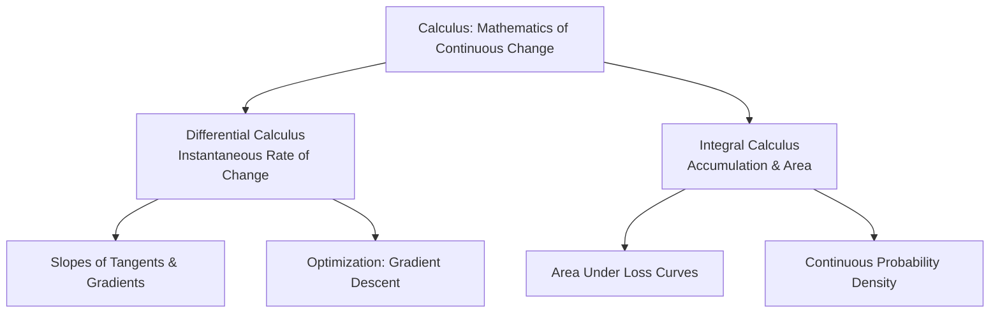

# Lecture 22.01: Introduction to Calculus for AI & Continuous Change

## 📌 Topic Overview
In this lecture, Shraddha ma'am introduces **Calculus as the mathematics of continuous change**, explaining why artificial intelligence and deep neural networks depend entirely on differential calculus for model optimization and weight updates.

---

## 🏛️ Differential vs Integral Calculus



---

## 📐 Calculus in Machine Learning

In AI, every machine learning model is a mathematical function parameterized by weights $\mathbf{w}$:

$$
\hat{y} = f_{\mathbf{w}}(\mathbf{x})
$$

To train the model, we calculate prediction error using a loss function $\mathcal{L}(\mathbf{w})$. Finding the best weights requires finding the minimum of this loss surface:

$$
\mathbf{w}^* = \arg\min_{\mathbf{w}} \mathcal{L}(\mathbf{w})
$$

### How Derivatives Drive Learning:
1. **The Derivative $\frac{d\mathcal{L}}{dw_i}$**: Tells us whether increasing weight $w_i$ will increase or decrease total loss.
2. **Gradient Descent**: Updates parameters iteratively in the opposite direction of the derivative:

$$
\mathbf{w}_{t+1} = \mathbf{w}_t - \eta \nabla \mathcal{L}(\mathbf{w}_t)
$$

---

## 💻 Python Implementation

```python
import numpy as np

def compute_instantaneous_slope(x0=3.0, deltas=None):
    """
    Demonstrates the fundamental concept of Calculus:
    Transition from Average Rate of Change (Secant line slope)
    to Instantaneous Rate of Change (Tangent line slope) as delta_x approaches 0.
    
    Function: f(x) = x^2, with analytical derivative f'(x) = 2x.
    """
    if deltas is None:
        deltas = [1.0, 0.5, 0.1, 0.01, 0.001, 0.0001]
        
    def f(x):
        return x ** 2
        
    analytical_derivative = 2 * x0
    results = []
    
    for dx in deltas:
        secant_slope = (f(x0 + dx) - f(x0)) / dx
        error = abs(secant_slope - analytical_derivative)
        results.append({
            'delta_x': dx,
            'secant_slope': secant_slope,
            'analytical': analytical_derivative,
            'error': error
        })
        
    return results

# --- Function Call & Testing ---
slope_table = compute_instantaneous_slope(x0=3.0)
print(f"{'Delta x':<10} | {'Secant Slope':<15} | {'Analytical (2x)':<15} | {'Error':<15}")
print("-" * 62)
for row in slope_table:
    print(f"{row['delta_x']:<10.4f} | {row['secant_slope']:<15.6f} | {row['analytical']:<15.6f} | {row['error']:<15.6e}")
```

---

## 🔑 Key Takeaways
1. Calculus models continuous dynamical change, while algebra handles static discrete points.
2. Differential calculus provides the mathematical foundation of gradient descent optimization.
3. As $\Delta x \to 0$, average rate of change converges exactly to the instantaneous derivative.
