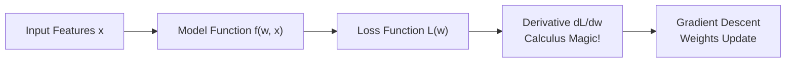

# Notes_22.01: Calculus Ka Parichay Aur Continuous Change [Hinglish]

## 📌 Topic Overview
Is lecture mein Shraddha ma'am ne **Calculus ka fundamental role** samjhaya hai: kyu Machine Learning aur Artificial Intelligence bina Calculus ke sambhav nahi hain, aur continuous change ko mathematically kaise measure karte hain.

---

### 📋 Is Topic Mein Hum Kya Seekhenge?
- Calculus asal mein kya hai aur iski zaroorat AI mein kyu padti hai?
- Differential Calculus vs Integral Calculus ka farq.
- Machine Learning models mein Loss Function ko minimize karne ka concept.
- Secant line (Average rate) se Tangent line (Instantaneous rate) ka safar.

---

### 🔍 Har Ek Point Ka Simple & Detailed Explanation

#### 1. Calculus Kya Hai?
Calculus **continuous change (lagatar badlav)** ka ganit hai.
Algebra mein hum static equations ($y = 2x + 3$) solve karte hain. Lekin asal duniya mein car ki speed, stock market ki price, ya model ka error lagatar badalta rehta hai. Calculus humein batata hai ki kisi *exact point of time* par badlav ki raftaar (rate of change) kya hai.

#### 2. AI Mein Calculus Kyu Zaroori Hai?
Har Machine Learning model ka ek **Loss Function** hota hai jo batata hai ki model kitni galtiyan kar raha hai:

$$
\mathbf{w}^* = \arg\min_{\mathbf{w}} \mathcal{L}(\mathbf{w})
$$

Derivatives humein yeh batate hain ki model ke weights badhane se loss kam hoga ya badhega. Isi information ka use karke **Gradient Descent** model ko seekhne mein madad karta hai:

$$
\mathbf{w}_{t+1} = \mathbf{w}_t - \eta \nabla \mathcal{L}(\mathbf{w}_t)
$$

---

### 📊 Visual Flowchart: Calculus Ka Role



---

### 💻 Python Code

```python
import numpy as np

def compute_instantaneous_slope(x0=3.0, deltas=None):
    """
    Demonstrates the fundamental concept of Calculus:
    Transition from Average Rate of Change (Secant line slope)
    to Instantaneous Rate of Change (Tangent line slope) as delta_x approaches 0.
    
    Function: f(x) = x^2, with analytical derivative f'(x) = 2x.
    """
    if deltas is None:
        deltas = [1.0, 0.5, 0.1, 0.01, 0.001, 0.0001]
        
    def f(x):
        return x ** 2
        
    analytical_derivative = 2 * x0
    results = []
    
    for dx in deltas:
        secant_slope = (f(x0 + dx) - f(x0)) / dx
        error = abs(secant_slope - analytical_derivative)
        results.append({
            'delta_x': dx,
            'secant_slope': secant_slope,
            'analytical': analytical_derivative,
            'error': error
        })
        
    return results

# --- Function Call & Testing ---
slope_table = compute_instantaneous_slope(x0=3.0)
print(f"{'Delta x':<10} | {'Secant Slope':<15} | {'Analytical (2x)':<15} | {'Error':<15}")
print("-" * 62)
for row in slope_table:
    print(f"{row['delta_x']:<10.4f} | {row['secant_slope']:<15.6f} | {row['analytical']:<15.6f} | {row['error']:<15.6e}")
```

---

### 📌 Summary Points
- Calculus continuous change ko analyze karta hai.
- Derivatives se humein pata chalta hai ki loss ko minimize karne ke liye weights ko kis taraf move karna hai.
