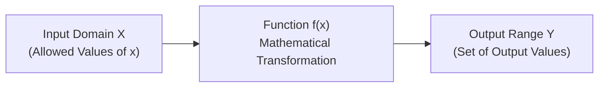

# Lecture 22.02: Mathematical Functions & Real-World Transformations

## 📌 Topic Overview
In this lecture, Shraddha ma'am covers the mathematical definition of a **Function**, input domains, output ranges, and visual curves including $y = \sqrt{x}$ and $y = \sin(x)$.

---

## 🏛️ What is a Function?
A function $f: X \to Y$ is a rule that assigns to each element $x$ in domain $X$ **exactly one** element $y = f(x)$ in range $Y$.



---

## 📈 Common Curves in AI
1. **Linear ($y = mx + c$)**: Constant rate of change (slope $= m$).
2. **Quadratic ($y = ax^2 + bx + c$)**: Parabolic curve, fundamental to Mean Squared Error loss surfaces.
3. **Square Root ($y = \sqrt{x}$)**: Only defined for $x \ge 0$. Output grows slowly as $x$ increases.
4. **Trigonometric ($y = \sin(x)$)**: Periodic oscillation bounded strictly between $[-1, +1]$.

---

## 💻 Python Implementation

```python
import numpy as np

def evaluate_mathematical_functions(x_vals=None):
    """
    Evaluates domain, range, and outputs of fundamental mathematical functions
    used throughout machine learning:
    1. Linear Function: f(x) = 2x + 3
    2. Quadratic Function: f(x) = x^2 - 4x + 4
    3. Square Root: f(x) = sqrt(x) (Domain: x >= 0)
    4. Sine Wave: f(x) = sin(x) (Periodic: [-1, 1])
    """
    if x_vals is None:
        x_vals = np.array([0.0, 1.0, 2.0, 4.0, 9.0])
        
    results = {
        'x': x_vals,
        'linear': 2 * x_vals + 3,
        'quadratic': x_vals ** 2 - 4 * x_vals + 4,
        'sqrt': np.sqrt(x_vals),
        'sin': np.sin(x_vals)
    }
    return results

# --- Function Call & Testing ---
eval_data = evaluate_mathematical_functions()
print(f"{'x':<6} | {'Linear (2x+3)':<15} | {'Quadratic (x^2-4x+4)':<22} | {'Sqrt(x)':<10} | {'Sin(x)':<10}")
print("-" * 72)
for i in range(len(eval_data['x'])):
    print(f"{eval_data['x'][i]:<6.1f} | {eval_data['linear'][i]:<15.2f} | {eval_data['quadratic'][i]:<22.2f} | {eval_data['sqrt'][i]:<10.3f} | {eval_data['sin'][i]:<10.3f}")
```

---

## 🔑 Key Takeaways
1. A function must map every valid input to a unique output.
2. In machine learning, neural network layers and loss objectives are pure functions.
3. Understanding domain constraints prevents numerical bugs like negative square roots or $\log(0)$.
