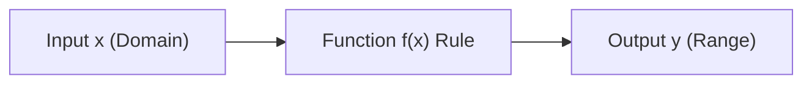

# Notes_22.02: Mathematical Functions Aur Real-World Transformations [Hinglish]

## 📌 Topic Overview
Is lecture mein Shraddha ma'am ne **Mathematical Functions** ka core concept samjhaya hai: Function kya hota hai, Domain aur Range kya hoti hain, aur alag-alag curves ($y = \sqrt{x}$, $y = \sin(x)$) ka nature kaisa hota hai.

---

### 📋 Is Topic Mein Hum Kya Seekhenge?
- Function ki aasan paribhasha (Input $\to$ Rule $\to$ Output).
- Domain (kya input de sakte hain) aur Range (kya output milega).
- $y = \sqrt{x}$ ka curve aur negative values par restriction ($x \ge 0$).
- $y = \sin(x)$ ka oscillatory nature (hamesha $-1$ se $+1$ ke beech).

---

### 🔍 Har Ek Point Ka Simple & Detailed Explanation

#### 1. Function Kya Hota Hai?
Function ek machine ki tarah hai. Aap usme ek input $x$ daalte ho, woh uspar koi mathematical rule lagata hai, aur badle mein ek unique output $y$ deta hai:

$$
y = f(x)
$$

- **Domain**: Woh saare inputs jo aap function ko bina kisi error ke de sakte ho. Jaise $\sqrt{x}$ mein negative numbers nahi daal sakte, toh Domain $x \ge 0$ hai.
- **Range**: Function run hone ke baad jo outputs nikalte hain. Jaise $\sin(x)$ ka output chahe kuch bhi $x$ daalo hamesha $[-1, 1]$ ke beech rehta hai.

---

### 📊 Visual Flowchart: Function Machine



---

### 💻 Python Code

```python
import numpy as np

def evaluate_mathematical_functions(x_vals=None):
    """
    Evaluates domain, range, and outputs of fundamental mathematical functions
    used throughout machine learning:
    1. Linear Function: f(x) = 2x + 3
    2. Quadratic Function: f(x) = x^2 - 4x + 4
    3. Square Root: f(x) = sqrt(x) (Domain: x >= 0)
    4. Sine Wave: f(x) = sin(x) (Periodic: [-1, 1])
    """
    if x_vals is None:
        x_vals = np.array([0.0, 1.0, 2.0, 4.0, 9.0])
        
    results = {
        'x': x_vals,
        'linear': 2 * x_vals + 3,
        'quadratic': x_vals ** 2 - 4 * x_vals + 4,
        'sqrt': np.sqrt(x_vals),
        'sin': np.sin(x_vals)
    }
    return results

# --- Function Call & Testing ---
eval_data = evaluate_mathematical_functions()
print(f"{'x':<6} | {'Linear (2x+3)':<15} | {'Quadratic (x^2-4x+4)':<22} | {'Sqrt(x)':<10} | {'Sin(x)':<10}")
print("-" * 72)
for i in range(len(eval_data['x'])):
    print(f"{eval_data['x'][i]:<6.1f} | {eval_data['linear'][i]:<15.2f} | {eval_data['quadratic'][i]:<22.2f} | {eval_data['sqrt'][i]:<10.3f} | {eval_data['sin'][i]:<10.3f}")
```

---

### 📌 Summary Points
- Machine Learning ka har model ek complex multi-variable function hota hai.
- Domain check karna zaroori hai taaki runtime par invalid math operations na hon.
