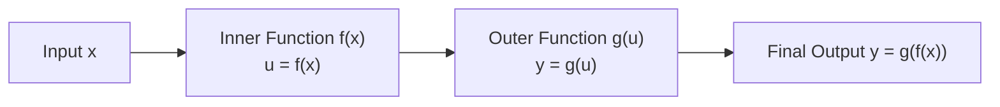

# Lecture 22.03: Composite Functions & Deep Neural Architectures

## 📌 Topic Overview
In this lecture, Shraddha ma'am explains **Composite Functions** $(g \circ f)(x) = g(f(x))$ and demonstrates how multi-layer deep neural networks are built by composing successive mathematical functions.

---

## 🏛️ Composite Function Architecture



---

## 🧠 Neural Networks as Deep Function Composition
A 3-layer neural network is fundamentally function composition:

$$
\hat{y} = f_3(f_2(f_1(\mathbf{x})))
$$

- Layer 1: $h_1 = \sigma(W_1 x + b_1)$
- Layer 2: $h_2 = \sigma(W_2 h_1 + b_2)$
- Layer 3: $\hat{y} = \sigma(W_3 h_2 + b_3)$

To differentiate composite functions during neural network training, we rely on the **Chain Rule of Calculus**:

$$
\frac{dy}{dx} = \frac{dy}{du} \cdot \frac{du}{dx}
$$

---

## 💻 Python Implementation

```python
import numpy as np

def compute_composite_function(x_vals=None):
    """
    Demonstrates Composite Functions: (g o f)(x) = g(f(x)).
    In Deep Learning, multi-layer neural networks are chains of composite functions.
    
    Inner Function: f(x) = 2x + 1 (Linear transformation)
    Outer Function: g(u) = u^2     (Non-linear activation)
    Composite:      h(x) = g(f(x)) = (2x + 1)^2
    """
    if x_vals is None:
        x_vals = np.array([-2.0, -1.0, 0.0, 1.0, 2.0])
        
    def f(x):
        return 2 * x + 1
        
    def g(u):
        return u ** 2
        
    u_vals = f(x_vals)
    h_vals = g(u_vals)
    
    return {
        'x': x_vals,
        'u_inner': u_vals,
        'h_composite': h_vals
    }

# --- Function Call & Testing ---
comp = compute_composite_function()
print(f"{'Input x':<10} | {'Inner f(x)=2x+1':<18} | {'Composite g(f(x))=(2x+1)^2':<25}")
print("-" * 58)
for i in range(len(comp['x'])):
    print(f"{comp['x'][i]:<10.2f} | {comp['u_inner'][i]:<18.2f} | {comp['h_composite'][i]:<25.2f}")
```

---

## 🔑 Key Takeaways
1. Composite functions pass the output of one function directly as the input to the next.
2. Deep learning is essentially large-scale composite function optimization.
3. The chain rule enables backpropagation through arbitrary depths of function composition.
