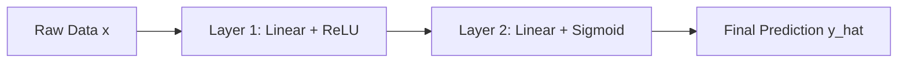

# Notes_22.03: Composite Functions Aur Neural Networks [Hinglish]

## 📌 Topic Overview
Is lecture mein Shraddha ma'am ne **Composite Functions** $g(f(x))$ ka concept samjhaya hai: kaise ek function ka output doosre function ka input banta hai, aur kaise poora Deep Learning isi concept par tika hai.

---

### 📋 Is Topic Mein Hum Kya Seekhenge?
- Composite Function $(g \circ f)(x)$ kya hota hai?
- Pipe / Pipeline intuition: Data ka flow kaise hota hai?
- Deep Neural Networks composite functions ki chain kaise hote hain?
- Chain Rule ka basic role.

---

### 🔍 Har Ek Point Ka Simple & Detailed Explanation

#### 1. Composite Function Ki Intuition:
Agar hamare paas do functions hain:
1. $f(x) = 2x + 1$ (Pehla step)
2. $g(u) = u^2$ (Doosra step)

Jab hum input $x$ daalte hain, pehle $f(x)$ compute hota hai. Fir uska jo result aata hai, woh seedha $g(u)$ ke andar chala jata hai:

$$
h(x) = g(f(x)) = (2x + 1)^2
$$

#### 2. Deep Learning Mein Iska Role:
Neural Network ki har layer ek function hoti hai. Pehli layer ka output doosri layer mein jata hai, doosri ka teesri mein:

$$
\hat{y} = \text{Layer}_3(\text{Layer}_2(\text{Layer}_1(x)))
$$

Is poori chain ko differentiate karke backpropagation chalane ke liye hum **Chain Rule** ka use karte hain.

---

### 📊 Visual Flowchart: Neural Network Function Chain



---

### 💻 Python Code

```python
import numpy as np

def compute_composite_function(x_vals=None):
    """
    Demonstrates Composite Functions: (g o f)(x) = g(f(x)).
    In Deep Learning, multi-layer neural networks are chains of composite functions.
    
    Inner Function: f(x) = 2x + 1 (Linear transformation)
    Outer Function: g(u) = u^2     (Non-linear activation)
    Composite:      h(x) = g(f(x)) = (2x + 1)^2
    """
    if x_vals is None:
        x_vals = np.array([-2.0, -1.0, 0.0, 1.0, 2.0])
        
    def f(x):
        return 2 * x + 1
        
    def g(u):
        return u ** 2
        
    u_vals = f(x_vals)
    h_vals = g(u_vals)
    
    return {
        'x': x_vals,
        'u_inner': u_vals,
        'h_composite': h_vals
    }

# --- Function Call & Testing ---
comp = compute_composite_function()
print(f"{'Input x':<10} | {'Inner f(x)=2x+1':<18} | {'Composite g(f(x))=(2x+1)^2':<25}")
print("-" * 58)
for i in range(len(comp['x'])):
    print(f"{comp['x'][i]:<10.2f} | {comp['u_inner'][i]:<18.2f} | {comp['h_composite'][i]:<25.2f}")
```

---

### 📌 Summary Points
- Composite function matlab functions ki chain.
- Neural networks composite functions ka real-world implementation hain.
