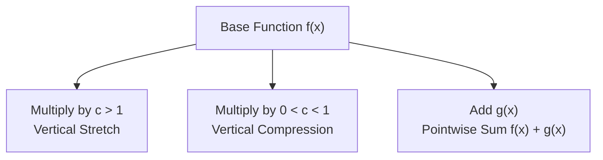

# Lecture 22.04: Operations on Functions: Scalar Multiplication & Addition

## 📌 Topic Overview
In this lecture, Shraddha ma'am covers operations on functions, specifically **Scalar Multiplication** $c \cdot f(x)$ and **Pointwise Addition** $(f + g)(x)$, exploring their geometric transformations.

---

## 🏛️ Mathematical Mechanics

### 1. Scalar Multiplication: $h(x) = c \cdot f(x)$
- Multiplies the output of $f(x)$ by constant $c$.
- **Geometric Effect**: Vertical stretching (if $c > 1$) or vertical compression (if $0 < c < 1$).
- If $c < 0$, the graph is vertically reflected across the x-axis.

### 2. Function Addition: $h(x) = f(x) + g(x)$
- Evaluates both functions at input $x$ and adds their values: $h(x) = f(x) + g(x)$.
- **In Machine Learning**: Ensemble methods and Residual Networks (ResNets) add feature representations: $x + \mathcal{F}(x)$.

---

## 📊 Visual Transformation Flowchart



---

## 💻 Python Implementation

```python
import numpy as np

def operate_on_functions(c=2.0, x_vals=None):
    """
    Demonstrates algebraic operations on functions:
    1. Scalar Multiplication: (c * f)(x) = c * f(x)
       Vertically scales (stretches or compresses) the function graph.
    2. Function Addition: (f + g)(x) = f(x) + g(x)
       Sums outputs pointwise, fundamental to residual learning.
       
    Base functions: f(x) = x^2, g(x) = 3x
    """
    if x_vals is None:
        x_vals = np.array([-2.0, -1.0, 0.0, 1.0, 2.0])
        
    def f(x):
        return x ** 2
        
    def g(x):
        return 3 * x
        
    f_vals = f(x_vals)
    g_vals = g(x_vals)
    scaled_f = c * f_vals
    sum_fg = f_vals + g_vals
    
    return {
        'x': x_vals,
        'f(x)': f_vals,
        'g(x)': g_vals,
        '2*f(x)': scaled_f,
        'f(x)+g(x)': sum_fg
    }

# --- Function Call & Testing ---
ops = operate_on_functions(c=2.0)
print(f"{'x':<6} | {'f(x)=x^2':<10} | {'g(x)=3x':<10} | {'2*f(x)':<10} | {'(f+g)(x)':<12}")
print("-" * 56)
for i in range(len(ops['x'])):
    print(f"{ops['x'][i]:<6.1f} | {ops['f(x)'][i]:<10.2f} | {ops['g(x)'][i]:<10.2f} | {ops['2*f(x)'][i]:<10.2f} | {ops['f(x)+g(x)'][i]:<12.2f}")
```

---

## 🔑 Key Takeaways
1. Multiplying by a constant scales the output vertically without shifting inputs horizontally.
2. Adding two functions produces pointwise superposition of their curves.
3. Linearity of derivatives: $\frac{d}{dx}[c f(x) + g(x)] = c f'(x) + g'(x)$.
