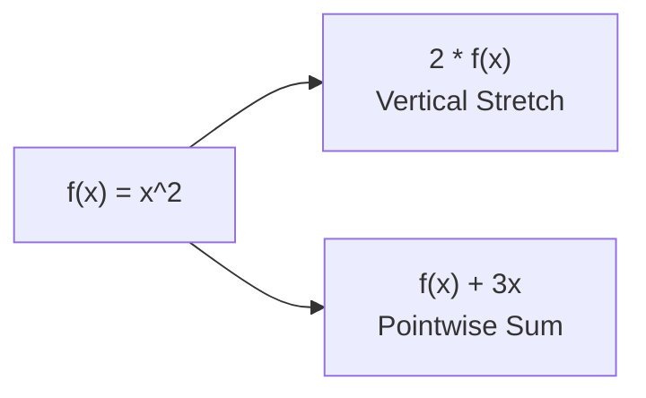

# Notes_22.04: Functions Par Scalar Multiplication Aur Addition [Hinglish]

## 📌 Topic Overview
Is lecture mein Shraddha ma'am ne functions par hone wale basic operations samjhaye hain: **Scalar Multiplication** ($c \cdot f(x)$) aur **Function Addition** ($(f + g)(x)$), aur inka graph par kya asar padta hai.

---

### 📋 Is Topic Mein Hum Kya Seekhenge?
- Function ko kisi number se multiply ($c \cdot f(x)$) karne par graph kaise stretch ya compress hota hai.
- Do functions ko jodne ($(f + g)(x)$) ka pointwise tareeqa.
- Machine Learning aur ResNets mein iska use.

---

### 🔍 Har Ek Point Ka Simple & Detailed Explanation

#### 1. Scalar Multiplication ($c \cdot f(x)$):
Agar $f(x) = x^2$ hai:
- $2 \cdot f(x) = 2x^2$: Graph upar ki taraf kheench jata hai (Vertical Stretch).
- $0.5 \cdot f(x) = 0.5x^2$: Graph dab jata hai (Vertical Compression).
- $-1 \cdot f(x) = -x^2$: Graph ulta ho jata hai (X-axis ke around reflect ho jata hai).

#### 2. Functions Ka Addition ($(f + g)(x)$):
Har input point $x$ par dono functions ke outputs ko aapas mein jod diya jata hai.
Deep Learning mein ResNets (Residual Networks) isi ka use karke skip connections banate hain ($y = x + F(x)$), jisse 100+ layers ke models bhi asani se train ho jaate hain.

---

### 📊 Visual Flowchart: Operations On Functions



---

### 💻 Python Code

```python
import numpy as np

def operate_on_functions(c=2.0, x_vals=None):
    """
    Demonstrates algebraic operations on functions:
    1. Scalar Multiplication: (c * f)(x) = c * f(x)
       Vertically scales (stretches or compresses) the function graph.
    2. Function Addition: (f + g)(x) = f(x) + g(x)
       Sums outputs pointwise, fundamental to residual learning.
       
    Base functions: f(x) = x^2, g(x) = 3x
    """
    if x_vals is None:
        x_vals = np.array([-2.0, -1.0, 0.0, 1.0, 2.0])
        
    def f(x):
        return x ** 2
        
    def g(x):
        return 3 * x
        
    f_vals = f(x_vals)
    g_vals = g(x_vals)
    scaled_f = c * f_vals
    sum_fg = f_vals + g_vals
    
    return {
        'x': x_vals,
        'f(x)': f_vals,
        'g(x)': g_vals,
        '2*f(x)': scaled_f,
        'f(x)+g(x)': sum_fg
    }

# --- Function Call & Testing ---
ops = operate_on_functions(c=2.0)
print(f"{'x':<6} | {'f(x)=x^2':<10} | {'g(x)=3x':<10} | {'2*f(x)':<10} | {'(f+g)(x)':<12}")
print("-" * 56)
for i in range(len(ops['x'])):
    print(f"{ops['x'][i]:<6.1f} | {ops['f(x)'][i]:<10.2f} | {ops['g(x)'][i]:<10.2f} | {ops['2*f(x)'][i]:<10.2f} | {ops['f(x)+g(x)'][i]:<12.2f}")
```

---

### 📌 Summary Points
- Constant se multiply karne par curve upar/neeche stretch hota hai.
- Derivative rules linear hote hain: $\frac{d}{dx}[a f(x) + b g(x)] = a f'(x) + b g'(x)$.
