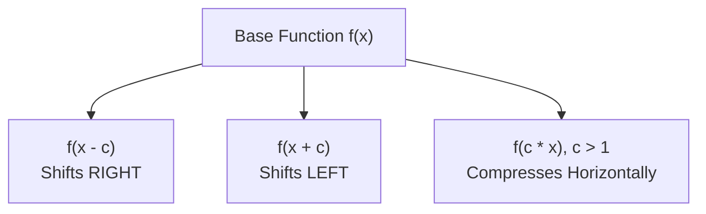

# Lecture 22.05: Input Transformations: Scaling & Shifts

## 📌 Topic Overview
In this lecture, Shraddha ma'am demonstrates how altering the **input argument** of a function ($f(x \pm c)$ and $f(cx)$) causes horizontal shifts and horizontal scaling across the coordinate plane.

---

## 🏛️ Transformation Rules

| Transformation | Mathematical Form | Geometric Effect | Direction |
| :--- | :--- | :--- | :--- |
| **Right Shift** | $f(x - c)$ with $c > 0$ | Shifts curve to the right by $c$ units | $\to$ Positive X |
| **Left Shift** | $f(x + c)$ with $c > 0$ | Shifts curve to the left by $c$ units | $\leftarrow$ Negative X |
| **Horizontal Compression** | $f(cx)$ with $c > 1$ | Compresses curve horizontally towards y-axis | $\to \leftarrow$ Narrower |
| **Horizontal Stretch** | $f(cx)$ with $0 < c < 1$ | Stretches curve horizontally away from y-axis | $\leftarrow \to$ Wider |



---

## 💻 Python Implementation

```python
import numpy as np

def demonstrate_input_transformations(x_vals=None):
    """
    Demonstrates input-space transformations:
    1. Horizontal Shift: f(x - c) shifts graph RIGHT by c; f(x + c) shifts LEFT by c.
    2. Horizontal Scaling: f(c * x) compresses horizontally by factor c if c > 1.
    
    Base function: f(x) = x^2
    """
    if x_vals is None:
        x_vals = np.array([-2.0, -1.0, 0.0, 1.0, 2.0])
        
    def base_f(x):
        return x ** 2
        
    shift_right = base_f(x_vals - 1.0)  # f(x - 1)
    shift_left  = base_f(x_vals + 1.0)  # f(x + 1)
    compressed  = base_f(2.0 * x_vals)   # f(2x)
    
    return {
        'x': x_vals,
        'base_x2': base_f(x_vals),
        'shift_right_minus1': shift_right,
        'shift_left_plus1': shift_left,
        'compressed_2x': compressed
    }

# --- Function Call & Testing ---
trans = demonstrate_input_transformations()
print(f"{'x':<6} | {'Base x^2':<10} | {'f(x-1) [Right]':<16} | {'f(x+1) [Left]':<16} | {'f(2x) [Compressed]':<18}")
print("-" * 74)
for i in range(len(trans['x'])):
    print(f"{trans['x'][i]:<6.1f} | {trans['base_x2'][i]:<10.2f} | {trans['shift_right_minus1'][i]:<16.2f} | {trans['shift_left_plus1'][i]:<16.2f} | {trans['compressed_2x'][i]:<18.2f}")
```

---

## 🔑 Key Takeaways
1. Modifying input arguments transforms curves along the horizontal (x) axis.
2. Subtracting a constant shifts right; adding a constant shifts left.
3. In neural networks, bias terms $b$ act as input shifts: $W x + b$.
