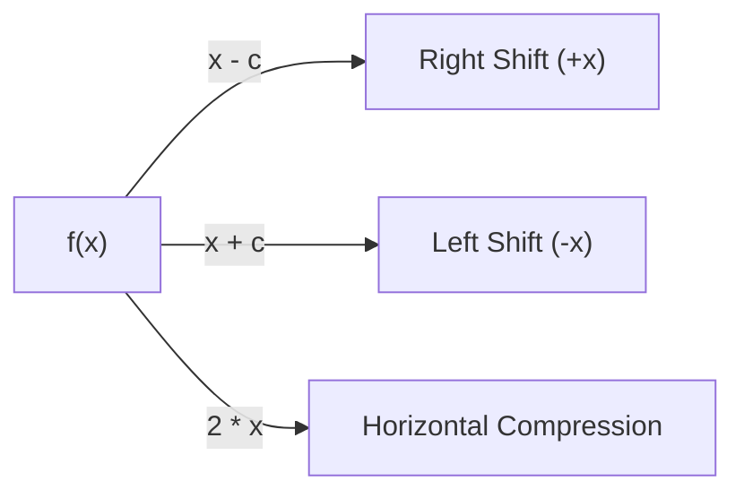

# Notes_22.05: Input Transformations (Scaling Aur Shifts) [Hinglish]

## 📌 Topic Overview
Is lecture mein Shraddha ma'am ne samjhaya hai ki jab hum function ke andar input $x$ ko badalte hain (jaise $f(x - c)$ ya $f(2x)$), toh graph par kya asar padta hai.

---

### 📋 Is Topic Mein Hum Kya Seekhenge?
- Horizontal Shift: Graph daayein (Right) ya baayein (Left) kyu khisakta hai?
- $f(x - c)$ Right kyu jata hai aur $f(x + c)$ Left kyu jata hai?
- Horizontal Compression: $f(2x)$ graph ko sikodta kaise hai?
- Machine Learning ke bias ($b$) ka connection.

---

### 🔍 Har Ek Point Ka Simple & Detailed Explanation

#### 1. Horizontal Shift ($f(x - c)$ vs $f(x + c)$):
Agar hamare paas $f(x) = x^2$ hai:
- **$f(x - 1)$**: Graph **Right side khisak jata hai**! Kyunki jo output pehle $x=0$ par aata tha, ab woh $x=1$ par aayega ($1 - 1 = 0$).
- **$f(x + 1)$**: Graph **Left side khisak jata hai**!

#### 2. Neural Networks Mein Bias Ka Role:
Linear Regression ya Neural Networks mein hum likhte hain: $z = w x + b$.
Yahan jo $+ b$ (Bias) hai, woh curve ko horizontally/vertically shift karne ka kaam karta hai taaki model data points ke exact center par fit ho sake!

---

### 📊 Visual Flowchart: Shift Ka Rule



---

### 💻 Python Code

```python
import numpy as np

def demonstrate_input_transformations(x_vals=None):
    """
    Demonstrates input-space transformations:
    1. Horizontal Shift: f(x - c) shifts graph RIGHT by c; f(x + c) shifts LEFT by c.
    2. Horizontal Scaling: f(c * x) compresses horizontally by factor c if c > 1.
    
    Base function: f(x) = x^2
    """
    if x_vals is None:
        x_vals = np.array([-2.0, -1.0, 0.0, 1.0, 2.0])
        
    def base_f(x):
        return x ** 2
        
    shift_right = base_f(x_vals - 1.0)  # f(x - 1)
    shift_left  = base_f(x_vals + 1.0)  # f(x + 1)
    compressed  = base_f(2.0 * x_vals)   # f(2x)
    
    return {
        'x': x_vals,
        'base_x2': base_f(x_vals),
        'shift_right_minus1': shift_right,
        'shift_left_plus1': shift_left,
        'compressed_2x': compressed
    }

# --- Function Call & Testing ---
trans = demonstrate_input_transformations()
print(f"{'x':<6} | {'Base x^2':<10} | {'f(x-1) [Right]':<16} | {'f(x+1) [Left]':<16} | {'f(2x) [Compressed]':<18}")
print("-" * 74)
for i in range(len(trans['x'])):
    print(f"{trans['x'][i]:<6.1f} | {trans['base_x2'][i]:<10.2f} | {trans['shift_right_minus1'][i]:<16.2f} | {trans['shift_left_plus1'][i]:<16.2f} | {trans['compressed_2x'][i]:<18.2f}")
```

---

### 📌 Summary Points
- Input mein minus karne se graph right jata hai, plus karne se left.
- Bias ($b$) activation function ko shift karke model ki flexibility badhata hai.
