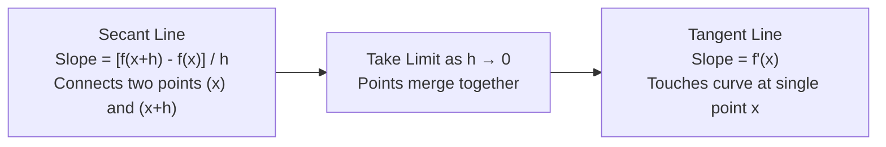

# Lecture 22.06: Differentiation & Instantaneous Rate of Change

## 📌 Topic Overview
In this lecture, Shraddha ma'am introduces **Differentiation**, transitioning from secant lines to tangent lines using the formal mathematical limit definition of the derivative.

---

## 🏛️ Formal Limit Definition of Derivative

The derivative of function $f(x)$ at point $x$ is defined as:

$$
f'(x) = \frac{df}{dx} = \lim_{h \to 0} \frac{f(x + h) - f(x)}{h}
$$



---

## 📐 Geometric Interpretation
- **Secant Line**: Measures the average rate of change over interval $[x, x + h]$.
- **Tangent Line**: Measures the instantaneous rate of change exactly at point $x$.
- The slope of the tangent line equals the derivative $f'(x)$.
  - If $f'(x) > 0$, the function is strictly increasing at $x$.
  - If $f'(x) < 0$, the function is strictly decreasing at $x$.
  - If $f'(x) = 0$, the function has a stationary / critical point.

---

## 💻 Python Implementation

```python
import numpy as np

def compute_numerical_derivative(func, x_val, h=1e-5):
    """
    Computes numerical derivative using the formal limit definition (Newton's Difference Quotient):
        f'(x) = lim_{h -> 0} [f(x + h) - f(x)] / h
    
    Also computes central difference quotient for enhanced numerical accuracy:
        f'_central(x) = [f(x + h) - f(x - h)] / (2h)
    """
    forward_diff = (func(x_val + h) - func(x_val)) / h
    central_diff = (func(x_val + h) - func(x_val - h)) / (2 * h)
    
    return {
        'x': x_val,
        'step_h': h,
        'forward_diff': forward_diff,
        'central_diff': central_diff
    }

# --- Function Call & Testing ---
target_f = lambda x: x ** 3
deriv = compute_numerical_derivative(target_f, x_val=2.0)
print(f"Function: f(x) = x^3 at x = {deriv['x']}")
print(f"Analytical Derivative (3x^2): 12.000000")
print(f"Forward Difference Quotient : {deriv['forward_diff']:.6f}")
print(f"Central Difference Quotient : {deriv['central_diff']:.6f}")
```

---

## 🔑 Key Takeaways
1. The derivative represents the slope of the tangent line to the curve at a specific point.
2. In machine learning, derivatives tell us whether increasing a weight will increase or decrease prediction error.
3. Central difference quotient $\frac{f(x+h) - f(x-h)}{2h}$ has error $\mathcal{O}(h^2)$, making it superior to forward difference for gradient checking.
