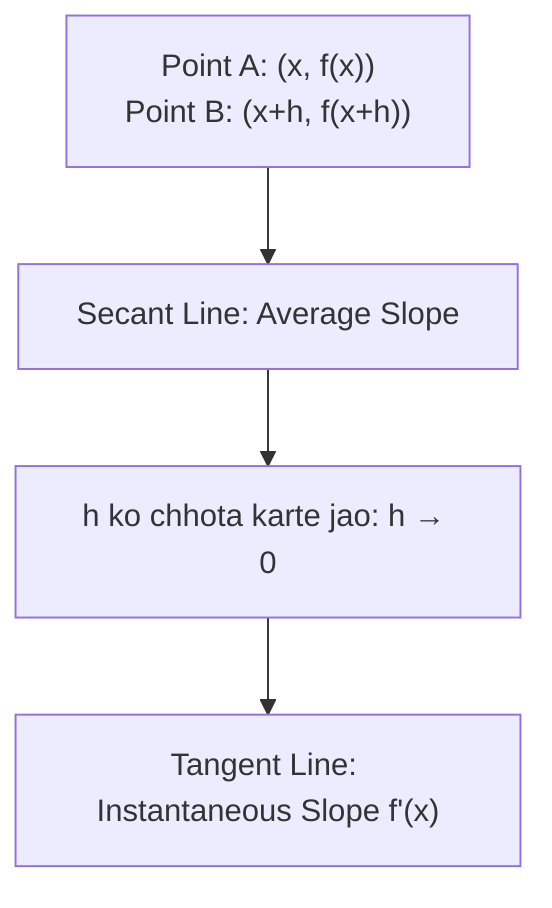

# Notes_22.06: Differentiation Aur Instantaneous Rate of Change [Hinglish]

## 📌 Topic Overview
Is lecture mein Shraddha ma'am ne **Differentiation** ka core concept samjhaya hai: Secant line se Tangent line tak ka safar aur derivative ka formal limit formula.

---

### 📋 Is Topic Mein Hum Kya Seekhenge?
- Differentiation ka matlab kya hota hai?
- Average rate of change vs Instantaneous rate of change.
- Limit formula: $f'(x) = \lim_{h \to 0} \frac{f(x+h) - f(x)}{h}$.
- Tangent line ka slope aur curve ka chadhav-utaar.

---

### 🔍 Har Ek Point Ka Simple & Detailed Explanation

#### 1. Instantaneous Rate of Change:
Agar aap car se Delhi se Jaipur ja rahe hain:
- Poore 5 ghante mein average speed 60 km/h thi (Average Rate).
- Lekin kisi ek exact second par speedometer 92 km/h dikha raha tha (Instantaneous Rate).
Calculus ka derivative wahi **speedometer** hai jo kisi exact point $x$ par curve ki speed (slope) batata hai!

#### 2. Limit Formula:

$$
f'(x) = \lim_{h \to 0} \frac{f(x + h) - f(x)}{h}
$$

Jab do points ke beech ki doori $h$ lagbhag zero ($h \to 0$) ho jati hai, toh Secant line **Tangent line** ban jaati hai.

---

### 📊 Visual Flowchart: Secant Se Tangent Tak



---

### 💻 Python Code

```python
import numpy as np

def compute_numerical_derivative(func, x_val, h=1e-5):
    """
    Computes numerical derivative using the formal limit definition (Newton's Difference Quotient):
        f'(x) = lim_{h -> 0} [f(x + h) - f(x)] / h
    
    Also computes central difference quotient for enhanced numerical accuracy:
        f'_central(x) = [f(x + h) - f(x - h)] / (2h)
    """
    forward_diff = (func(x_val + h) - func(x_val)) / h
    central_diff = (func(x_val + h) - func(x_val - h)) / (2 * h)
    
    return {
        'x': x_val,
        'step_h': h,
        'forward_diff': forward_diff,
        'central_diff': central_diff
    }

# --- Function Call & Testing ---
target_f = lambda x: x ** 3
deriv = compute_numerical_derivative(target_f, x_val=2.0)
print(f"Function: f(x) = x^3 at x = {deriv['x']}")
print(f"Analytical Derivative (3x^2): 12.000000")
print(f"Forward Difference Quotient : {deriv['forward_diff']:.6f}")
print(f"Central Difference Quotient : {deriv['central_diff']:.6f}")
```

---

### 📌 Summary Points
- Derivative curve ke kisi point par Tangent line ka slope hota hai.
- $f'(x) > 0$ ka matlab curve upar ja raha hai, $f'(x) < 0$ ka matlab curve neeche aa raha hai.
