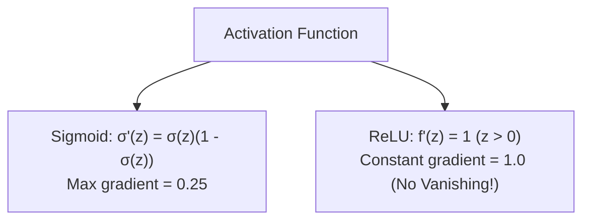

# Notes_22.07: Differentiation Ke Rules Aur Activation Functions [Hinglish]

## 📌 Topic Overview
Is lecture mein Shraddha ma'am ne **Differentiation ke Core Rules** (Power, Product, Chain Rule) aur Neural Networks ke **Activation Functions (Sigmoid, ReLU, Tanh)** ke derivatives nikalna sikhaya hai.

---

### 📋 Is Topic Mein Hum Kya Seekhenge?
- Power Rule: $\frac{d}{dx} x^n = n x^{n-1}$.
- Product Rule aur Quotient Rule ka aasan formula.
- Chain Rule: Composite functions ka derivative.
- Sigmoid ka derivative: $\sigma'(z) = \sigma(z)(1 - \sigma(z))$.
- ReLU ka derivative aur Vanishing Gradient problem ka solution.

---

### 🔍 Har Ek Point Ka Simple & Detailed Explanation

#### 1. Core Differentiation Rules:
- **Power Rule**: Power aage aati hai aur upar ek kam ho jata hai:

$$
\frac{d}{dx} x^4 = 4x^3
$$

- **Chain Rule**: Pehle bahar wale function ka derivative lo, fir andar wale ka multiply karo:

$$
\frac{d}{dx} (3x + 2)^2 = 2(3x + 2) \cdot 3 = 6(3x + 2)
$$

#### 2. Sigmoid vs ReLU Derivative:
- **Sigmoid**: Iska maximum derivative sirf **0.25** hota hai. Jab deep neural network mein 10 layers hoti hain, toh $0.25 \times 0.25 \dots$ hokar gradient zero ban jata hai (Vanishing Gradient).
- **ReLU**: Positive inputs ($z > 0$) ke liye iska derivative hamesha **1** rehta hai, jisse gradient kabhi vanish nahi hota!

---

### 📊 Visual Flowchart: Derivative Comparison



---

### 💻 Python Code

```python
import numpy as np

def differentiate_activation_functions(z_vals=None):
    """
    Computes analytical derivatives of common neural network activation functions:
    1. Sigmoid: sigma(z) = 1 / (1 + e^-z)
       Derivative: sigma'(z) = sigma(z) * (1 - sigma(z))
    2. ReLU: f(z) = max(0, z)
       Derivative: f'(z) = 1 if z > 0 else 0
    3. Tanh: tanh(z)
       Derivative: tanh'(z) = 1 - tanh^2(z)
    """
    if z_vals is None:
        z_vals = np.array([-2.0, -1.0, 0.0, 1.0, 2.0])
        
    # 1. Sigmoid
    sig = 1.0 / (1.0 + np.exp(-z_vals))
    sig_deriv = sig * (1.0 - sig)
    
    # 2. ReLU
    relu = np.maximum(0.0, z_vals)
    relu_deriv = np.where(z_vals > 0, 1.0, 0.0)
    
    # 3. Tanh
    tanh_val = np.tanh(z_vals)
    tanh_deriv = 1.0 - tanh_val ** 2
    
    return {
        'z': z_vals,
        'sigmoid_deriv': sig_deriv,
        'relu_deriv': relu_deriv,
        'tanh_deriv': tanh_deriv
    }

# --- Function Call & Testing ---
activations = differentiate_activation_functions()
print(f"{'Input z':<8} | {'Sigmoid Deriv':<15} | {'ReLU Deriv':<12} | {'Tanh Deriv':<12}")
print("-" * 55)
for i in range(len(activations['z'])):
    print(f"{activations['z'][i]:<8.1f} | {activations['sigmoid_deriv'][i]:<15.4f} | {activations['relu_deriv'][i]:<12.1f} | {activations['tanh_deriv'][i]:<12.4f}")
```

---

### 📌 Summary Points
- Chain rule deep learning ke backpropagation ka engine hai.
- ReLU activation vanishing gradient se bachata hai kyunki iska gradient $1$ hota hai.
