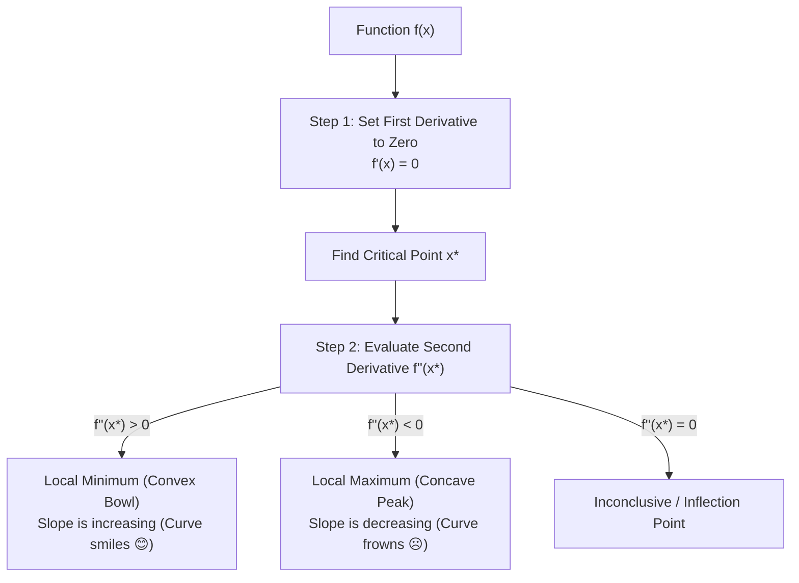

# Lecture 22.08: Finding Minima & Maxima (Optimization Foundations)

## 📌 Topic Overview
In this lecture, Shraddha ma'am explains how to find stationary critical points where the derivative equals zero ($f'(x) = 0$) and classify them as **Local Minima** or **Local Maxima** using the **Second Derivative Test**.

---

## 🏛️ First & Second Derivative Tests



---

## 📐 Mathematical Formulation

1. **Stationary Condition (First Order)**:

$$
f'(x) = 0
$$

   At the vertex or peak, the tangent line is completely flat (slope $= 0$).

2. **Curvature Classification (Second Order)**:
   - **$f''(x) > 0$**: The tangent slope is increasing from negative to positive. The curve is **concave up** (bowl shape) $\implies$ **Minimum**.
   - **$f''(x) < 0$**: The tangent slope is decreasing from positive to negative. The curve is **concave down** (peak shape) $\implies$ **Maximum**.

---

## 💻 Python Implementation

```python
import numpy as np

def find_critical_points_and_extrema(a, b, c):
    """
    Finds stationary/critical points and classifies them as local minima or maxima
    for a quadratic loss function:
        f(x) = a*x^2 + b*x + c
        
    First Derivative:  f'(x) = 2ax + b = 0 => x* = -b / (2a)
    Second Derivative: f''(x) = 2a
        - If f''(x*) > 0 => Local Minimum (Convex bowl, ideal for loss functions!)
        - If f''(x*) < 0 => Local Maximum (Concave peak)
    """
    if a == 0:
        raise ValueError("Parameter 'a' cannot be 0 for a quadratic function.")
        
    x_critical = -b / (2.0 * a)
    y_critical = a * (x_critical ** 2) + b * x_critical + c
    second_derivative = 2.0 * a
    
    classification = "Local Minimum" if second_derivative > 0 else "Local Maximum"
    
    return {
        'x_critical': x_critical,
        'y_critical': y_critical,
        'f_double_prime': second_derivative,
        'classification': classification
    }

# --- Function Call & Testing ---
# Quadratic Loss: f(x) = 2x^2 - 8x + 10 (a=2, b=-8, c=10)
extrema = find_critical_points_and_extrema(a=2.0, b=-8.0, c=10.0)
print("Function: f(x) = 2x^2 - 8x + 10")
print(f"Critical Point x*  : {extrema['x_critical']:.2f}")
print(f"Function Value f(x*): {extrema['y_critical']:.2f}")
print(f"Second Derivative  : {extrema['f_double_prime']:.2f}")
print(f"Extremum Nature    : {extrema['classification']}")
```

---

## 🔑 Key Takeaways
1. Setting $f'(x) = 0$ finds all points where the curve is flat.
2. The second derivative $f''(x)$ reveals curvature (convexity).
3. Machine learning loss functions (like MSE) are designed to be strictly convex ($f''(x) > 0$), guaranteeing that any local minimum is the unique global minimum.
