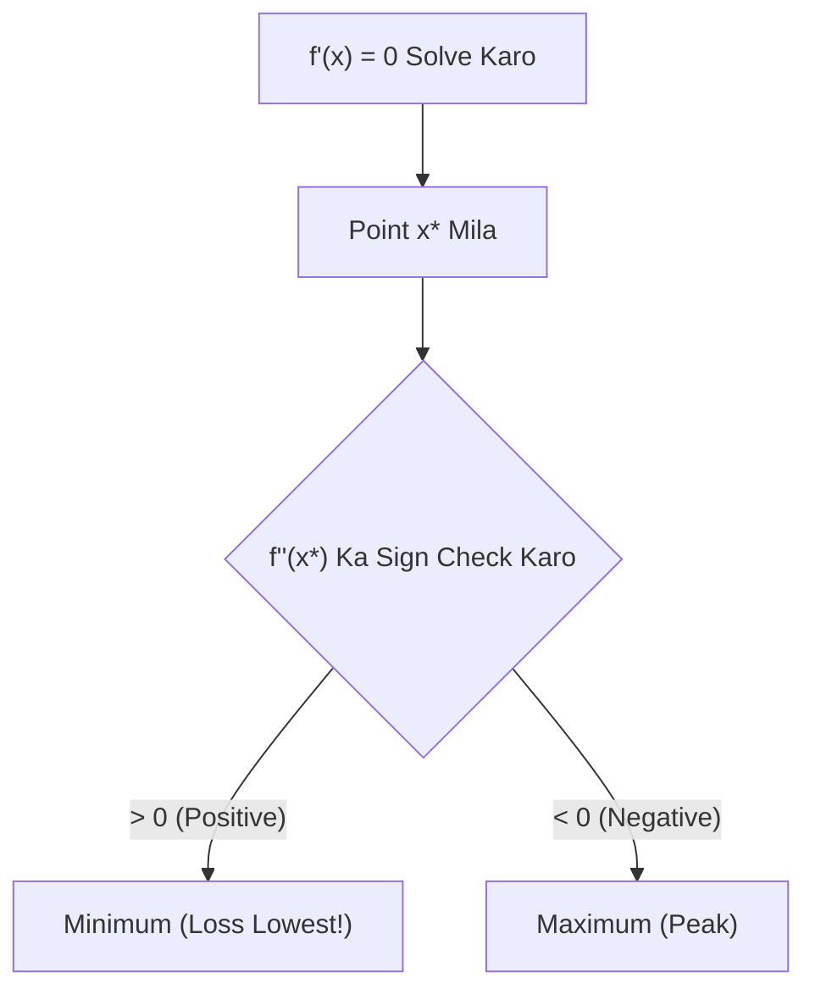

# Notes_22.08: Minima Aur Maxima Kaise Nikalte Hain [Hinglish]

## 📌 Topic Overview
Is lecture mein Shraddha ma'am ne **Minima aur Maxima** nikalne ka complete step-by-step tareeqa samjhaya hai: kaise first derivative ko zero ($f'(x) = 0$) karke critical points dhoondte hain aur second derivative ($f''(x)$) se pata karte hain ki point minimum hai ya maximum.

---

### 📋 Is Topic Mein Hum Kya Seekhenge?
- Critical Point / Stationary Point kya hota hai?
- First Derivative Test: $f'(x) = 0$ kyu rakhte hain?
- Second Derivative Test ($f''(x) > 0$ vs $f''(x) < 0$).
- Smile curve (Minimum) vs Frown curve (Maximum) intuition.

---

### 🔍 Har Ek Point Ka Simple & Detailed Explanation

#### 1. First Derivative Ko Zero Kyu Rakhte Hain?
Jab curve apne sabse nichle point (Gaddhe/Valley) ya sabse oonche point (Choti/Peak) par pahunchta hai, toh wahan curve bilkul flat ho jata hai. Flat line ka slope hamesha **0** hota hai. Isliye:

$$
f'(x) = 0
$$

Isko solve karne se humein candidate points ($x^*$) milte hain.

#### 2. Second Derivative Test:
- **$f''(x) > 0$ (Positive)**: Curve smile karta hai (😊 Concave Up / Katori shape). Yeh **Local Minimum** hota hai! Machine learning mein humein yahi chahiye hota hai taaki loss sabse kam ho sake.
- **$f''(x) < 0$ (Negative)**: Curve udas hota hai (☹️ Concave Down / Pahaad shape). Yeh **Local Maximum** hota hai.

---

### 📊 Visual Flowchart: Minima Maxima Test



---

### 💻 Python Code

```python
import numpy as np

def find_critical_points_and_extrema(a, b, c):
    """
    Finds stationary/critical points and classifies them as local minima or maxima
    for a quadratic loss function:
        f(x) = a*x^2 + b*x + c
        
    First Derivative:  f'(x) = 2ax + b = 0 => x* = -b / (2a)
    Second Derivative: f''(x) = 2a
        - If f''(x*) > 0 => Local Minimum (Convex bowl, ideal for loss functions!)
        - If f''(x*) < 0 => Local Maximum (Concave peak)
    """
    if a == 0:
        raise ValueError("Parameter 'a' cannot be 0 for a quadratic function.")
        
    x_critical = -b / (2.0 * a)
    y_critical = a * (x_critical ** 2) + b * x_critical + c
    second_derivative = 2.0 * a
    
    classification = "Local Minimum" if second_derivative > 0 else "Local Maximum"
    
    return {
        'x_critical': x_critical,
        'y_critical': y_critical,
        'f_double_prime': second_derivative,
        'classification': classification
    }

# --- Function Call & Testing ---
# Quadratic Loss: f(x) = 2x^2 - 8x + 10 (a=2, b=-8, c=10)
extrema = find_critical_points_and_extrema(a=2.0, b=-8.0, c=10.0)
print("Function: f(x) = 2x^2 - 8x + 10")
print(f"Critical Point x*  : {extrema['x_critical']:.2f}")
print(f"Function Value f(x*): {extrema['y_critical']:.2f}")
print(f"Second Derivative  : {extrema['f_double_prime']:.2f}")
print(f"Extremum Nature    : {extrema['classification']}")
```

---

### 📌 Summary Points
- $f'(x) = 0$ flat point batata hai.
- $f''(x) > 0$ matlab minimum, $f''(x) < 0$ matlab maximum.
- Convex functions mein local minimum hi global minimum hota hai.
