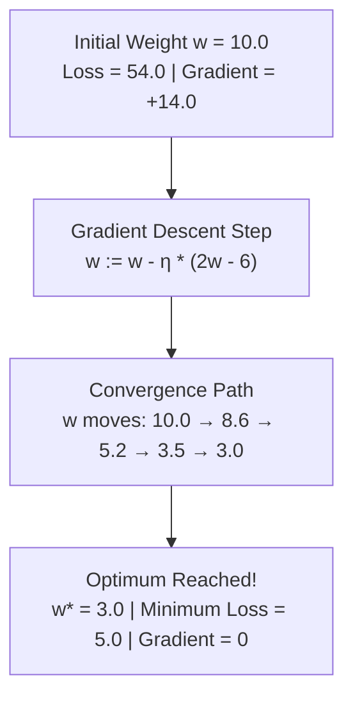

# Lecture 22.09: Calculus Optimization Practice Problem

## 📌 Topic Overview
In this concluding lecture for Day 22, Shraddha ma'am walks through a complete end-to-end blackboard **Practice Problem**, solving the analytical minimum of a quadratic loss function and connecting it directly to Gradient Descent.

---

## 📋 Blackboard Practice Problem Statement

**Problem**: Find the value of $w$ that minimizes the loss function:

$$
J(w) = w^2 - 6w + 14
$$

---

## 🧮 Step-by-Step Analytical Solution

### Step 1: Compute First Derivative

$$
\frac{dJ}{dw} = \frac{d}{dw}[w^2 - 6w + 14] = 2w - 6
$$

### Step 2: Set Derivative to Zero to Find Critical Point

$$
2w - 6 = 0 \implies 2w = 6 \implies w^* = 3
$$

### Step 3: Verify Minimum with Second Derivative Test

$$
\frac{d^2J}{dw^2} = \frac{d}{dw}[2w - 6] = 2
$$

Since $\frac{d^2J}{dw^2} = 2 > 0$, the function is strictly convex and $w^* = 3$ is guaranteed to be the **Global Minimum**.

### Step 4: Calculate Minimum Loss Value

$$
J(3) = (3)^2 - 6(3) + 14 = 9 - 18 + 14 = 5
$$

---

## 📊 Visual Diagram: Loss Optimization Convergence



---

## 💻 Python Implementation

```python
import numpy as np

def solve_optimization_practice_problem():
    """
    Solves Shraddha ma'am's classroom blackboard practice problem:
    Minimize the cost/loss function:
        J(w) = w^2 - 6w + 14
        
    1. Analytical Solution:
       dJ/dw = 2w - 6 = 0 => w* = 3.0
       J(w*) = (3)^2 - 6(3) + 14 = 9 - 18 + 14 = 5.0
       d2J/dw2 = 2 > 0 => Verified Global Minimum!
       
    2. Numerical Gradient Descent Simulation:
       Starts from w_0 = 10.0 and converges to w* = 3.0.
    """
    # Analytical
    w_star = 3.0
    j_min = w_star ** 2 - 6 * w_star + 14
    
    # Numerical Gradient Descent verification
    lr = 0.1
    w = 10.0  # Initial guess far from optimum
    iterations = 25
    trajectory = []
    
    for step in range(iterations):
        loss = w ** 2 - 6 * w + 14
        grad = 2 * w - 6
        trajectory.append({'step': step, 'w': w, 'loss': loss, 'grad': grad})
        w = w - lr * grad
        
    return {
        'analytical_w_opt': w_star,
        'analytical_j_min': j_min,
        'final_gd_w': w,
        'sample_steps': trajectory[::5]
    }

# --- Function Call & Testing ---
solution = solve_optimization_practice_problem()
print(f"Analytical Optimal Weight w* : {solution['analytical_w_opt']:.2f}")
print(f"Minimum Loss Value J(w*)     : {solution['analytical_j_min']:.2f}")
print(f"Final GD Converged Weight    : {solution['final_gd_w']:.4f}")
print()
print(f"{'Step':<6} | {'Current w':<12} | {'Loss J(w)':<12} | {'Gradient':<12}")
print("-" * 48)
for row in solution['sample_steps']:
    print(f"{row['step']:<6} | {row['w']:<12.4f} | {row['loss']:<12.4f} | {row['grad']:<12.4f}")
```

---

## 🔑 Key Takeaways
1. Setting the first derivative to zero analytically finds the exact global optimum for convex loss functions.
2. Gradient Descent takes iterative numerical steps proportional to the gradient, converging exactly to the analytical minimum $w^* = 3.0$.
3. This single-variable problem is the direct prototype for multi-variable Linear Regression optimization.
